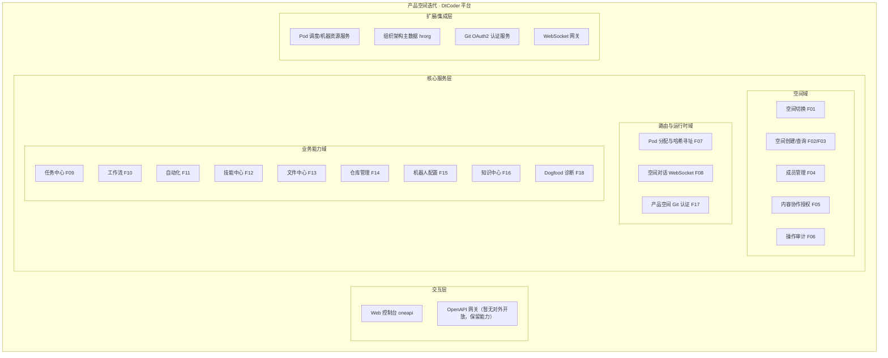
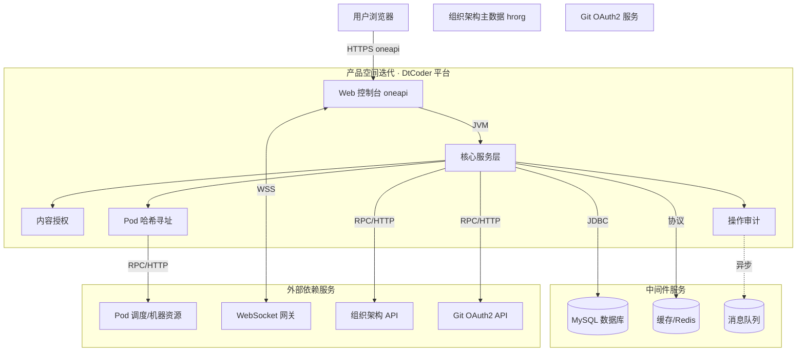
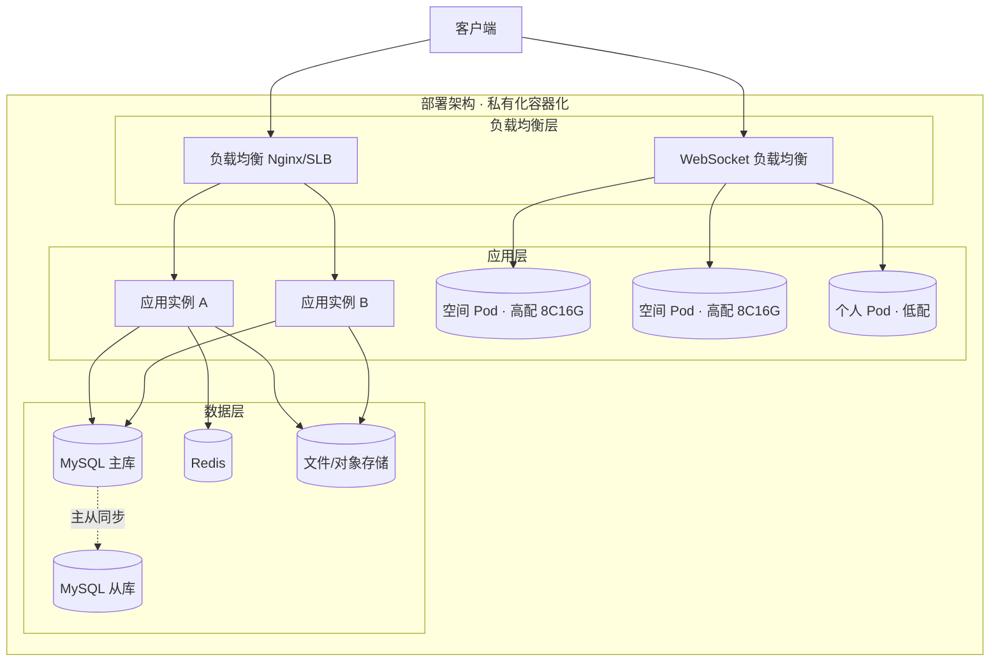
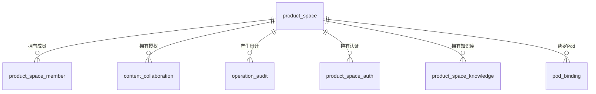
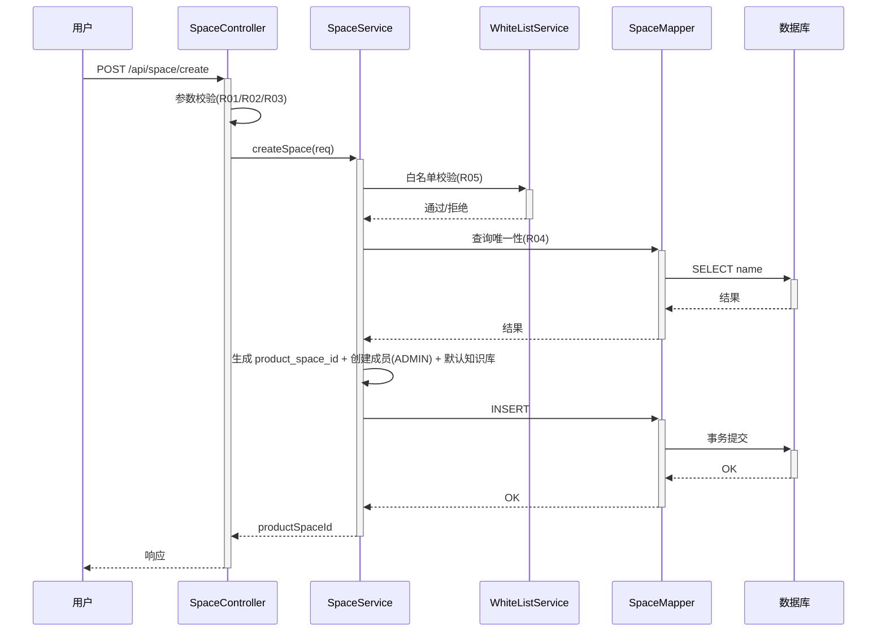
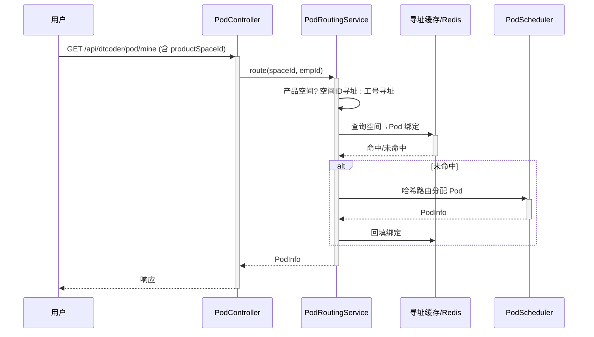
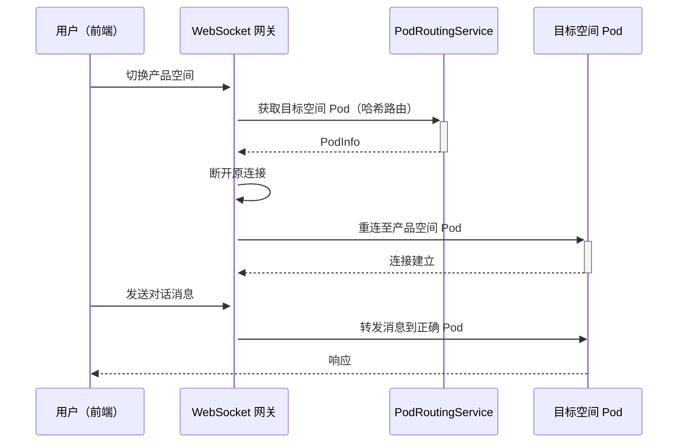

> **文档元信息**
>
> | 项目 | 内容 |
> |------|------|
> | 文档版本 | v1.0 |
> | 作者 | AiWork |
> | 创建日期 | 2026-10-21 |
> | 需求来源 | 《产品空间迭代测分-测试用例汇总1.md》（用户上传附件，201 条 TP） |
> | 评审状态 | 待评审 |

# 产品空间迭代（空间对话）系分设计

> 说明：本需求为 DtCoder/Dtazzi 智能体开发平台"产品空间（Product Space）"迭代，核心能力为**空间对话（Space 对话）**——在"个人空间"之外引入共享的"产品空间"，实现多成员协作、空间维度资源/路由/权限隔离，以及空间对话消息的正确 Pod 路由（其中空间→Pod 寻址采用**哈希路由函数**，见 §5.8）。需求全部功能点来自附件测试用例汇总（TP-001~TP-201）。

## 1. 需求与范围

### 背景与目标
- **背景**：现有平台以"个人空间"为单元（按工号寻址、数据个人私有），协作能力弱。本次迭代引入"产品空间"概念，让同一业务团队的多个成员在共享空间内协作，共享任务、Workflow、自动化规则、技能、文件、仓库、机器人、知识库等资源。
- **目标**：① 建立产品空间及成员管理；② 实现空间切换与按空间的资源隔离（含 WebSocket/Pod 路由切换）；③ 提供内容协作授权（任务/工作流/自动化规则）；④ 建立操作审计；⑤ 将存量各业务模块（任务中心、Workflow、自动化、技能、文件、仓库、机器人、知识中心等）改造为支持 `product_space_id` 维度。

### 核心功能
1. 左侧导航空间切换器（默认个人空间，可切至已加入产品空间，切换后数据与 WebSocket/Pod 同步切换）。
2. 产品空间与管理：创建/查询空间、成员管理（新增/移除/搜索/分页）。
3. 内容授权：任务/工作流/自动化规则的协作授权与撤销、权限校验。
4. 操作审计：AOP 自动记录 + 手动记录，页面查询与筛选。
5. Pod 分配改造：按产品空间寻址、高配机器白名单、mine/system-info/health-check 适配。
6. 空间对话：切换空间后 WebSocket 连接切换至对应 Pod，消息正确路由（哈希寻址）。
7. 存量模块改造：任务中心、Workflow、自动化、技能中心、文件中心、仓库、机器人、知识中心、Git 认证、Dogfood 的产品空间维度适配。

### 约束与非功能要求
- 单表命名遵循 DB 规范（小写下划线、`pk_`/`uk_`/`idx_` 前缀、InnoDB、单列整型主键、datetime 禁 timestamp、禁 float/double/enum、禁外键/存储过程/触发器）。
- 新增 `product_space_id` 字段一律**可选**，不传时走原个人空间逻辑，保证存量请求与数据兼容。
- 产品空间共用高配机器（8C16G），需关注并发资源竞争；审计异步写入不阻塞主流程。

### 排除范围
- 商业版（内外版）既有功能不做改动，仅保证新增功能不影响商业版回归（TP-185）。
- Dtazzi 市场列表接口保持不变（TP-133）。
- 通过 `trigger_id` 进行修改/查询/删除的自动化接口无需改造（TP-123/124）。
- 变更三板斧/灰度/监控/测试过程管理等过程管理项不属于被测功能范围。

### 需求功能清单与优先级

| 编号 | 功能点 | 优先级 | 原始描述/测试点 | 备注 |
|------|--------|--------|-----------------|------|
| F01 | 空间切换器 | P0 | TP-001~TP-006 | 默认个人空间、切换产品空间、数据与 WebSocket 切换 |
| F02 | 产品空间创建 | P0 | TP-007~TP-015 | 名称必填/长度/特殊字符/唯一性、创建人自动管理员 |
| F03 | 产品空间查询列表 | P0 | TP-016~TP-019 | 分页、已删除不展示 |
| F04 | 空间成员管理 | P0 | TP-020~TP-034 | 新增/移除/搜索/分页、移除后资源归属不变 |
| F05 | 内容协作授权 | P0 | TP-035~TP-048 | 三类授权、唯一性、删除、权限校验 |
| F06 | 操作审计 | P0 | TP-049~TP-062 | 页面展示、AOP 记录、手动记录 |
| F07 | Pod 分配改造 | P0 | TP-063~TP-077 | 空间寻址、高配白名单、mine/system-info/health |
| F08 | 空间对话（WebSocket） | P0 | TP-078~TP-082 | 连接切换、消息正确路由、无连接泄漏 |
| F09 | 任务中心改造 | P0 | TP-083~TP-099 | 空间过滤、创建人字段、协作、权限字段 |
| F10 | Workflow 改造 | P1 | TP-100~TP-109 | 空间共享、权限、导出 |
| F11 | 自动化改造 | P1 | TP-110~TP-124 | 规则/执行记录/创建/触发创建任务 |
| F12 | 技能中心改造 | P1 | TP-125~TP-133 | CLI 授权、Skill 安装/列表 |
| F13 | 文件中心改造 | P1 | TP-134~TP-142 | 上传/下载/删除/mine |
| F14 | 仓库管理改造 | P1 | TP-143~TP-146 | 添加/列表 |
| F15 | 机器人配置改造 | P1 | TP-147~TP-152 | 添加/列表/通知范围 |
| F16 | 知识中心改造 | P1 | TP-153~TP-159 | 默认知识库、Board 知识库、调用 |
| F17 | 产品空间 Git 认证 | P1 | TP-160~TP-166 | 前置检测、环境变量传递、OAuth2 |
| F18 | Dogfood 智能诊断 | P1 | TP-167~TP-169 | 按空间路由诊断 |
| F19 | 公共表兼容改造 | P1 | TP-170~TP-176 | 存量兼容、前端参数传递 |
| F20 | 非功能要求 | P1/P2 | TP-177~TP-201 | 性能/兼容/安全/越权 |

### 假设与待确认项

| 编号 | 假设/待确认内容 | 当前假设 | 确认状态 |
|------|-----------------|----------|----------|
| A01 | 需求标题"写个哈希函数" | 解读为：空间对话中"空间→Pod 寻址"的路由哈希函数设计（一致性哈希/取模映射），详见 §5.8；主题以附件《产品空间迭代-测试用例汇总1.md》为准 | 待确认 |
| A02 | 技术栈 | 存量系统为 Java Spring 单体服务（Controller–Service–Repository/Mapper），前后端分离；沿用该架构增量改造 | 待确认 |
| A03 | 对外接口形式 | 前端调用默认 oneapi REST（`/api` 前缀），无对外 OpenAPI 开放需求 | 待确认 |
| A04 | 错误码格式 | `{MODULE}_{SEQ}`，通用出参 `{code, msg, data}`（沿用存量约定） | 待确认 |
| A05 | 高配机器白名单 | 白名单控制创建产品空间（申请高配机器）的资格，配置中心维护 | 待确认 |
| A06 | 租户/空间隔离 | 采用 `product_space_id` 作为隔离维度；`NULL/空` 表示个人空间；`tenant_id` 不引入（单租户内空间维度） | 待确认 |
| A07 | 操作审计操作类型枚举 | 以 TP-056 所列 7 类为准（TASK_CANCEL/TASK_CHAT/TASK_CREATE/WORKFLOW_CREATE/WORKFLOW_PUBLISH/AUTOMATION_RULE_CREATE/AUTOMATION_RULE_UPDATE），可能不完整需后续补充 | 待确认 |
## 2. 架构与模块

### 功能架构



- **交互层**：Web 控制台（oneapi 前缀 `/api`）供前端调用；OpenAPI 暂不对外暴露，预留。
- **核心服务层**：空间域（空间、成员、授权、审计）、路由与运行时域（Pod 哈希寻址、空间对话 WebSocket、Git 认证）、业务能力域（各存量模块的 `product_space_id` 维度改造）。
- **扩展/集成层**：Pod 调度与机器资源服务、组织架构主数据（hrorg）、Git OAuth2、WebSocket 网关。

**模块清单**

| 模块 | 职责 | 依赖 |
|------|------|------|
| 空间域-空间管理 | 空间创建/查询/切换、名称唯一性校验 | 成员管理、Pod 路由 |
| 空间域-成员管理 | 空间成员增删查、角色（管理员/普通成员） | 组织架构主数据 hrorg |
| 空间域-内容授权 | 任务/工作流/自动化规则协作授权与撤销、权限校验 | 任务/工作流/自动化模块 |
| 空间域-操作审计 | AOP 自动记录 + 手动记录、查询筛选 | 各业务写入点 |
| 路由域-Pod 分配 | 空间→机器寻址（哈希路由）、高配白名单、mine/system-info/health | Pod 调度、机器资源 |
| 路由域-空间对话 | WebSocket 连接空间切换、消息正确路由、无泄漏 | Pod 分配、WSS |
| 路由域-Git 认证 | 空间级 Git OAuth2 认证、环境变量传递、移除清理 | GitOAuth |
| 业务能力域 | 任务/工作流/自动化/技能/文件/仓库/机器人/知识/诊断的 `product_space_id` 适配 | 空间域、Pod 路由、外部服务 |

### 应用集成架构



**集成关系说明：**

| 调用方 | 被调用方 | 协议 | 接口类型 | 说明 |
|--------|----------|------|----------|------|
| 用户浏览器 | Web 控制台 | HTTPS | oneapi REST | 空间切换、成员、授权、审计、各资源操作 |
| 用户浏览器 | WebSocket 网关 | WSS | WebSocket | 空间对话消息收发 |
| 核心服务层 | MySQL | JDBC | SQL | 空间/成员/授权/审计/业务数据存储 |
| 核心服务层 | Redis | Redis 协议 | 缓存 | 空间→Pod 寻址缓存、白名单 |
| 核心服务层 | 消息队列 | MQ | 消息 | 操作审计异步写入 |
| 核心服务层 | 组织架构主数据 | RPC/HTTP | hrorg | 成员选择、工号/邮箱校验 |
| 核心服务层 | Git OAuth2 | RPC/HTTP | OAuth2 | 产品空间 Git 认证 |
| 核心服务层 | Pod 调度/机器资源 | RPC/HTTP | 内部集成 | 空间→机器哈希寻址、资源查询、健康检查 |

### 部署架构



**部署说明：**
- **负载均衡层**：HTTP 用 Nginx/SLB；WebSocket 用独立网关按 `product_space_id` 哈希路由到对应容器的 Pod。
- **应用层**：无状态应用多副本（≥2）；Pod 按空间维度调度——个人空间低配、产品空间高配（8C16G），空间 Pod 暂不支持释放。
- **数据层**：MySQL 主从、Redis 缓存、对象存储；无单点。

## 3. 数据模型与存储

### 实体清单

| 实体名称 | 实体说明 | 所属模块 | 与其他实体的关系 |
|----------|----------|----------|-----------------|
| product_space（产品空间） | 产品空间主表 | 空间管理 | 一对多：成员、知识库、授权记录、审计记录 |
| product_space_member（空间成员） | 空间与成员关系 | 成员管理 | 多对一：产品空间；多对一：成员 |
| content_collaboration（内容协作授权） | 任务/工作流/自动化协作授权 | 内容授权 | 多对一：产品空间；多对一：被授权成员 |
| operation_audit（操作审计） | 操作审计流水 | 操作审计 | 多对一：产品空间（可空） |
| product_space_auth（空间 Git 认证） | 空间创建人 Git OAuth2 认证 | Git 认证 | 多对一：产品空间 |
| product_space_knowledge（空间知识库） | 空间默认知识库/Board 知识库 | 知识中心 | 多对一：产品空间 |
| pod_binding（Pod 绑定） | 空间/工号→容器 Pod 绑定 | Pod 分配 | 多对一：产品空间（可空，个人空间为空） |

> 说明：任务（task）、工作流（workflow）、自动化规则（trigger_config）、执行记录、技能、文件、仓库、机器人等**存量实体**新增 `product_space_id` 维度字段，属变更字段而非新增实体；本清单仅列新增实体。

### 实体关系图



**模型说明：**
- `product_space_member` 中 `role` 区分 `ADMIN`/`MEMBER`；创建者自动为 ADMIN。
- `content_collaboration` 针对同一（空间+类型+目标+被授权者）唯一，防止重复授权。
- `operation_audit` 仅当请求含非空 `product_space_id` 时记录（AOP 条件）。
- `product_space_auth` 存创建人 Git OAuth2 token（加密），移除授权时级联清理。
- 存量业务表以 `product_space_id`（可空）作为空间隔离维度，`NULL` 表示个人空间，查询时个人空间按工号、产品空间按空间 ID 筛选。

## 4. 接口设计

### 4.1 oneapi（Web 控制台接口）

| 编号 | 接口名称 | 方法 | 路径 | 模块 |
|------|----------|------|------|------|
| W01 | 创建产品空间 | POST | /api/space/create | 空间管理 |
| W02 | 查询产品空间列表 | GET | /api/space/list | 空间管理 |
| W03 | 查询空间成员列表 | GET | /api/space/{spaceId}/member/list | 成员管理 |
| W04 | 新增空间成员 | POST | /api/space/{spaceId}/member/add | 成员管理 |
| W05 | 移除空间成员 | POST | /api/space/{spaceId}/member/remove | 成员管理 |
| W06 | 新增内容协作授权 | POST | /api/space/collaboration/add | 内容授权 |
| W07 | 删除内容协作授权 | POST | /api/space/collaboration/remove | 内容授权 |
| W08 | 查询操作审计列表 | GET | /api/space/audit/list | 操作审计 |
| W09 | 手动新增审计记录 | POST | /api/space/audit/record | 操作审计 |
| W10 | Pod mine 查询 | GET | /api/dtcoder/pod/mine | Pod 分配 |
| W11 | Pod 系统资源查询 | GET | /api/dtcoder/pod/system-info | Pod 分配 |
| W12 | Pod 健康检查 | GET | /api/dtcoder/pod/health | Pod 分配 |
| W13 | 任务列表（空间适配） | GET | /api/task/list | 任务中心 |
| W14 | 创建任务（空间适配） | POST | /api/task/create | 任务中心 |
| W15 | 工作流匹配（空间适配） | POST | /api/task/workflow-match | 任务中心 |
| W16 | Workflow 列表（空间适配） | GET | /api/workflow/list | Workflow |
| W17 | Workflow 导出（空间适配） | POST | /api/workflow/template/{workflowId}/export | Workflow |
| W18 | 自动化规则列表（空间适配） | GET | /api/automation/rule/list | 自动化 |
| W19 | 执行记录列表（空间适配） | GET | /api/automation/execution/list | 自动化 |
| W20 | 创建 DIMA 自动化（空间适配） | POST | /api/automation/dima/create | 自动化 |
| W21 | 创建定时任务自动化（空间适配） | POST | /api/automation/cron/create | 自动化 |
| W22 | 安装 Skill（空间适配） | POST | /api/v1/dtconfig/skill-import/install | 技能中心 |
| W23 | 从路径安装 Skill（空间适配） | POST | /api/v1/dtconfig/skill-import/install-from-path | 技能中心 |
| W24 | 已安装列表（空间适配） | POST | /api/v1/dtconfig/skill-config/list-installed | 技能中心 |
| W25 | 文件上传（空间适配） | POST | /api/file/upload | 文件中心 |
| W26 | 文件下载（空间适配） | GET | /api/file/download | 文件中心 |
| W27 | 文件删除（空间适配） | POST | /api/file/delete | 文件中心 |
| W28 | 文件 mine（空间适配） | GET | /api/file/mine | 文件中心 |
| W29 | 添加仓库（空间适配） | POST | /api/repo/add | 仓库管理 |
| W30 | 仓库列表（空间适配） | GET | /api/repo/list | 仓库管理 |
| W31 | 添加机器人（空间适配） | POST | /api/capability-center/dingtalk/save | 机器人配置 |
| W32 | 机器人列表（空间适配） | GET | /api/capability-center/list | 机器人配置 |
| W33 | 添加知识库（空间适配） | POST | /api/knowledge/add | 知识中心 |
| W34 | 知识库列表（空间适配） | GET | /api/knowledge/list | 知识中心 |
| W35 | Git 授权认证检测（空间适配） | POST | /api/space/git-auth/check | Git 认证 |

### 4.2 OpenAPI（对外接口）

本迭代无对外 OpenAPI 开放需求，本项不适用，原因：产品空间为平台内部多成员协作能力，全部面向内部 Web 控制台与前端调用。

### 4.3 内部接口（Service 层）

| 编号 | 接口名称 | 类 | 方法签名 |
|------|----------|------|----------|
| S01 | 空间创建 | SpaceService | SpaceId createSpace(CreateSpaceReq req) |
| S02 | 空间查询 | SpaceService | List<SpaceVO> listSpace(ListSpaceReq req) |
| S03 | 成员新增 | SpaceMemberService | void addMember(SpaceId, List<String> empIds) |
| S04 | 成员移除 | SpaceMemberService | void removeMember(SpaceId, String empId) |
| S05 | 协作授权 | CollaborationService | void grant(GrantReq req) |
| S06 | 协作撤销 | CollaborationService | void revoke(RevokeReq req) |
| S07 | 权限校验 | CollaborationService | boolean hasPermission(String type, String targetId, String userId) |
| S08 | 审计写入 | AuditService | void record(AuditRecord record) |
| S09 | 空间寻址 | PodRoutingService | PodInfo route(SpaceId spaceId, EmployeeId empId) |
| S10 | 哈希路由 | PodRoutingService | PodInfo hashRoute(String key, List<PodInfo> pods) |
| S11 | Git 认证检测 | ProductSpaceAuthService | boolean checkGitAuth(SpaceId, String creatorId) |

### 4.4 集成接口（Integration 层）

| 编号 | 接口名称 | 类 | 方法签名 | 说明 |
|------|----------|------|----------|------|
| I01 | 查询员工/工号校验 | HrOrgClient | EmployeeInfo getEmployee(String empId) | 组织架构主数据 |
| I02 | 员工搜索 | HrOrgClient | List<EmployeeInfo> searchEmployee(String keyword) | 组织架构主数据 |
| I03 | Git OAuth2 token 获取 | GitOAuthClient | OAuthToken fetchToken(String userId) | Git 认证 |
| I04 | Pod 调度/资源查询 | PodSchedulerClient | PodInfo allocate(String key) | Pod 寻址 |
| I05 | 机器系统资源查询 | PodSchedulerClient | SystemInfo systemInfo(SpaceId) | 资源查询 |
| I06 | WSS 连接切换 | WssGatewayClient | void rebind(SpaceId, String sessionId) | 空间对话 |

## 5. 功能模块设计

### 全局约定

- 通用出参结构：`{code, msg, data}`，`code=0` 表示成功。
- 错误码格式：`{MODULE}_{SEQ}`。规约如下。

| 模块 | 错误码前缀 |
|------|-----------|
| 空间管理/成员 | SPACE_xxx |
| 内容授权 | COLLAB_xxx |
| 操作审计 | AUDIT_xxx |
| Pod 分配/空间对话 | POD_xxx |
| Git 认证 | GITAUTH_xxx |
| 业务能力域 | 沿用各存量模块既有前缀 + 新增空间维度校验码 |

---

### 5.1 空间管理

#### 5.1.1 表结构设计

##### 5.1.1.1 product_space（产品空间）

| 字段名 | 数据类型 | 约束 | 默认值 | 说明 |
|--------|----------|------|--------|------|
| id | bigint | PK, 自增 | - | 系统自增主键 |
| product_space_id | varchar(32) | NOT NULL | - | 业务空间 ID（全局唯一，雪花/序列生成） |
| name | varchar(64) | NOT NULL | - | 空间名称（唯一） |
| creator_id | varchar(32) | NOT NULL | - | 创建人工号 |
| status | tinyint | NOT NULL | 1 | 状态：1-正常，0-已删除（逻辑删除） |
| gmt_create | datetime | NOT NULL | CURRENT_TIMESTAMP | 创建时间 |
| gmt_modified | datetime | NOT NULL | CURRENT_TIMESTAMP | 修改时间 |

**索引：**
- UK: `uk_product_space_name` (name)
- UK: `uk_product_space_space_id` (product_space_id)
- IDX: `idx_product_space_creator` (creator_id)

##### 5.1.1.2 product_space_member（空间成员）

| 字段名 | 数据类型 | 约束 | 默认值 | 说明 |
|--------|----------|------|--------|------|
| id | bigint | PK, 自增 | - | 系统自增主键 |
| product_space_id | varchar(32) | NOT NULL | - | 所属空间 ID |
| emp_id | varchar(32) | NOT NULL | - | 成员工号 |
| role | varchar(16) | NOT NULL | MEMBER | 角色：ADMIN/MEMBER |
| emp_name | varchar(64) | NULL | - | 姓名（冗余，便于展示） |
| email | varchar(64) | NULL | - | 邮箱（冗余） |
| status | tinyint | NOT NULL | 1 | 状态：1-正常，0-已移除 |
| gmt_create | datetime | NOT NULL | CURRENT_TIMESTAMP | 创建时间 |
| gmt_modified | datetime | NOT NULL | CURRENT_TIMESTAMP | 修改时间 |

**索引：**
- UK: `uk_space_member_uniq` (product_space_id, emp_id)
- IDX: `idx_space_member_space` (product_space_id, status)
- IDX: `idx_space_member_emp` (emp_id)

##### 5.1.1.x 枚举与常量定义

| 枚举名称 | 取值 | 含义 | 关联字段 |
|----------|------|------|----------|
| SpaceStatus | 1 / 0 | 正常 / 已删除 | product_space.status |
| MemberRole | ADMIN / MEMBER | 管理员 / 普通成员 | product_space_member.role |
| MemberStatus | 1 / 0 | 正常 / 已移除 | product_space_member.status |

#### 5.1.2 接口详细设计

##### W01 创建产品空间

- **URI**: POST /api/space/create
- **描述**: 有创建权限（高配机器白名单内）的用户创建产品空间，创建者自动成为管理员，并自动创建默认知识库
- **入参**:

| 参数名称 | 类型 | 是否必填 | 描述 |
|----------|------|----------|------|
| name | String | 是 | 空间名称（长度、特殊字符、唯一性校验） |

- **出参**:

| 参数名称 | 类型 | 描述 |
|----------|------|------|
| code | String | 结果 code |
| msg | String | 提示信息 |
| data.productSpaceId | String | 新空间 ID |

- **错误码**:

| 错误码 | 说明 |
|--------|------|
| SPACE_001 | 空间名称已存在 |
| SPACE_002 | 空间名称为空 |
| SPACE_003 | 空间名称超长/含非法字符 |
| SPACE_004 | 无创建权限（非白名单） |

- **业务规则**: R01 名称必填；R02 名称长度 ≤ 32 字符；R03 名称仅允许中英文/数字/下划线/中划线；R04 名称唯一（忽略已删除）；R05 创建者自动为 ADMIN 并纳入成员；R06 创建后异步/同步创建默认知识库。

- **请求示例**:
```json
{ "name": "测试产品空间" }
```

- **响应示例**:
```json
{ "code": "0", "msg": "SUCCESS", "data": { "productSpaceId": "ps_xxx" } }
```

#### 5.1.3 子功能详细设计

##### 5.1.3.1 创建产品空间（F02）



**业务规则：**

| 规则编号 | 规则描述 | 校验时机 | 不满足时的处理 |
|----------|----------|----------|--------------|
| R01 | 名称为必填 | 创建时 | SPACE_002 |
| R02 | 名称长度 ≤ 32 | 创建时 | SPACE_003 |
| R03 | 名称仅允许合法字符 | 创建时 | SPACE_003 |
| R04 | 名称全局唯一（含跨空间） | 创建时 | SPACE_001 |
| R05 | 创建者需在白名单 | 创建时 | SPACE_004 |
| R06 | 创建者自动成为管理员 | 创建后 | 事务内写入成员表 |

**异常场景：**

| 异常场景 | 处理方式 |
|----------|----------|
| 名称重复 | 返回 SPACE_001，不落库 |
| 未加入白名单 | 返回 SPACE_004，不落库 |
| 默认知识库创建失败 | 整体事务回滚，提示创建失败 |

**并发控制：** 唯一索引 `uk_product_space_name` 兜底，防止并发创建同名空间；名称唯一校验+唯一索引双保险。

---

### 5.2 成员管理

#### 5.2.1 表结构设计（见 5.1.1.2 product_space_member）

#### 5.2.2 接口详细设计

##### W03 查询空间成员列表 / W04 新增成员 / W05 移除成员（合并说明）

- **W03 URI**: GET /api/space/{spaceId}/member/list
- **W04 URI**: POST /api/space/{spaceId}/member/add
- **W05 URI**: POST /api/space/{spaceId}/member/remove

- **W04 新增成员入参**:

| 参数名称 | 类型 | 是否必填 | 描述 |
|----------|------|----------|------|
| spaceId | String | 是 | 空间 ID（路径） |
| empIds | List<String> | 是 | 待添加成员工号列表 |

- **W04 出参 data**: 新增成员数、失败明细（已存在/工号不存在）

- **W05 移除成员入参**:

| 参数名称 | 类型 | 是否必填 | 描述 |
|----------|------|----------|------|
| spaceId | String | 是 | 空间 ID（路径） |
| empId | String | 是 | 待移除成员工号 |

- **错误码**:

| 错误码 | 说明 |
|--------|------|
| SPACE_010 | 无管理员权限（垂直越权） |
| SPACE_011 | 成员已存在 |
| SPACE_012 | 工号不存在 |
| SPACE_013 | 不能移除自己 |

#### 5.2.3 子功能详细设计（F04）

**业务规则：**

| 规则编号 | 规则描述 | 校验时机 | 不满足时的处理 |
|----------|----------|----------|--------------|
| R11 | 仅管理员可增/删成员 | 始终 | SPACE_010 |
| R12 | 从组织架构 hrorg 校验工号存在 | 新增时 | SPACE_012 |
| R13 | 同一空间成员唯一 | 新增时 | SPACE_011 |
| R14 | 不能移除自己（管理员退出需专项流程） | 移除时 | SPACE_013 |
| R15 | 移除成员不删除其创建的任务/工作流等资源，归属不变 | 移除时 | 仅置成员状态=0 |

**异常场景：**

| 异常场景 | 处理方式 |
|----------|----------|
| 工号不存在 | 返回 SPACE_012，本次不新增 |
| 批量新增部分失败 | 返回明细，已存在的跳过并提示 |
| 移除后成员访问空间资源 | 鉴权层拦截，成员关系已失效 |

**并发控制：** 唯一索引 `uk_space_member_uniq` 兜底；移除采用逻辑删除（status=0），资源归属不物理级联删除。

---

### 5.3 内容协作授权

#### 5.3.1 表结构设计

##### 5.3.1.1 content_collaboration（内容协作授权）

| 字段名 | 数据类型 | 约束 | 默认值 | 说明 |
|--------|----------|------|--------|------|
| id | bigint | PK, 自增 | - | 系统自增主键 |
| product_space_id | varchar(32) | NOT NULL | - | 所属空间 ID |
| target_type | varchar(32) | NOT NULL | - | 内容类型：TASK_COLLABORATION / WORKFLOW_COLLABORATION / AUTOMATION_RULE_COLLABORATION |
| target_id | varchar(64) | NOT NULL | - | 内容 ID（任务/工作流/自动化规则） |
| grantee_emp_id | varchar(32) | NOT NULL | - | 被授权成员工号 |
| grantor_emp_id | varchar(32) | NOT NULL | - | 授权者工号 |
| status | tinyint | NOT NULL | 1 | 状态：1-有效，0-已撤销 |
| gmt_create | datetime | NOT NULL | CURRENT_TIMESTAMP | 创建时间 |
| gmt_modified | datetime | NOT NULL | CURRENT_TIMESTAMP | 修改时间 |

**索引：**
- UK: `uk_collab_uniq` (product_space_id, target_type, target_id, grantee_emp_id)
- IDX: `idx_collab_target` (target_type, target_id, status)
- IDX: `idx_collab_grantee` (grantee_emp_id, status)

##### 5.3.1.x 枚举与常量定义

| 枚举名称 | 取值 | 含义 | 关联字段 |
|----------|------|------|----------|
| CollabType | TASK_COLLABORATION / WORKFLOW_COLLABORATION / AUTOMATION_RULE_COLLABORATION | 任务/工作流/自动化协作 | content_collaboration.target_type |
| CollabStatus | 1 / 0 | 有效 / 已撤销 | content_collaboration.status |

#### 5.3.2 接口详细设计

##### W06 新增内容协作授权 / W07 删除内容协作授权

- **W06 URI**: POST /api/space/collaboration/add
- **W07 URI**: POST /api/space/collaboration/remove

- **W06 入参**:

| 参数名称 | 类型 | 是否必填 | 描述 |
|----------|------|----------|------|
| productSpaceId | String | 是 | 空间 ID |
| targetType | String | 是 | 授权类型 |
| targetId | String | 是 | 内容 ID |
| granteeEmpId | String | 是 | 被授权成员 |

- **W07 入参**:

| 参数名称 | 类型 | 是否必填 | 描述 |
|----------|------|----------|------|
| productSpaceId | String | 是 | 空间 ID |
| targetType | String | 是 | 授权类型 |
| targetId | String | 是 | 内容 ID |
| granteeEmpId | String | 是 | 被授权成员 |

- **错误码**:

| 错误码 | 说明 |
|--------|------|
| COLLAB_001 | 非创建人/管理员（水平越权） |
| COLLAB_002 | 授权记录已存在 |
| COLLAB_003 | 目标内容不存在 |
| COLLAB_004 | 被授权者非空间成员 |

#### 5.3.3 子功能详细设计（F05）

**业务规则：**

| 规则编号 | 规则描述 | 校验时机 | 不满足时的处理 |
|----------|----------|----------|--------------|
| R21 | 仅管理员/创建人可授权与撤销 | 始终 | COLLAB_001 |
| R22 | （空间+类型+目标+被授权者）唯一 | 新增时 | COLLAB_002 |
| R23 | 被授权者需为空间成员 | 新增时 | COLLAB_004 |
| R24 | 撤销后成员仅可查看，不可编辑 | 撤销后 | 权限校验生效 |
| R25 | 授权者信息正确记录 | 新增时 | 写入 grantor_emp_id |

**权限语义（hasCollaborationPermission）：** 涉及协作的内容（任务/工作流/自动化）返回对象新增 `hasCollaborationPermission` 字段；有害权者具备审批节点介入、推进下一节点、取消、重试、一键反馈等操作能力，无权限者仅查看。

**异常场景：**

| 异常场景 | 处理方式 |
|----------|----------|
| 重复授权 | 返回 COLLAB_002 |
| 撤销不存在的授权 | 幂等返回成功（不报错） |
| 目标内容已删除 | 返回 COLLAB_003 |

**并发控制：** 唯一索引 `uk_collab_uniq` 兜底；撤销采用逻辑删除（status=0）。

---

### 5.4 操作审计

#### 5.4.1 表结构设计

##### 5.4.1.1 operation_audit（操作审计）

| 字段名 | 数据类型 | 约束 | 默认值 | 说明 |
|--------|----------|------|--------|------|
| id | bigint | PK, 自增 | - | 系统自增主键 |
| product_space_id | varchar(32) | NULL | - | 所属空间（个人空间为空，空则不记录） |
| operate_type | varchar(48) | NOT NULL | - | 操作类型 |
| operate_detail | varchar(2048) | NULL | - | 操作详情（截取前 2048 字符） |
| target_id | varchar(64) | NULL | - | 操作内容 ID（SpEL 解析） |
| operator_emp_id | varchar(32) | NOT NULL | - | 操作人工号 |
| operator_name | varchar(64) | NULL | - | 操作人姓名 |
| module | varchar(32) | NULL | - | 模块分类（任务/Workflow/自动化/技能/仓库/知识中心） |
| gmt_create | datetime | NOT NULL | CURRENT_TIMESTAMP | 操作时间 |
| gmt_modified | datetime | NOT NULL | CURRENT_TIMESTAMP | 修改时间 |

**索引：**
- IDX: `idx_audit_space_time` (product_space_id, gmt_create)
- IDX: `idx_audit_operator` (operator_emp_id)
- IDX: `idx_audit_type` (operate_type)

##### 5.4.1.x 枚举与常量定义

| 枚举名称 | 取值 | 含义 | 关联字段 |
|----------|------|------|----------|
| OperateType | TASK_CANCEL / TASK_CHAT / TASK_CREATE / WORKFLOW_CREATE / WORKFLOW_PUBLISH / AUTOMATION_RULE_CREATE / AUTOMATION_RULE_UPDATE | 操作类型 | operation_audit.operate_type |

#### 5.4.2 接口详细设计

##### W08 查询操作审计列表 / W09 手动新增审计

- **W08 URI**: GET /api/space/audit/list（支持操作类型/操作人/时间范围筛选 + 分页）
- **W09 URI**: POST /api/space/audit/record（手动记录，用于 WebSocket 对话等无法 AOP 场景）

- **错误码**: AUDIT_001 无空间查看权限（空间成员均可查看）

#### 5.4.3 子功能详细设计（F06）

**关键设计：**
- AOP 注解 `@OperationAudit`：在接口调用后异步记录审计；仅当请求参数含**非空** `productSpaceId` 时记录；通过 SpEL 表达式 `targetIdExpression` 提取操作内容 ID。
- 异步写入：线程池异步落库，失败仅记录错误日志不影响业务；详情字段截取前 2048 字符。
- 手动记录与 AOP 记录字段结构一致。

**业务规则：**

| 规则编号 | 规则描述 | 校验时机 | 不满足时的处理 |
|----------|----------|----------|--------------|
| R31 | 仅非空 productSpaceId 才记录 | 调用后 | 不记录 |
| R32 | 异步写入不阻塞主流程 | 始终 | 线程池执行 |
| R33 | 异步失败仅记日志 | 异步时 | 不抛错给业务 |
| R34 | 空间成员均有查看审计权限 | 查询时 | AUDIT_001 |

**异常场景：**

| 异常场景 | 处理方式 |
|----------|----------|
| 审计写入失败（DB 不可用） | 记录错误日志，业务正常返回 |
| 详情超 2048 字符 | 截取前 2048 字符 |

**并发控制：** 异步队列 + 独立线程池（有界队列 + 拒绝策略），避免线程池耗尽；审计为只追加流水，无更新并发问题。

---

### 5.5 Pod 分配改造

#### 5.5.1 表结构设计

##### 5.5.1.1 pod_binding（Pod 绑定）

| 字段名 | 数据类型 | 约束 | 默认值 | 说明 |
|--------|----------|------|--------|------|
| id | bigint | PK, 自增 | - | 系统自增主键 |
| product_space_id | varchar(32) | NULL | - | 所属空间（空=个人空间） |
| emp_id | varchar(32) | NULL | - | 工号（个人空间寻址键） |
| pod_id | varchar(64) | NOT NULL | - | Pod 标识 |
| machine_type | varchar(16) | NOT NULL | LOW | 机器类型：LOW/HIGH（高配 8C16G） |
| status | tinyint | NOT NULL | 1 | 状态：1-绑定，0-已释放 |
| gmt_create | datetime | NOT NULL | CURRENT_TIMESTAMP | 创建时间 |
| gmt_modified | datetime | NOT NULL | CURRENT_TIMESTAMP | 修改时间 |

**索引：**
- UK: `uk_pod_binding_key` (product_space_id, emp_id)
- IDX: `idx_pod_binding_space` (product_space_id, status)
- IDX: `idx_pod_binding_pod` (pod_id)

##### 5.5.1.x 枚举与常量定义

| 枚举名称 | 取值 | 含义 | 关联字段 |
|----------|------|------|----------|
| MachineType | LOW / HIGH | 低配 / 高配（8C16G） | pod_binding.machine_type |

#### 5.5.2 接口详细设计

##### W10 Pod mine / W11 系统资源 / W12 健康检查

- **W10 URI**: GET /api/dtcoder/pod/mine（产品空间下返回空间机器信息，个人空间返回个人机器信息）
- **W11 URI**: GET /api/dtcoder/pod/system-info（返回内存/磁盘/CPU/负载）
- **W12 URI**: GET /api/dtcoder/pod/health（产品空间使用当前登录人认证信息）

#### 5.5.3 子功能详细设计（F07）



**业务规则：**

| 规则编号 | 规则描述 | 校验时机 | 不满足时的处理 |
|----------|----------|----------|--------------|
| R41 | 个人空间按工号寻址，产品空间按空间 ID 寻址 | 寻址时 | 区分处理 |
| R42 | 产品空间申请高配机器，个人空间申请低配 | 分配时 | 按空间类型选择 machine_type |
| R43 | 高配机器申请需白名单 | 创建空间时 | POD_001 |
| R44 | 产品空间 Pod 暂不支持释放 | 释放时 | POD_002 |
| R45 | 健康检查使用当前登录人认证 | 健康检查时 | 认证失败返回 401 |

**异常场景：**

| 异常场景 | 处理方式 |
|----------|----------|
| 未加白名单创建团队空间 | 返回 POD_001 |
| 产品空间 Pod 被释放请求 | 返回 POD_002 |
| Pod 释放时行为 | 合理降级/提示 |

**并发控制：** 空间→Pod 绑定唯一索引 `uk_pod_binding_key` 兜底；寻址结果缓存 + 原子回填，避免并发重复分配。

---

### 5.6 空间对话（Space 对话 WebSocket）

#### 5.6.1 表结构设计（复用 pod_binding，无独立新表）

#### 5.6.2 子功能详细设计（F08）



**业务规则：**

| 规则编号 | 规则描述 | 校验时机 | 不满足时的处理 |
|----------|----------|----------|--------------|
| R51 | 切换空间后 WSS 连接切换至对应空间 Pod | 切换时 | 断开旧连接后重连 |
| R52 | 切换回个人空间恢复个人 Pod | 切换时 | 同上 |
| R53 | 多次切换无连接泄漏 | 始终 | 连接池/会话管理 |

**异常场景：**

| 异常场景 | 处理方式 |
|----------|----------|
| 多次切换连接泄漏 | 网关统一会话管理，旧连接显式关闭 |
| 目标 Pod 不可用 | 降级提示并保持可用连接 |

**并发控制：** 网关会话级隔离，切换为会话内串行操作，无共享写入竞争。

---

### 5.7 产品空间 Git 认证

#### 5.7.1 表结构设计

##### 5.7.1.1 product_space_auth（空间 Git 认证）

| 字段名 | 数据类型 | 约束 | 默认值 | 说明 |
|--------|----------|------|--------|------|
| id | bigint | PK, 自增 | - | 系统自增主键 |
| product_space_id | varchar(32) | NOT NULL | - | 所属空间 ID |
| creator_id | varchar(32) | NOT NULL | - | 创建人工号 |
| token_encrypted | varchar(512) | NOT NULL | - | OAuth2 token（加密存储） |
| auth_type | varchar(16) | NOT NULL | OAUTH2 | 认证方式 |
| status | tinyint | NOT NULL | 1 | 状态：1-有效，0-已移除 |
| gmt_create | datetime | NOT NULL | CURRENT_TIMESTAMP | 创建时间 |
| gmt_modified | datetime | NOT NULL | CURRENT_TIMESTAMP | 修改时间 |

**索引：**
- UK: `uk_psauth_space` (product_space_id)
- IDX: `idx_psauth_creator` (creator_id, status)

##### 5.7.1.x 枚举与常量定义

| 枚举名称 | 取值 | 含义 | 关联字段 |
|----------|------|------|----------|
| AuthType | OAUTH2 | OAuth2 token | product_space_auth.auth_type |

#### 5.7.2 子功能详细设计（F17）

**业务规则：**

| 规则编号 | 规则描述 | 校验时机 | 不满足时的处理 |
|----------|----------|----------|--------------|
| R61 | 创建任务时 Git 认证前置检测 | 创建任务时 | 未认证则阻断/引导 |
| R62 | 产品空间在 product_space_auth 查看创建人认证 | 检测时 | 区分空间/个人 |
| R63 | 认证信息通过环境变量传给子进程 | 任务执行时 | 不污染其他进程 |
| R64 | 移除授权时同步清理认证信息 | 移除时 | 级联置 status=0 |
| R65 | Git 操作使用 OAuth2 token | 始终 | 令牌失效则刷新 |
| R66 | token 加密存储 | 存储时 | 不允许明文 |

**异常场景：**

| 异常场景 | 处理方式 |
|----------|----------|
| 创建人未认证 | 返回 GITAUTH_001，引导认证 |
| token 过期 | OAuth2 刷新或重新授权 |
| 移除授权后残留认证 | 同步清理，保证一致性 |

---

### 5.8 空间→Pod 哈希寻址（“哈希函数”核心设计）

> 本模块对应需求标题"写个哈希函数-空间对话"的哈希函数设计：**空间/工号 → Pod 的路由哈希**。当产品空间（或工号）与后端 Pod 实例动态映射时，需要一个稳定、均衡、易扩展的哈希路由函数，保证空间对话消息与资源请求落到正确的 Pod，且 Pod 增删时尽量少迁移。

#### 5.8.1 方案对比

| 方案 | 原理 | 优点 | 缺点 | 适用性 |
|------|------|------|------|--------|
| 方案A：简单取模 hash(key) % N | 对 key 哈希后对 Pod 数 N 取模 | 实现简单、计算快 | Pod 数变化时几乎全部重映射（雪崩） | 仅 Pod 数量固定且极少的场景 |
| 方案B：一致性哈希（Ketama 环） | 将 Pod 映射到哈希环，key 沿环顺时针找首个 Pod | 增删 Pod 仅影响相邻节点，迁移量 ~K/N | 实现稍复杂，需虚拟节点均衡 | **推荐**：Pod 动态扩缩容 |
| 方案C：Rendezvous/最高随机权重哈希 | 对每个 Pod 计算 hash(key+pod)，取最大权重者 | 增删节点仅影响单个 key，均衡性好 | 每次计算 O(N)，N 大时开销高 | 备选：Pod 数量小且需最优均衡 |

**推荐方案：方案B（一致性哈希）+ 虚拟节点**，理由：
1. 产品空间/工号→Pod 的映射需在 Pod 动态扩缩容（高配机器申请、空间迁移）时保持稳定；
2. 一致性哈希将 Pod 增删的迁移量从 `O(全部)` 降为 `O(K/N)`，符合"切换空间/扩容时不整体抖动"的非功能要求；
3. 虚拟节点（如每 Pod 150 个）消除环上节点分布不均导致的负载倾斜。

#### 5.8.2 哈希函数选型

| 哈希函数 | 特点 | 选型结论 |
|----------|------|----------|
| MurmurHash3 (128/32) | 分布均匀、速度快、无碰撞顾虑（132-bit 均匀） | **推荐**：key 与 virtual node 的环坐标均用 MurmurHash3 计算 |
| FNV-1a | 简单快速，但分布略差、雪崩一般 | 备选 |
| Ketama MD5 变体 | libketama 传统做法，用 MD5(IP:port) 分段 | 兼容方案，若存量已是 ketama 则沿用 |

**推荐：MurmurHash3**，理由：均衡性、速度、稳定性均衡，规避 MD5 加密型哈希的计算开销与分布特性局限。

#### 5.8.3 哈希路由设计（伪代码级描述，不产出实现代码）

- 环坐标：`ringPos(pod_vnode) = murmur3_32(podId + ":" + vnodeIdx)`，每 Pod 挂 V=150 个虚拟节点。
- key 坐标：`keyPos = murmur3_32(spaceKey)`，其中 `spaceKey = product_space_id`（产品空间）或 `emp_id`（个人空间）。
- 路由：在有序环上取 `>= keyPos` 的最小节点；越界则回绕取环上首个节点。
- 候选过滤：命中 Pod 若不可用（健康检查失败），沿环向后取下一个健康 Pod。

**业务规则：**

| 规则编号 | 规则描述 | 校验时机 | 不满足时的处理 |
|----------|----------|----------|--------------|
| R71 | 哈希键：产品空间用空间 ID，个人空间用工号 | 寻址时 | 区分处理 |
| R72 | 虚拟节点数量统一（V=150） | 建环时 | 保证均衡 |
| R73 | Pod 扩缩容时仅相邻 key 迁移 | 变更时 | 一致性哈希保证 |
| R74 | 命中 Pod 不可用向后顺延 | 寻址时 | 健康检查驱动 |

**异常场景：**

| 异常场景 | 处理方式 |
|----------|----------|
| 命中 Pod 下线/不可用 | 沿环顺延取下一健康 Pod，并告警 |
| 环重建时短暂不一致 | 版本号 + 缓存刷新，最终一致 |
| 大量空间同时迁移 | 限制并发迁移速率，保护机器资源 |

**并发控制：** 环数据（Pod 列表/虚拟节点）由调度服务统一维护并以版本号发布；寻址读走本地缓存 + 版本比对，避免并发写入环结构。

---

### 5.9 业务能力域改造（存量模块 product_space_id 适配）

> 以下存量模块统一改造模式：① 相关接口新增可选 `product_space_id`；② 个人空间（空/未传）走原逻辑（按工号），产品空间按空间 ID 筛选；③ 返回对象补充权限/创建人字段；④ 涉及协作内容返回 `hasCollaborationPermission`。

| 模块 | 改造点 | 涉及接口/表 | TP |
|------|--------|-------------|-----|
| 任务中心 | 列表/创建/工作流匹配新增 product_space_id；新增创建人字段；返回操作权限字段；协作按钮与权限 | dtcoder_task、W13/W14/W15 | TP-083~099 |
| Workflow | 空间共享、成员类型与权限字段、导出新增参数 | W16/W17 | TP-100~109 |
| 自动化 | 规则/执行记录/创建接口新增参数；触发创建任务透传空间 | dtcoder_trigger_config、W18~W21 | TP-110~124 |
| 技能中心 | 安装/从路径安装/已安装列表新增参数；展示上传作者；CLI 授权"谁先授权用谁额度" | W22/W23/W24 | TP-125~133 |
| 文件中心 | 上传/下载/删除/mine 新增参数；WSS 切换空间机器 | W25~W28 | TP-134~142 |
| 仓库管理 | 添加/列表适配空间 | W29/W30 | TP-143~146 |
| 机器人配置 | 添加/列表适配空间；通知范围为可编辑协作者 | W31/W32 | TP-147~152 |
| 知识中心 | 创造空间自动默认知识库、Board 知识库、调用范围 | W33/W34、product_space_knowledge | TP-153~159 |
| Dogfood | 智能诊断按空间路由到对应机器 | - | TP-167~169 |

**公共表改造统一规则（TP-170~176）：** 存量个人空间数据 `product_space_id` 为空，兼容正常；个人空间查询按工号、产品空间查询按空间 ID；产品空间成员可见空间全量任务；前端在所有接口正确传递 `product_space_id`，个人空间下为空/未传不影响行为。

**业务规则（共性）：**

| 规则编号 | 规则描述 | 校验时机 | 不满足时的处理 |
|----------|----------|----------|--------------|
| R81 | product_space_id 为可选，未传走原逻辑 | 始终 | 兼容 |
| R82 | 产品空间按空间 ID 筛选，个人空间按工号 | 查询时 | 区分 |
| R83 | 产品空间资源空间内共享 | 查询时 | 范围=空间 |
| R84 | 返回对象补充权限/创建人字段 | 查询时 | 字段透出 |

#### 5.9.1 product_space_knowledge（空间知识库）

| 字段名 | 数据类型 | 约束 | 默认值 | 说明 |
|--------|----------|------|--------|------|
| id | bigint | PK, 自增 | - | 系统自增主键 |
| product_space_id | varchar(32) | NOT NULL | - | 所属空间 ID |
| knowledge_name | varchar(128) | NOT NULL | - | 知识库名称 |
| source_type | varchar(16) | NOT NULL | DEFAULT | 来源类型：DEFAULT/BOARD |
| board_url | varchar(512) | NULL | - | Board 链接 |
| board_id | varchar(64) | NULL | - | Board ID |
| is_default | tinyint | NOT NULL | 0 | 是否默认知识库：1-是，0-否 |
| creator_id | varchar(32) | NOT NULL | - | 创建人工号 |
| status | tinyint | NOT NULL | 1 | 状态：1-正常，0-已删除 |
| gmt_create | datetime | NOT NULL | CURRENT_TIMESTAMP | 创建时间 |
| gmt_modified | datetime | NOT NULL | CURRENT_TIMESTAMP | 修改时间 |

**索引：**
- UK: `uk_knowledge_space_name` (product_space_id, knowledge_name)
- IDX: `idx_knowledge_space` (product_space_id, status)
- IDX: `idx_knowledge_default` (product_space_id, is_default)

**枚举定义：**

| 枚举名称 | 取值 | 含义 | 关联字段 |
|----------|------|------|----------|
| KnowledgeSourceType | DEFAULT / BOARD | 默认知识库 / Board 知识库 | product_space_knowledge.source_type |

**业务规则：**

| 规则编号 | 规则描述 | 校验时机 | 不满足时的处理 |
|----------|----------|----------|--------------|
| R85 | 创建产品空间时自动创建默认知识库 | 创建空间后 | 名称与空间关联（如"空间名知识库"） |
| R86 | 知识库名称可自定义，留空用 Board 名称 | 添加 Board 知识库时 | 回填 Board 名称 |
| R87 | 任务创建时可调用产品空间所有知识库 | 任务创建时 | 按空间范围检索 |
| R88 | 个人空间知识库调用逻辑不变 | 始终 | 兼容 |

## 6. 非功能性需求设计

### 6.1 高可用性
- 应用无状态多副本部署（≥2），负载均衡分发；WebSocket 网关多实例。
- 组织架构主数据、Git OAuth2、Pod 调度等外部依赖故障时，空间切换/查询降级（本地缓存 + 兜底），不阻塞核心空间对话。
- 空间→Pod 寻址缓存（Redis）不可用时，本地一致性哈希环兜底，保证寻址可用。

### 6.2 可扩展性
- 水平扩展：无状态应用按请求量扩容；Pod 层按空间维度扩缩容，一致性哈希保证迁移最小化。
- 插件式资源依赖：对象存储/机器资源服务可替换（如 OSS ↔ MinIO），通过 Integration 适配层隔离。
- 存量模块仅增 `product_space_id` 维度，不改变原有表引擎与主键设计，低侵入。

### 6.3 稳定性/可靠性
- 产品空间高配机器多成员并发操作：依赖高配资源 + 连接池/线程池合理配置，资源竞争可控（TP-177）。
- 操作审计异步线程池：有界队列 + 拒绝策略，防线程池耗尽（TP-178）。
- SQL 查询增加空间过滤后需索引覆盖：新增 `product_space_id` 相关组合索引，保证查询效率（TP-179/180）。
- 成员数较多时分页查询：深分页需评估游标分页或索引覆盖。

### 6.4 安全性设计
#### 6.4.1 账户系统方案
- 沿用平台现有统一登录（内部 antbuservice/buc 体系），本迭代不新增独立账户系统。

#### 6.4.2 授权&访问控制
##### 6.4.2.1 是否实现水平权限检查
- 是。内容协作授权、任务操作、Workflow 编辑、审计查看均需水平权限校验：
  - 授权/撤销：仅创建人或管理员；
  - 任务取消/重试/推进：仅创建人或被授权协作者；
  - 审计查看：空间成员均可查看。
- 实现方式：注解式权限检查器 + 服务层 `hasCollaborationPermission` 校验。

##### 6.4.2.2 是否实现垂直权限检查
- 是。空间设置修改、成员管理仅管理员（ADMIN）可操作；普通成员（MEMBER）被拒绝。

##### 6.4.2.3 是否检查登录态
- 是。全局统一拦截器校验登录态；健康检查/mine 等使用当前登录人认证（产品空间）。

#### 6.4.3 数据防护方案
##### 6.4.3.1 是否对敏感数据加密存储
- 是。`product_space_auth.token_encrypted`（OAuth2 token）加密存储，非明文。

##### 6.4.3.2 是否对敏感数据展示进行脱敏
- Git 认证 token 不在前端回显；日志打印脱敏 token/邮箱；操作审计详情截取 2048 字符。

### 6.5 监控/统计/日志/告警
- 空间对话：监控 WebSocket 连接数、切换成功率、消息路由延迟、连接泄漏告警。
- Pod 寻址：监控哈希环节点数、迁移量、健康检查失败率。
- 审计：监控异步写入失败率、线程池队列深度。
- 关键接口：空间创建/成员变更/授权变更的调用量、耗时、错误率埋点。

## 7. 变更三板斧

### 7.1 可监控
- 调用服务/处理结果/耗时埋点：空间创建、成员增删、授权增删、审计写入、Pod 寻址、WSS 切换均埋点。
- 第三方（hrorg/GitOAuth/PodScheduler）调用独立埋点：成功/失败/耗时。
- 关键指标告警：连接泄漏、寻址失败率、审计线程池耗尽、白名单拒绝率。

### 7.2 可灰度
- 方案对比：
  - 方案A（按租户尾号灰度）：本迭代为单租户内空间维度，无租户尾号可切，不适用。
  - 方案B（按空间/白名单灰度，推荐）：先对白名单内少数空间开放产品空间能力，验证后逐步放开，风险可控。
- 推荐：方案B。新增 `product_space_id` 均为可选，未命中灰度（未加入空间/未白名单）走原逻辑，天然向后兼容。

### 7.3 可应急
- 关键功能保留开关：产品空间创建（白名单开关）、内容授权、审计异步写入均有配置开关，可快速关闭切回旧逻辑。
- 发布包回滚兜底：因新增字段均为可选、存量数据 `product_space_id` 为空，回滚至旧版本后旧逻辑（按工号）正常，关注表新增字段的保留兼容（不删除字段）。
- 应急优先级：优先开关关闭降级，避免回滚；确需回滚时，新表数据可弃用（无下游依赖），存量表仅保留新增可空字段，不影响旧版本读写。

---

## 附录：方案检查（Step 9 Checklist）

| 检查项 | 结果 | 说明 |
|--------|------|------|
| 模块划分合理性检查 | 通过 | 空间域/路由域/业务能力域/集成层单一职责，无循环依赖，无超 50% 功能点的巨型模块 |
| 依赖关系合理性 | 通过 | 下游（hrorg/GitOAuth/PodScheduler）异常时均设计本地缓存降级，应用自身可用 |
| 单点问题检查（部署层面） | 通过 | 应用/网关多副本、DB 主从、Redis 冗余，无单点 |
| 表模型设计范式检查 | 通过 | 达第三范式；成员表存 emp_name/email 冗余属性能权衡，见 R 冗余字段约束 |
| 隐私安全检查 | 通过 | Git token 加密存储；日志与前端回显脱敏；审计详情截取 |
| 兼容性检查（接口） | 通过 | 新增 product_space_id 均为可选，未传走原逻辑，兼容旧调用方 |
| 兼容性检查（表） | 通过 | 存量表仅增可空字段，个人空间数据 product_space_id 为空，新旧版本可运行 |
| 数据迁移检查 | 通过 | 存量个人空间数据无需迁移（默认为空）；新增表无需初始化数据（空间成员按创建时写入） |
| 一致性检查（功能点） | 通过 | F01~F20 均映射至 §5 各模块（空间/成员/授权/审计/Pod/对话/Git/哈希/业务域/知识库） |
| 一致性检查（表） | 通过 | Step 3 全部 7 实体（product_space/member/collaboration/audit/auth/knowledge/pod_binding）在 §5 有完整表结构 |
| 一致性检查（接口） | 通过 | Step 4 接口 W01~W35 在 §5 有定义（部分汇总说明，核心接口含入/出参/错误码） |
| 一致性检查（枚举） | 通过 | SpaceStatus/MemberRole/CollabType/CollabStatus/OperateType/MachineType/AuthType/KnowledgeSourceType 与表字段一致 |
| 状态机完整性检查 | 通过 | status 字段（正常/删除/移除/撤销）为二维状态无复杂流转，以枚举表+业务规则说明，无孤岛状态 |
| 并发风险检查 | 通过 | 唯一索引兜底 + 逻辑删除 + 一致性哈希无共享写 + 事务回滚（多方案对比见各节并发控制） |
| 单点问题检查（定时任务层面） | 通过 | 定时任务自动化沿用存量调度，未新增独立定时器；若新增需分布式锁/分片 |
| 非功能性设计可行性检查 | 通过 | 高可用/扩展/安全/监控均有落地手段，无纯理想化设计 |
| 变更三板斧（可监控） | 通过 | 关键服务与三方调用均埋点，连接泄漏/寻址失败/线程池告警 |
| 变更三板斧（可灰度） | 通过 | 按空间/白名单灰度（方案对比见 §7.2），未命中走原逻辑 |
| 变更三板斧（可应急） | 通过 | 开关关闭降级优先，回滚依赖分析完毕（新增可空字段+新表可弃用） |
