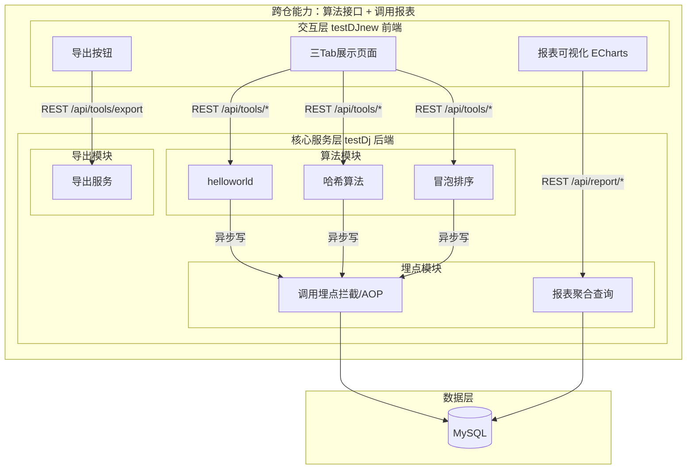
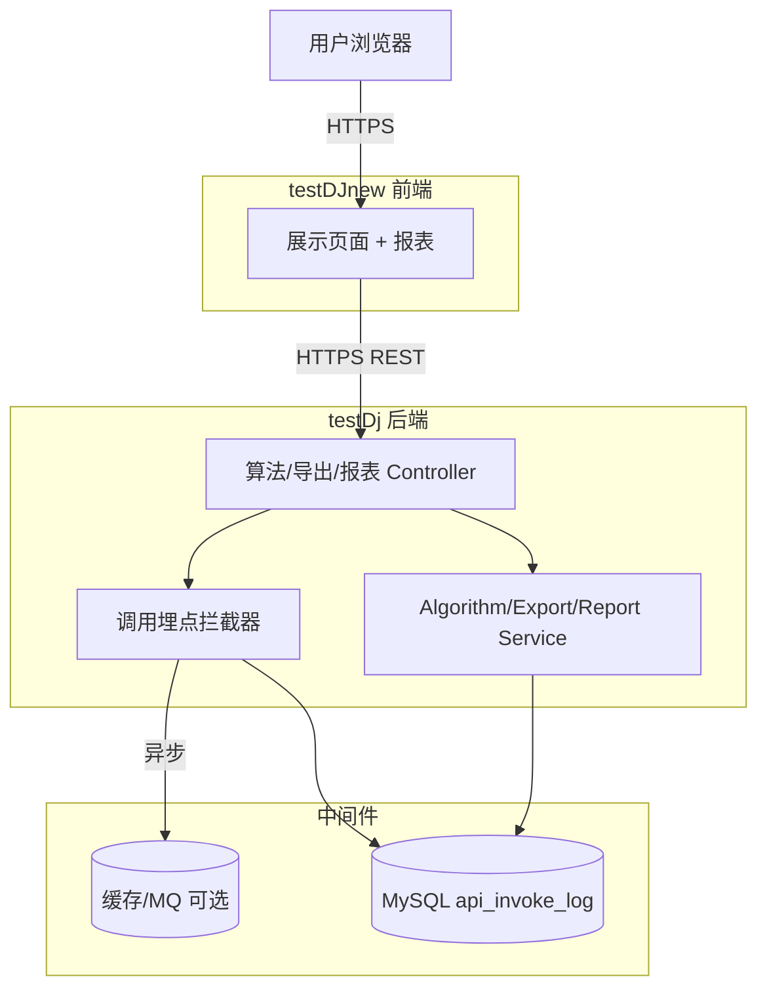
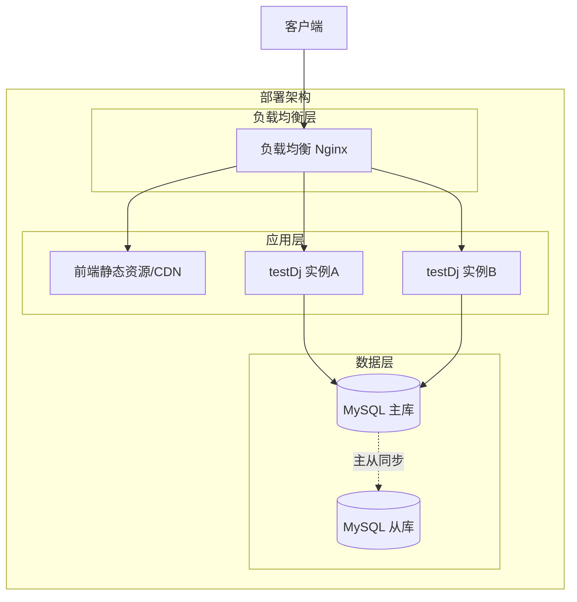
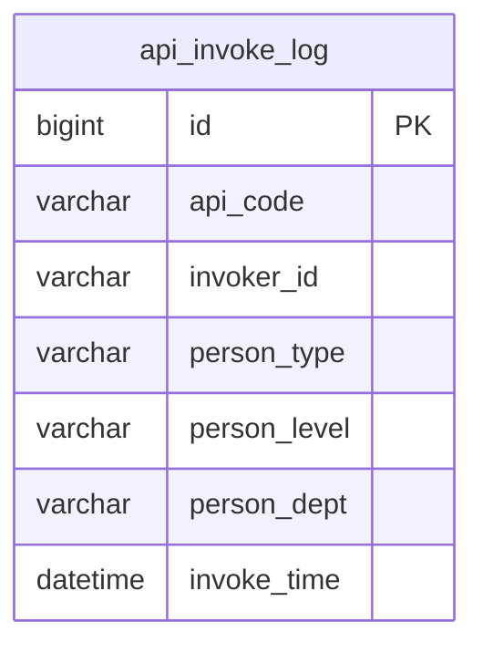
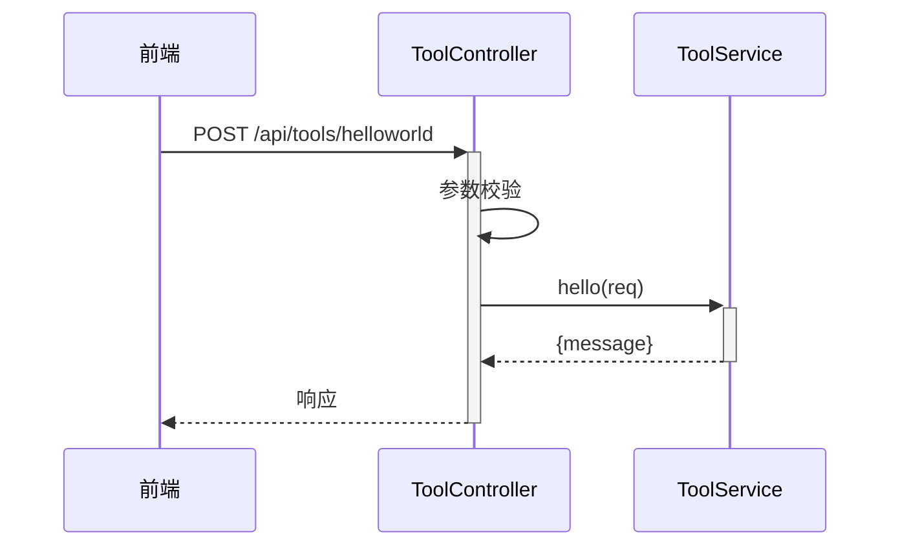
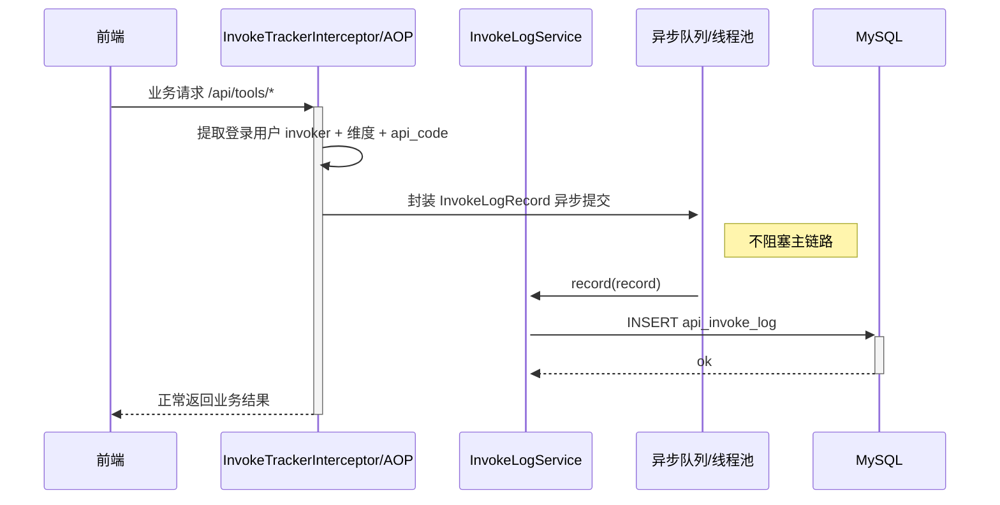
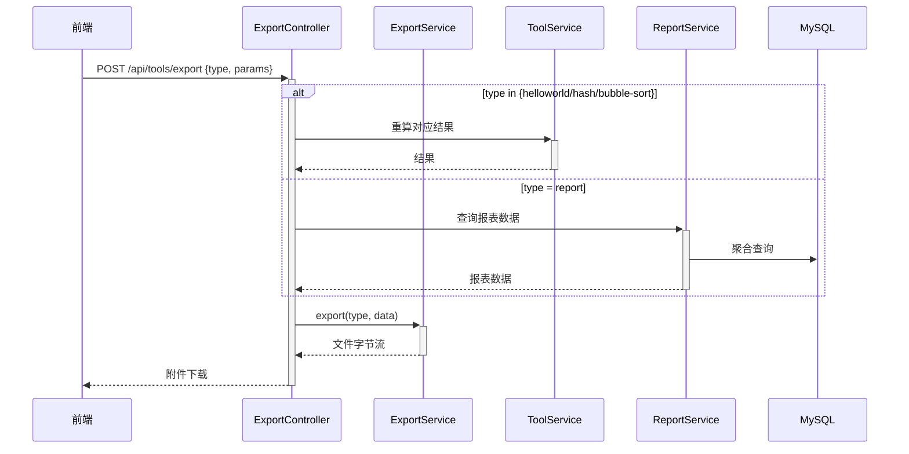
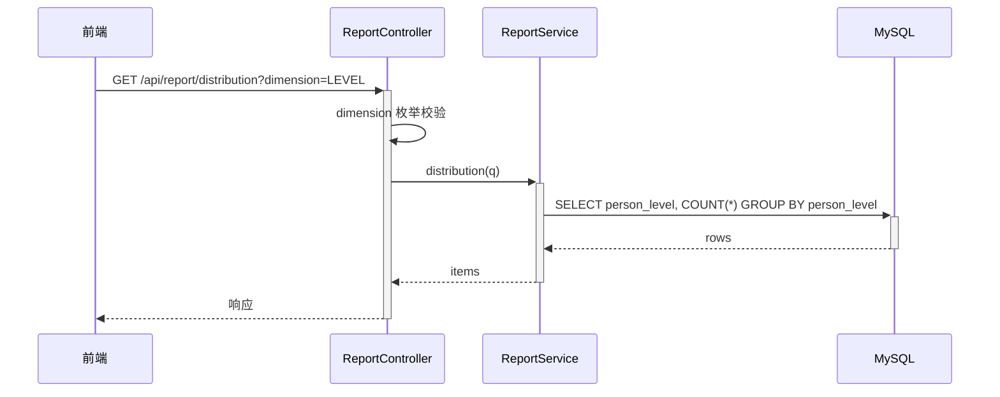
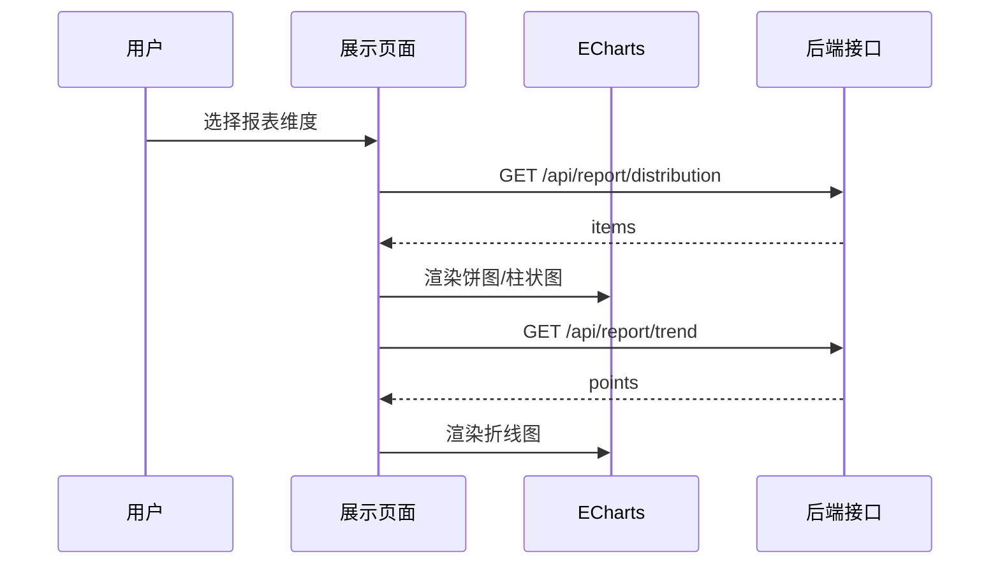

> **文档元信息**
>
> | 项目 | 内容 |
> |------|------|
> | 文档版本 | v1.0 |
> | 作者 | AiWork |
> | 创建日期 | 2026-10-22 |
> | 需求来源 | 任务需求（分别写三个接口 helloworld、哈希算法、冒泡排序；前端新增页面三 Tab；导出按钮+导出接口；后端埋点；前端报表可视化） |
> | 评审状态 | 待评审 |

# 跨仓接口编排与调用可视化报表 系分设计

## 1. 需求与范围

### 背景与目标

- 背景：本次任务跨越两个仓库（[testDj]、[testDJnew]），需要一次性交付「后端算法接口能力 + 前端展示页面 + 导出能力 + 调用埋点 + 可视化报表」的完整闭环。
- 目标：
  1. 后端提供 3 个基础算法/演示接口：helloworld、哈希算法、冒泡排序。
  2. 前端新增一个页面，以 3 个 Tab 分别展示三个接口的执行结果。
  3. 页面提供导出按钮，后端提供导出接口，支持导出各 Tab 对应的展示结果。
  4. 后端对接口调用进行埋点，记录「调用次数 + 调用人」，并可关联人员类型、人员层级、人员部门等维度。
  5. 前端在当前页面可视化「调用情况报表」，支持按维度（人员类型/人员层级/人员部门）查看，并以折线图、饼图、柱状图三种形式展示。

### 核心功能

- 算法接口：helloworld、哈希、冒泡排序。
- 展示页面：三 Tab 结果展示 + 导出按钮。
- 导出接口：按类型导出各 Tab 展示结果（CSV/Excel）。
- 调用埋点：统一拦截/AOP 记录调用次数与调用人及人员维度。
- 报表接口：调用趋势（折线图）、维度分布（饼图/柱状图）。
- 报表可视化：前端 ECharts 折线图、饼图、柱状图。

### 约束与非功能要求

- 遵循因数科 Java 编码规范与数据库设计规范（见 references/db.md）。
- 埋点不阻塞主接口：采用异步写埋点或 MQ 解耦。
- 报表查询基于维度冗余字段 + 索引，保证查询性能。
- 导出支持大结果集时流式写出，避免内存溢出。

### 排除范围

- 不改造现有账号/组织系统，人员维度字段取自登录态上下文或现有用户服务（见 A03）。
- 不涉及用户登录、鉴权体系的从零搭建（沿用既有统一登录/权限，见 A06）。
- 不做接口的对外 OpenAPI 网关发布（本期为 Web 控制台内部接口）。

### 需求功能清单与优先级

| 编号 | 功能点 | 优先级 | PRD 原始描述 | 备注 |
|------|--------|--------|--------------|------|
| F01 | helloworld 接口 | P0 | 分别写三个接口 helloworld | 返回问候语 |
| F02 | 哈希算法接口 | P0 | 三个接口之一：哈希算法 | 支持 MD5/SHA256 |
| F03 | 冒泡排序接口 | P0 | 三个接口之一：冒泡排序 | 支持升/降序 |
| F04 | 前端新增展示页面（三 Tab） | P0 | 前端新增一个页面，有三个 tab 分别展示不同的执行结果 | 三 Tab 对应三个接口 |
| F05 | 导出按钮 + 导出接口 | P0 | 新增导出按钮，后台提供导出接口，支持导出各个页面的展示结果 | 逐 Tab 导出 |
| F06 | 调用埋点（次数+调用人） | P0 | 后端再做个埋点，获取调用次数和调用人 | 拦截/AOP 统一埋点 |
| F07 | 报表查询接口 | P0 | 前端可视化报表查看调用情况 | 维度/指标聚合 |
| F08 | 前端报表可视化（折线/饼/柱状） | P0 | 折线图以及饼图和柱状图不同展示形式 | ECharts |

### 假设与待确认项

| 编号 | 假设/待确认内容 | 当前假设 | 确认状态 |
|------|-----------------|----------|----------|
| A01 | 仓库职责映射 | [testDj]=后端（Java/Spring Boot），[testDJnew]=前端（Vue3 + TypeScript） | 已确认 |
| A02 | 后端技术栈 | Spring Boot + MyBatis-Plus + MySQL | 已确认 |
| A03 | 前端技术栈 | Vue3 + Vite + Element Plus + ECharts | 待确认 |
| A04 | 人员维度数据来源 | 登录态上下文中携带 invoker 及 person_type/person_level/person_dept，埋点时冗余落库 | 已确认 |
| A05 | 导出格式 | 默认 Excel(.xlsx)，首版用 EasyExcel/SheetJS；可选 CSV | 已确认 |
| A06 | 登录态/鉴权 | 沿用现有统一登录态校验，本期不新增账号体系 | 待确认 |
| A07 | 埋点持久化方式 | 拦截器同步采集 + 异步批量落库（ThreadPool/MQ 择一） | 待确认 |
| A08 | 报表时间范围 | 默认最近 7 天，支持起止时间筛选 | 待确认 |

## 2. 架构与模块

### 功能架构

- 交互层说明：前端负责 Tab 结果展示、导出触发与报表图表渲染，不落库。
- 核心服务层说明：算法模块承载三个基础接口；导出模块按类型导出展示结果；埋点模块统一采集调用记录并支持聚合查询。
- 数据层说明：MySQL 存储埋点流水表，报表按维度冗余字段聚合。

**模块清单**

| 模块 | 职责 | 依赖 |
|------|------|------|
| 算法模块 | helloworld / 哈希 / 冒泡排序 | 无 |
| 导出模块 | 按 Tab 类型导出展示结果 | 算法模块 |
| 埋点模块 | 拦截采集调用记录、异步落库 | 用户上下文、MySQL |
| 报表模块 | 维度/时间聚合查询 | MySQL（埋点表） |
| 前端展示模块 | Tab 展示、导出、报表图表 | 后端 REST |

### 应用集成架构

**集成关系说明：**

| 调用方 | 被调用方 | 协议 | 接口类型 | 说明 |
|--------|----------|------|----------|------|
| 用户浏览器 | [testDJnew] 展示页面 | HTTPS | 静态资源/Web | 页面加载与渲染 |
| [testDJnew] 页面 | [testDj] Controller | HTTPS | oneapi REST | 算法/导出/报表 |
| [testDj] 埋点模块 | MySQL | JDBC | SQL | 埋点流水落库 |
| [testDj] 报表模块 | MySQL | JDBC | SQL | 维度/时间聚合查询 |

### 部署架构

**部署说明：**
- 负载均衡层：Nginx 反向代理，前端静态资源走 CDN。
- 应用层：[testDj] 后端无状态多实例部署，[testDJnew] 前端构建产物静态部署。
- 数据层：埋点流水表写入主库，报表查询可走从库降低主库压力。

## 3. 数据模型与存储

### 实体清单

| 实体名称 | 实体说明 | 所属模块 | 与其他实体的关系 |
|----------|----------|----------|-----------------|
| api_invoke_log | 接口调用埋点流水表 | 埋点模块 | 无外键，独立流水 |

### 实体关系图

**模型说明：**
- 报表按 `person_type / person_level / person_dept` 三个维度冗余字段聚合，避免跨系统联表，符合「允许适当冗余以提高查询性能」的规范。
- 维度字段为非频繁修改、非超长、非唯一、非 text，满足冗余字段规范。

### 表结构设计

#### api_invoke_log（接口调用埋点流水表）

| 字段名 | 数据类型 | 约束 | 默认值 | 说明 |
|--------|----------|------|--------|------|
| id | bigint | PK, 自增 | - | 系统自增主键 |
| api_code | varchar(32) | NOT NULL | - | 接口编码（如 HELLO/HASH/BUBBLE_SORT） |
| api_name | varchar(64) | NOT NULL | - | 接口名称 |
| invoker_id | varchar(64) | NOT NULL | - | 调用人 ID |
| invoker_name | varchar(64) | NULL | - | 调用人姓名 |
| person_type | varchar(32) | NOT NULL | - | 人员类型（冗余） |
| person_level | varchar(32) | NOT NULL | - | 人员层级（冗余） |
| person_dept | varchar(64) | NOT NULL | - | 人员部门（冗余） |
| invoke_time | datetime | NOT NULL | CURRENT_TIMESTAMP | 调用时间 |
| duration_ms | int | NULL | - | 调用耗时(ms) |
| result_code | varchar(16) | NULL | - | 结果码 |
| ip | varchar(64) | NULL | - | 调用来源 IP |
| gmt_create | datetime | NOT NULL | CURRENT_TIMESTAMP | 创建时间 |
| gmt_modified | datetime | NOT NULL | CURRENT_TIMESTAMP | 修改时间 |

**索引：**
- IDX: `idx_api_invoke_log_api_time` (api_code, invoke_time)
- IDX: `idx_api_invoke_log_person_type` (person_type, invoke_time)
- IDX: `idx_api_invoke_log_person_level` (person_level, invoke_time)
- IDX: `idx_api_invoke_log_person_dept` (person_dept, invoke_time)
- IDX: `idx_api_invoke_log_invoker` (invoker_id, invoke_time)

#### 枚举与常量定义

| 枚举名称 | 取值 | 含义 | 关联字段 |
|----------|------|------|----------|
| ApiCode | HELLO / HASH / BUBBLE_SORT | 接口编码 | api_invoke_log.api_code |
| PersonType | EMPLOYEE / OUTSOURCE / OTHER | 人员类型（正式/外包/其他） | api_invoke_log.person_type |
| ChartType | LINE / PIE / BAR | 图表类型 | 前端渲染 |
| ReportDimension | TYPE / LEVEL / DEPT | 报表维度 | report 查询入参 |

## 4. 接口设计

### 4.1 oneapi（Web 控制台接口）

| 编号 | 接口名称 | 方法 | 路径 | 模块 |
|------|----------|------|------|------|
| W01 | helloworld | POST | /api/tools/helloworld | 算法模块 |
| W02 | 哈希算法 | POST | /api/tools/hash | 算法模块 |
| W03 | 冒泡排序 | POST | /api/tools/bubble-sort | 算法模块 |
| W04 | 导出展示结果 | GET/POST | /api/tools/export | 导出模块 |
| W05 | 调用趋势查询 | GET | /api/report/trend | 报表模块 |
| W06 | 调用维度分布查询 | GET | /api/report/distribution | 报表模块 |

### 4.3 内部接口（Service 层）

| 编号 | 接口名称 | 类 | 方法签名 |
|------|----------|------|----------|
| S01 | helloworld | ToolService | `String hello(HelloRequest req)` |
| S02 | 哈希 | ToolService | `HashResult hash(String text, String algorithm)` |
| S03 | 冒泡排序 | ToolService | `SortResult bubbleSort(int[] nums, String order)` |
| S04 | 导出 | ExportService | `byte[] export(ExportRequest req)` |
| S05 | 记录埋点 | InvokeLogService | `void record(InvokeLogRecord record)` |
| S06 | 趋势聚合 | ReportService | `List<TrendPoint> trend(ReportQuery q)` |
| S07 | 维度分布 | ReportService | `List<DistributionItem> distribution(ReportQuery q)` |

### 接口详细设计

#### W01 helloworld
- **URI**: POST /api/tools/helloworld
- **描述**: 返回问候语
- **入参**:

| 参数名称 | 类型 | 是否必填 | 描述 |
|----------|------|----------|------|
| name | String | 否 | 问候对象名，默认 "World" |

- **出参**:

| 参数名称 | 类型 | 描述 |
|----------|------|------|
| result | String | 结果 code |
| msg | String | 提示信息 |
| data | Object | `{ message: "Hello, xxx" }` |

- **业务规则**: name 非空时拼入问候语。

#### W02 哈希算法
- **URI**: POST /api/tools/hash
- **描述**: 对文本做哈希摘要
- **入参**:

| 参数名称 | 类型 | 是否必填 | 描述 |
|----------|------|----------|------|
| text | String | 是 | 待哈希文本 |
| algorithm | String | 是 | 算法，取值 MD5 / SHA256 |

- **出参**:

| 参数名称 | 类型 | 描述 |
|----------|------|------|
| data.algorithm | String | 使用的算法 |
| data.hash | String | 十六进制摘要 |

- **业务规则**: algorithm 不在 {MD5, SHA256} 时返回参数错误码。

#### W03 冒泡排序
- **URI**: POST /api/tools/bubble-sort
- **描述**: 对整型数组执行冒泡排序
- **入参**:

| 参数名称 | 类型 | 是否必填 | 描述 |
|----------|------|----------|------|
| nums | int[] | 是 | 待排序数组 |
| order | String | 否 | ASC / DESC，默认 ASC |

- **出参**:

| 参数名称 | 类型 | 描述 |
|----------|------|------|
| data.original | int[] | 原始数组 |
| data.sorted | int[] | 排序后数组 |
| data.swapCount | long | 交换次数 |
| data.order | String | 排序方向 |

- **业务规则**: order 取值校验；数组为空时返回空数组。

#### W04 导出展示结果
- **URI**: POST /api/tools/export
- **描述**: 按类型导出对应 Tab 的展示结果，返回文件流
- **入参**:

| 参数名称 | 类型 | 是否必填 | 描述 |
|----------|------|----------|------|
| type | String | 是 | helloworld / hash / bubble-sort / report |
| format | String | 否 | xlsx / csv，默认 xlsx |
| params | Object | 否 | 各类型对应参数（三接口入参或报表筛选条件） |

- **出参**: `Content-Disposition` 附件，二进制文件（xlsx/csv）
- **业务规则**: 按 type 重算或重查对应结果后流式写出；report 导出当前报表数据。

#### W05 调用趋势查询（折线图）
- **URI**: GET /api/report/trend
- **入参**:

| 参数名称 | 类型 | 是否必填 | 描述 |
|----------|------|----------|------|
| startTime | String | 否 | 开始时间 yyyy-MM-dd |
| endTime | String | 否 | 结束时间 yyyy-MM-dd |
| apiCode | String | 否 | 接口编码过滤 |

- **出参**:

| 参数名称 | 类型 | 描述 |
|----------|------|------|
| data.points | List | `[{ "time": "2026-10-22", "count": 12 }]` |

#### W06 调用维度分布查询（饼图/柱状图）
- **URI**: GET /api/report/distribution
- **入参**:

| 参数名称 | 类型 | 是否必填 | 描述 |
|----------|------|----------|------|
| dimension | String | 是 | TYPE / LEVEL / DEPT |
| startTime | String | 否 | 开始时间 |
| endTime | String | 否 | 结束时间 |
| apiCode | String | 否 | 接口编码过滤 |

- **出参**:

| 参数名称 | 类型 | 描述 |
|----------|------|------|
| data.items | List | `[{ "key": "P6", "count": 30 }]` |

## 5. 功能模块设计

### 5.1 算法模块（[testDj]）

#### 5.1.1 表结构设计
见第 3 章 `api_invoke_log`，本模块无独立表。

#### 5.1.2 接口详细设计
见 W01/W02/W03。

#### 5.1.3 子功能详细设计

##### 5.1.3.1 helloworld（F01）

**业务规则：**
| 规则编号 | 规则描述 | 校验时机 | 不满足时的处理 |
|----------|----------|----------|--------------|
| R01 | name 为可空字符串 | 始终 | name 为空时默认 "World" |

##### 5.1.3.2 哈希算法（F02）
**业务规则：**
| 规则编号 | 规则描述 | 校验时机 | 不满足时的处理 |
|----------|----------|----------|--------------|
| R02 | algorithm ∈ {MD5, SHA256} | 创建时 | 返回错误码 PARAM_001 |
| R03 | text 非空 | 创建时 | 返回错误码 PARAM_002 |

##### 5.1.3.3 冒泡排序（F03）
**业务规则：**
| 规则编号 | 规则描述 | 校验时机 | 不满足时的处理 |
|----------|----------|----------|--------------|
| R04 | order ∈ {ASC, DESC} | 创建时 | 返回错误码 PARAM_003 |
| R05 | nums 长度上限（如 1000） | 创建时 | 超出返回错误码 PARAM_004 |

**异常场景：**
| 异常场景 | 处理方式 |
|----------|----------|
| nums 为空/超长 | 空数组返回空结果；超长拒绝并提示 |
| 非法 algorithm/order | 统一返回参数错误码 |

**并发控制：** 算法接口无共享写状态，无并发风险。

### 5.2 埋点模块（[testDj]）

#### 5.2.1 表结构设计
见第 3 章 `api_invoke_log`。

#### 5.2.2 子功能详细设计

##### 5.2.2.1 调用埋点采集（F06）

**业务规则：**
| 规则编号 | 规则描述 | 校验时机 | 不满足时的处理 |
|----------|----------|----------|--------------|
| R06 | 仅对 /api/tools/* 与 /api/report/* 触发埋点 | 拦截时 | 白名单外接口跳过 |
| R07 | 埋点失败不影响主接口 | 异步落库 | 记录 WARN 日志，主链路继续 |

**异常场景：**
| 异常场景 | 处理方式 |
|----------|----------|
| 登录态缺失 | 降级：说不清楚调用人时 invoker_id 记为 "anonymous" |
| 落库失败/队列积压 | 日志告警，采样本地重试，不阻塞 |

**并发控制：** 异步批量落库，单条插入无冲突；无需乐观锁。

### 5.3 导出模块（[testDj]）

#### 5.3.1 子功能详细设计

##### 5.3.1.1 导出展示结果（F05）

**业务规则：**
| 规则编号 | 规则描述 | 校验时机 | 不满足时的处理 |
|----------|----------|----------|--------------|
| R08 | type 取值校验 | 导出时 | 返回 PARAM_005 |
| R09 | 大结果集流式写出 | 导出时 | 分页/流式避免 OOM |

### 5.4 报表模块（[testDj]）

#### 5.4.1 子功能详细设计

##### 5.4.1.1 维度分布聚合（F07）

**业务规则：**
| 规则编号 | 规则描述 | 校验时机 | 不满足时的处理 |
|----------|----------|----------|--------------|
| R10 | dimension ∈ {TYPE, LEVEL, DEPT} | 查询时 | 返回 PARAM_006 |
| R11 | 时间范围默认近 7 天 | 查询时 | 空值补齐默认区间 |

**并发控制：** 只读聚合，无并写冲突。

### 5.5 前端展示模块（[testDJnew]）

#### 5.5.1 展示页面（三 Tab，F04）
- 页面路由：`/tools`（三 Tab：helloworld / 哈希 / 冒泡排序）。
- 每个 Tab 内：入参表单 → 「执行」按钮 → 展示后端返回结果。
- 顶部「导出」按钮：按当前 Tab 类型调用 W04 下载文件。

#### 5.5.2 报表可视化（F08）
- 页面内嵌报表区，按维度下拉选择（人员类型/人员层级/人员部门）。
- 折线图：调用趋势 `W05`；饼图/柱状图：维度分布 `W06`。
- 图表库：ECharts（line / pie / bar）。

**业务规则：**
| 规则编号 | 规则描述 | 校验时机 | 不满足时的处理 |
|----------|----------|----------|--------------|
| R12 | 切换维度需重新拉取 distribution | 切换时 | 清空旧图重新渲染 |
| R13 | 导出按钮针对当前 Tab | 点击时 | 携带当前 Tab 的 type |

## 6. 非功能性需求设计

### 6.1 高可用性
- 后端无状态多实例；埋点异步队列持久化，实例宕机不丢主请求。
- 报表查询失败时前端展示空态提示，不影响算法接口。

### 6.2 可扩展性
- 埋点用统一拦截器，新增接口只需加入白名单即可接入埋点。
- 报表维度为冗余字段聚合，新增维度只需扩展 `dimension` 枚举与聚合 SQL。

### 6.3 稳定性/可靠性
- 算法接口纯函数式，无副作用，边界入参（空数组、超长文本）有明确校验。
- 导出流式写出，避免大结果集 OOM。

### 6.4 安全性设计
#### 6.4.1 账户系统方案
- 沿用现有统一登录态；本期不新做账户体系（A06 待确认）。

#### 6.4.2 授权&访问控制
- 水平权限：报表/埋点均为本人可见公共统计，不涉及跨租户资源。
- 垂直权限：报表查看可能需按角色控制，待确认（A06）。
- 登录态：建议全局统一拦截器校验。

#### 6.4.3 数据防护方案
- 调用人名/工号在报表展示时按需脱敏；日志打印脱敏。

### 6.5 监控/统计/日志/告警
- 埋点落库失败、队列积压、报表慢查询配置监控告警。
- 关键埋点：接口调用量、埋点失败率、导出成功率。

## 7. 变更三板斧

### 7.1 可监控
- 新增监控点位：三接口调用量、埋点异步队列长度、导出耗时、报表查询耗时。
- 通过日志埋点与指标上报，配合告警。

### 7.2 可灰度
- 接口为新增能力：后端新增 controller/service 不触碰旧逻辑，可按流量灰度发布。
- 前端新增页面独立路由，可按用户分组灰白名单放量。
- 埋点拦截器按接口白名单挂载，可独立开启/关闭，不灰度影响存量接口。

### 7.3 可应急
- 埋点开关：配置项可一键关闭埋点，避免埋点异常拖垮业务。
- 导出/报表均新增独立接口，异常时可直接下线该接口路由。
- 尽量避免回滚：接口幂等、纯函数、无共享状态，回滚无需数据修复；若需回滚埋点表，不影响业务数据。

## 跨仓对齐点（Review 重点）

| 对齐点 | [testDj] 后端 | [testDJnew] 前端 |
|--------|--------------|------------------|
| 接口契约 | 提供 W01–W06 及出参结构 | 按契约消费与渲染 |
| 接口路径 | `/api/tools/*`、`/api/report/*` | 前端请求路径一致 |
| 导出 | W04 返回文件流 + 参数 `type/format/params` | 按钮按当前 Tab 携带 type |
| 埋点维度 | 落库 `person_type/person_level/person_dept` | 报表按维度下拉传 `dimension` 枚举 |
| 图表数据 | W05 折线 / W06 分布 | ECharts line/pie/bar |