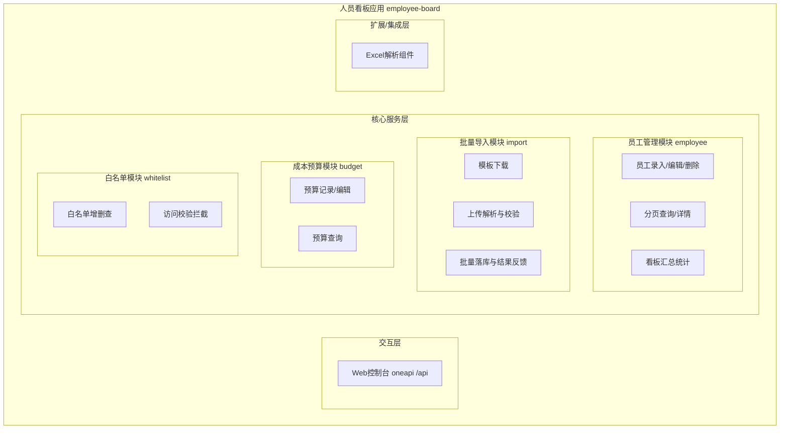
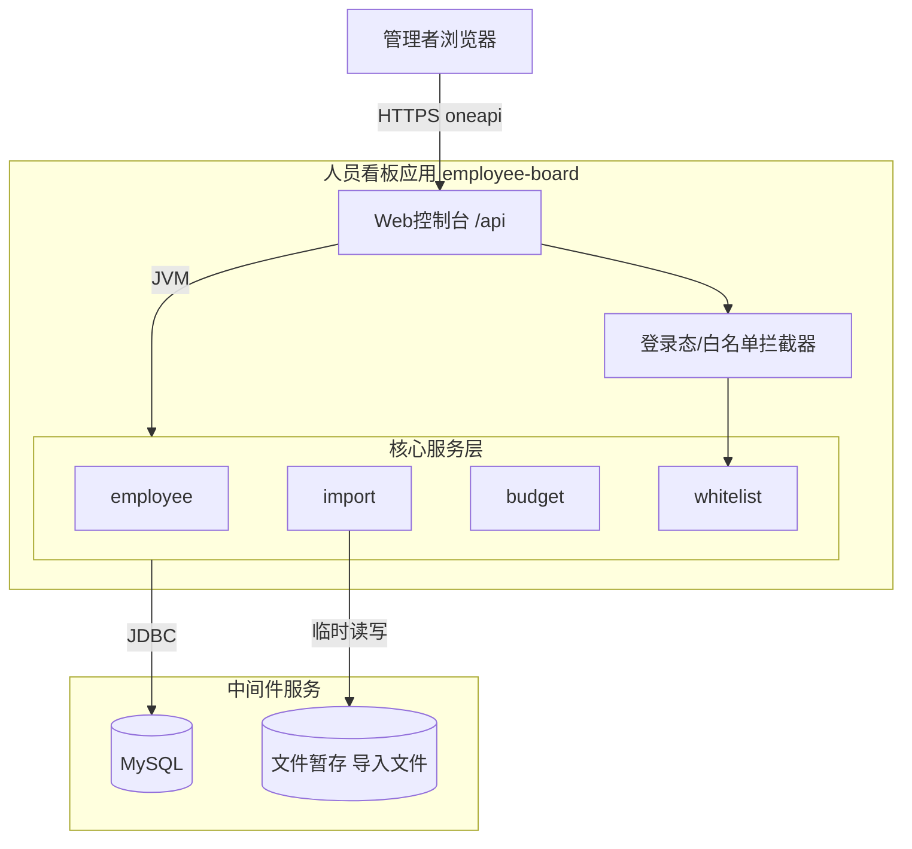
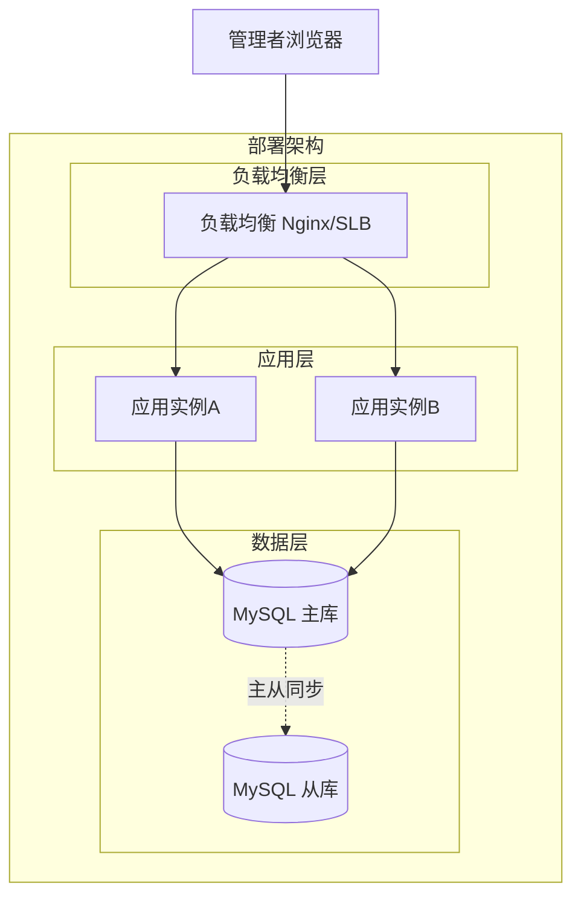
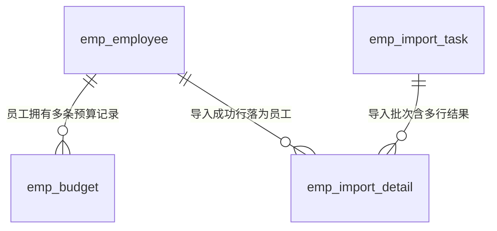
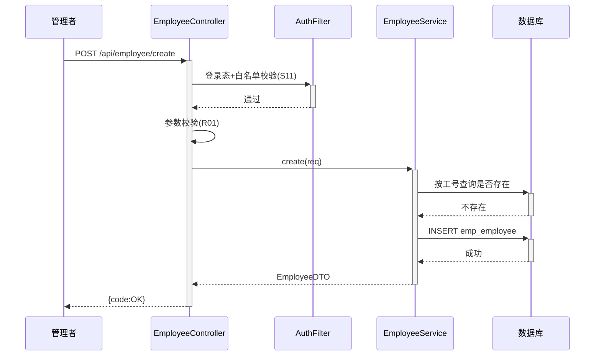
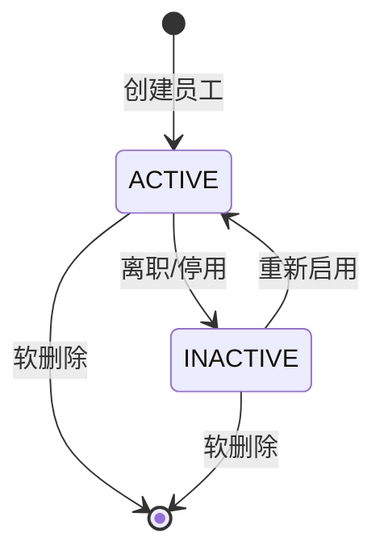
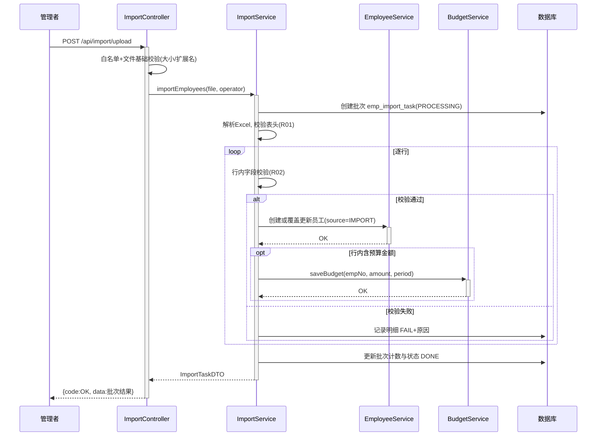

> **文档元信息**
>
> | 项目 | 内容 |
> |------|------|
> | 文档版本 | v1.0 |
> | 作者 | AiWork（系分自动生成） |
> | 创建日期 | 2026-10-22 |
> | 需求来源 | 需求描述：开发一个人员看板，有入口记录员工的基本信息以及增删改查，支持导入以及记录成本预算--白名单、批量导入 |
> | 评审状态 | 待评审 |

# 人员看板（Employee Board）系分设计

## 1. 需求与范围

### 背景与目标

团队/部门管理者需要一个统一的人员看板，集中管理员工基本信息，支持人工录入与批量导入，并能记录员工的成本预算信息。批量导入与白名单操作需面向管理端开放，保证数据可控、可追溯。

目标：
- 提供员工基本信息的录入入口与完整的增删改查能力；
- 支持 Excel 批量导入员工数据（含模板下载、校验、结果反馈）；
- 支持白名单管理（控制可操作系统/可被导入的用户范围）；
- 支持员工成本预算的记录与维护。

### 核心功能

1. 员工信息管理：新增、编辑、删除（软删）、分页查询、详情查看；
2. 批量导入：下载导入模板 → 上传 Excel → 服务端解析校验 → 批量落库 → 返回逐行结果；
3. 白名单管理：白名单增删查，控制管理端功能（尤其批量导入）的访问权限；
4. 成本预算：为员工记录成本预算（金额、币种、周期、生效区间），支持编辑与查询；
5. 人员看板：汇总展示员工列表及关键指标（总人数、预算合计等）。

### 约束与非功能要求

- 单次批量导入上限 1000 行，超出提示分批；
- 列表查询分页，默认 20 条/页；
- 员工工号全局唯一；
- 金额使用 decimal，禁止 float/double；
- 敏感字段（手机号、成本金额）展示脱敏（按角色）；
- 系统默认单租户起步，预留 tenant_id。

### 排除范围

- 不含审批流（如入职审批）；
- 不含与外部 HR 系统的实时同步；
- 不含前端页面视觉稿设计（仅定义接口契约）；
- 不含预算的实际执行/核销（仅记录）。

### 需求功能清单与优先级

| 编号 | 功能点 | 优先级 | PRD 原始描述/章节 | 备注 |
|------|--------|--------|-------------------|------|
| F01 | 员工基本信息录入（新增） | P0 | "有入口记录员工的基本信息" | 手工录入入口 |
| F02 | 员工信息增删改查 | P0 | "增删改查" | 删除采用软删除 |
| F03 | 人员看板列表与汇总展示 | P0 | "人员看板" | 分页+统计 |
| F04 | 批量导入员工 | P0 | "支持导入……批量导入" | Excel 模板导入 |
| F05 | 成本预算记录与维护 | P1 | "记录成本预算" | 员工维度预算 |
| F06 | 白名单管理 | P1 | "白名单" | 控制管理端访问 |

### 假设与待确认项

| 编号 | 假设/待确认内容 | 当前假设 | 确认状态 |
|------|-----------------|----------|----------|
| A01 | 仓库 testDj / ranxitest 均为空仓库，无既有代码 | 采用全新设计（全量模式），技术栈假设为 Java + Spring Boot + MySQL | 待确认 |
| A02 | 白名单语义 | 白名单 = 允许访问管理端（尤其批量导入/成本预算）的用户名单，按工号维度维护 | 待确认 |
| A03 | 成本预算粒度 | 按员工 + 预算周期（如 2026-Q4 / 2026-10）记录一条预算，允许覆盖更新 | 待确认 |
| A04 | 导入文件格式 | Excel（.xlsx），提供标准模板，单次 ≤1000 行 | 待确认 |
| A05 | 登录与身份 | 复用统一登录态（如 SSO），用户身份以工号标识；权限简化为白名单控制 | 待确认 |
| A06 | 租户隔离 | 默认单租户，表结构预留 tenant_id 便于未来扩展 | 待确认 |

## 2. 架构与模块

### 功能架构



- 交互层说明：Web 控制台 oneapi 接口（/api 前缀），供前端人员看板页面调用。
- 核心服务层说明：employee 模块负责员工主数据；import 模块负责批量导入；budget 模块负责成本预算；whitelist 模块负责访问控制。
- 扩展/集成层说明：Excel 解析组件（Apache POI / EasyExcel）供 import 模块使用。

**模块清单**

| 模块 | 职责 | 依赖 |
|------|------|------|
| employee | 员工基本信息 CRUD、看板汇总 | budget（汇总预算合计）、DB |
| import | 模板下载、Excel 解析校验、批量导入 | employee（落库）、whitelist（权限前置）、Excel 解析组件 |
| budget | 成本预算记录与查询 | employee（校验员工存在）、DB |
| whitelist | 白名单维护与访问校验 | DB |

模块依赖方向：import → employee ← budget；whitelist 被各管理端接口横向依赖（拦截器方式），无循环依赖。

### 应用集成架构



**集成关系说明：**

| 调用方 | 被调用方 | 协议 | 接口类型 | 说明 |
|--------|----------|------|----------|------|
| 管理者浏览器 | 应用 Web 控制台 | HTTPS | oneapi REST | 全部管理端接口 |
| Web 控制台 | 核心服务层 | JVM 内部调用 | Service | 同进程调用 |
| 核心服务层 | MySQL | JDBC | SQL | 数据持久化 |
| import 模块 | 文件暂存 | SDK/本地磁盘 | 文件 IO | 上传文件临时存储与解析 |

### 部署架构



**部署说明：**
- 负载均衡层：SLB/Nginx，无单点。
- 应用层：≥2 实例，无状态化，导入文件不写本地持久目录（用临时目录或对象存储），支持水平扩容。
- 数据层：MySQL 主从，读写均走主库（初期量级小）。

## 3. 数据模型与存储

### 实体清单

| 实体名称 | 实体说明 | 所属模块 | 与其他实体的关系 |
|----------|----------|----------|-----------------|
| emp_employee | 员工基本信息 | employee | 一对多关联 emp_budget；被导入批次结果引用 |
| emp_budget | 员工成本预算 | budget | 多对一关联 emp_employee |
| emp_import_task | 批量导入任务批次 | import | 一对多关联 emp_import_detail |
| emp_import_detail | 批量导入逐行结果 | import | 多对一关联 emp_import_task |
| emp_whitelist | 白名单用户 | whitelist | 独立实体 |

### 实体关系图



**模型说明：**
- emp_employee 以 emp_no（工号）作为业务唯一键；
- emp_budget 以 (emp_no, budget_period) 唯一，重复导入/提交视为更新；
- 导入采用"批次+明细"模型，便于追溯每行成败；
- 白名单独立成表，与员工表解耦（白名单用户未必是看板中的员工）。
- 缓存/MQ：初期不引入；导入为同步处理（≤1000 行秒级完成）。假设：单批 1000 行同步可接受，若未来超量再引入 MQ 异步化。

## 4. 接口设计

### 4.1 oneapi（Web 控制台接口）

| 编号 | 接口名称 | 方法 | 路径 | 模块 |
|------|----------|------|------|------|
| W01 | 新增员工 | POST | /api/employee/create | employee |
| W02 | 编辑员工 | POST | /api/employee/update | employee |
| W03 | 删除员工（软删） | POST | /api/employee/delete | employee |
| W04 | 员工分页查询 | POST | /api/employee/pageQuery | employee |
| W05 | 员工详情 | GET | /api/employee/detail | employee |
| W06 | 看板汇总统计 | GET | /api/employee/summary | employee |
| W07 | 导入模板下载 | GET | /api/import/template | import |
| W08 | 批量导入上传 | POST | /api/import/upload | import |
| W09 | 导入批次结果查询 | GET | /api/import/taskDetail | import |
| W10 | 保存成本预算 | POST | /api/budget/save | budget |
| W11 | 员工预算列表查询 | GET | /api/budget/queryByEmp | budget |
| W12 | 白名单新增 | POST | /api/whitelist/add | whitelist |
| W13 | 白名单移除 | POST | /api/whitelist/remove | whitelist |
| W14 | 白名单分页查询 | POST | /api/whitelist/pageQuery | whitelist |

### 4.2 OpenAPI（对外接口）

本期不开放对外接口。本项不适用，原因：需求仅要求管理端看板功能，无外部系统对接诉求。

### 4.3 内部接口（Service 层）

| 编号 | 接口名称 | 类 | 方法签名 |
|------|----------|------|----------|
| S01 | 员工创建 | EmployeeService | create(EmployeeCreateReq): EmployeeDTO |
| S02 | 员工更新 | EmployeeService | update(EmployeeUpdateReq): Boolean |
| S03 | 员工软删除 | EmployeeService | deleteByEmpNo(String empNo): Boolean |
| S04 | 员工分页查询 | EmployeeService | pageQuery(EmployeeQueryReq): PageResult<EmployeeDTO> |
| S05 | 按工号查员工 | EmployeeService | getByEmpNo(String empNo): EmployeeDTO |
| S06 | 看板汇总 | EmployeeService | summary(): EmployeeSummaryDTO |
| S07 | 批量导入执行 | ImportService | importEmployees(MultipartFile file, String operator): ImportTaskDTO |
| S08 | 导入批次查询 | ImportService | getTaskDetail(Long taskId): ImportTaskDetailDTO |
| S09 | 预算保存 | BudgetService | saveBudget(BudgetSaveReq): Boolean |
| S10 | 员工预算查询 | BudgetService | queryByEmpNo(String empNo): List<BudgetDTO> |
| S11 | 白名单校验 | WhitelistService | isAllowed(String empNo): Boolean |
| S12 | 白名单维护 | WhitelistService | add/remove/pageQuery |

### 4.4 集成接口（Integration 层）

本项不适用，原因：本期无外部系统调用，Excel 解析为本地组件非远程集成。

## 5. 功能模块设计

**全局约定：**
- 错误码格式：{MODULE}_{SEQ}，如 EMP_001、IMP_001、BUD_001、WL_001。
- 通用出参结构：{code, msg, data}，成功 code="OK"。
- 所有表含 id、gmt_create、gmt_modified，引擎 InnoDB，字符集 utf8mb4。

### 5.1 员工管理模块（employee）

#### 5.1.1 表结构设计

##### 5.1.1.1 emp_employee（员工基本信息表）

| 字段名 | 数据类型 | 约束 | 默认值 | 说明 |
|--------|----------|------|--------|------|
| id | bigint | PK, 自增 | - | 系统自增主键 |
| tenant_id | varchar(32) | NOT NULL | 'default' | 租户标识（预留） |
| emp_no | varchar(32) | NOT NULL | '' | 员工工号（业务唯一） |
| emp_name | varchar(64) | NOT NULL | '' | 员工姓名 |
| dept_name | varchar(64) | NOT NULL | '' | 所属部门 |
| position | varchar(64) | NOT NULL | '' | 岗位 |
| email | varchar(128) | NOT NULL | '' | 邮箱 |
| phone | varchar(32) | NOT NULL | '' | 手机号（脱敏展示） |
| hire_date | datetime | NULL | NULL | 入职日期 |
| status | varchar(16) | NOT NULL | 'ACTIVE' | 状态：ACTIVE/INACTIVE |
| source | varchar(16) | NOT NULL | 'MANUAL' | 来源：MANUAL/IMPORT |
| is_deleted | tinyint | NOT NULL | 0 | 软删标记 0/1 |
| gmt_create | datetime | NOT NULL | CURRENT_TIMESTAMP | 创建时间 |
| gmt_modified | datetime | NOT NULL | CURRENT_TIMESTAMP | 修改时间 |

**索引：**
- PK: `pk_emp_employee` (id)
- UK: `uk_emp_employee_no` (tenant_id, emp_no)
- IDX: `idx_emp_employee_dept` (tenant_id, dept_name)

##### 5.1.1.2 枚举与常量定义

| 枚举名称 | 取值 | 含义 | 关联字段 |
|----------|------|------|----------|
| EmployeeStatus | ACTIVE | 在职 | emp_employee.status |
| EmployeeStatus | INACTIVE | 离职/停用 | emp_employee.status |
| EmployeeSource | MANUAL | 手工录入 | emp_employee.source |
| EmployeeSource | IMPORT | 批量导入 | emp_employee.source |

#### 5.1.2 接口详细设计

##### W01 新增员工

- **URI**: POST /api/employee/create
- **描述**: 管理端录入单个员工基本信息
- **入参**:

| 参数名称 | 类型 | 是否必填 | 描述 |
|----------|------|----------|------|
| empNo | String | 是 | 工号，1-32位，全局唯一 |
| empName | String | 是 | 姓名，1-64位 |
| deptName | String | 是 | 部门 |
| position | String | 否 | 岗位 |
| email | String | 否 | 邮箱，格式校验 |
| phone | String | 否 | 手机号，格式校验 |
| hireDate | String | 否 | 入职日期 yyyy-MM-dd |

- **出参**:

| 参数名称 | 类型 | 描述 |
|----------|------|------|
| code | String | 结果 code，OK 表示成功 |
| msg | String | 提示信息 |
| data | Object | 创建成功的员工对象（含 id） |

- **错误码**:

| 错误码 | 说明 |
|--------|------|
| EMP_001 | 工号已存在 |
| EMP_002 | 必填参数缺失或格式非法 |
| WL_001 | 操作者不在白名单 |

- **业务规则**: 工号唯一；默认状态 ACTIVE；source=MANUAL。

- **请求示例**:
```json
{
  "empNo": "A1001",
  "empName": "张三",
  "deptName": "技术部",
  "position": "后端工程师",
  "email": "zhangsan@example.com",
  "phone": "138****0000",
  "hireDate": "2026-10-22"
}
```

- **响应示例**:
```json
{
  "code": "OK",
  "msg": "SUCCESS",
  "data": {"id": 1001, "empNo": "A1001", "status": "ACTIVE"}
}
```

##### W02 编辑员工

- **URI**: POST /api/employee/update
- **描述**: 按工号更新员工信息，仅更新传入字段
- **入参**:

| 参数名称 | 类型 | 是否必填 | 描述 |
|----------|------|----------|------|
| empNo | String | 是 | 工号（定位记录，不允许修改） |
| empName | String | 否 | 姓名 |
| deptName | String | 否 | 部门 |
| position | String | 否 | 岗位 |
| email | String | 否 | 邮箱 |
| phone | String | 否 | 手机号 |
| hireDate | String | 否 | 入职日期 |
| status | String | 否 | ACTIVE/INACTIVE |

- **出参**: {code, msg, data: Boolean}
- **错误码**: EMP_003 员工不存在；EMP_002 参数非法；EMP_004 状态流转非法（见状态机）；WL_001 白名单校验失败。

##### W03 删除员工（软删）

- **URI**: POST /api/employee/delete
- **入参**:

| 参数名称 | 类型 | 是否必填 | 描述 |
|----------|------|----------|------|
| empNo | String | 是 | 工号 |

- **出参**: {code, msg, data: Boolean}
- **错误码**: EMP_003 员工不存在；WL_001 白名单校验失败。
- **业务规则**: 软删除 is_deleted=1；员工名下预算记录保留但查询时标记员工已删除。

##### W04 员工分页查询

- **URI**: POST /api/employee/pageQuery
- **入参**:

| 参数名称 | 类型 | 是否必填 | 描述 |
|----------|------|----------|------|
| pageNo | Integer | 是 | 页码，从1开始 |
| pageSize | Integer | 是 | 每页条数，默认20，最大100 |
| keyword | String | 否 | 工号/姓名模糊搜索 |
| deptName | String | 否 | 部门过滤 |
| status | String | 否 | 状态过滤 |

- **出参**: data = {total, pageNo, pageSize, list:[{id, empNo, empName, deptName, position, status, hireDate}]}；phone 按权限脱敏（非白名单用户返回中间四位打码）。

##### W05 员工详情

- **URI**: GET /api/employee/detail?empNo=A1001
- **出参**: data = 员工完整信息 + 预算列表摘要（最近一期预算金额与周期）。

##### W06 看板汇总统计

- **URI**: GET /api/employee/summary
- **出参**:

| 参数名称 | 类型 | 描述 |
|----------|------|------|
| data.totalCount | Long | 在职员工总数 |
| data.deptCount | Long | 部门数 |
| data.budgetTotal | Decimal | 当前周期预算合计 |
| data.recentImport | Object | 最近一次导入批次摘要（批次号/成功数/失败数） |

#### 5.1.3 子功能详细设计

##### 5.1.3.1 员工录入与编辑（F01/F02）



**业务规则：**

| 规则编号 | 规则描述 | 校验时机 | 不满足时的处理 |
|----------|----------|----------|--------------|
| R01 | 必填字段（工号/姓名/部门）非空且长度合法 | 创建/更新时 | 返回 EMP_002 |
| R02 | 工号在租户内唯一 | 创建时 | 返回 EMP_001 |
| R03 | 邮箱/手机号格式合法（如填写） | 创建/更新时 | 返回 EMP_002 |
| R04 | 更新/删除前员工必须存在且未删除 | 更新/删除前 | 返回 EMP_003 |
| R05 | 操作者须在白名单（管理端写操作） | 始终 | 返回 WL_001 |

**异常场景：**

| 异常场景 | 处理方式 |
|----------|----------|
| 并发创建同工号 | 数据库唯一索引兜底，捕获 DuplicateKey 返回 EMP_001 |
| 更新时已离职员工 | 允许编辑信息，但不允许 INACTIVE→ACTIVE 之外恢复为在职时的日期校验缺失则放行（见状态机） |
| DB 异常 | 事务回滚，返回系统错误，记录错误日志 |

**并发控制：**
- 并发场景：两人同时编辑同一员工。
- 控制策略：工号唯一索引 + 更新按主键条件 `where id=? and is_deleted=0`；初期不引入乐观锁（后台管理低频场景，假设：冲突概率极低，采用最后写入胜出并记录审计日志）。

**状态机设计：**



**状态流转规则：**

| 当前状态 | 目标状态 | 流转条件 | 前置校验 | 触发动作 |
|----------|----------|----------|----------|----------|
| ACTIVE | INACTIVE | 管理员操作离职 | 员工存在且未删除 | 更新 gmt_modified |
| INACTIVE | ACTIVE | 管理员重新启用 | 员工存在且未删除 | 更新 gmt_modified |
| ACTIVE/INACTIVE | 删除(is_deleted=1) | 管理员删除 | 员工存在 | 列表/统计排除该员工 |

##### 5.1.3.2 看板汇总（F03）

- 汇总 SQL 走 idx 索引统计在职人数；预算合计按当前周期聚合 emp_budget。
- 并发风险：只读统计，无并发风险。
- 性能：数据量 <10w 时直接 count/sum；预留本地缓存（60s TTL）降级方案。

### 5.2 批量导入模块（import）

#### 5.2.1 表结构设计

##### 5.2.1.1 emp_import_task（导入批次表）

| 字段名 | 数据类型 | 约束 | 默认值 | 说明 |
|--------|----------|------|--------|------|
| id | bigint | PK, 自增 | - | 批次ID |
| tenant_id | varchar(32) | NOT NULL | 'default' | 租户 |
| operator | varchar(32) | NOT NULL | '' | 操作人工号 |
| file_name | varchar(128) | NOT NULL | '' | 原始文件名 |
| total_count | int | NOT NULL | 0 | 总行数 |
| success_count | int | NOT NULL | 0 | 成功行数 |
| fail_count | int | NOT NULL | 0 | 失败行数 |
| status | varchar(16) | NOT NULL | 'PROCESSING' | PROCESSING/DONE/FAILED |
| gmt_create | datetime | NOT NULL | CURRENT_TIMESTAMP | 创建时间 |
| gmt_modified | datetime | NOT NULL | CURRENT_TIMESTAMP | 修改时间 |

**索引：** PK: pk_emp_import_task(id)；IDX: idx_emp_import_task_op (tenant_id, operator)

##### 5.2.1.2 emp_import_detail（导入明细表）

| 字段名 | 数据类型 | 约束 | 默认值 | 说明 |
|--------|----------|------|--------|------|
| id | bigint | PK, 自增 | - | 主键 |
| task_id | bigint | NOT NULL | 0 | 批次ID |
| row_no | int | NOT NULL | 0 | Excel 行号 |
| emp_no | varchar(32) | NOT NULL | '' | 行内工号 |
| result | varchar(8) | NOT NULL | '' | SUCCESS/FAIL |
| fail_reason | varchar(256) | NOT NULL | '' | 失败原因 |
| gmt_create | datetime | NOT NULL | CURRENT_TIMESTAMP | 创建时间 |
| gmt_modified | datetime | NOT NULL | CURRENT_TIMESTAMP | 修改时间 |

**索引：** PK: pk_emp_import_detail(id)；IDX: idx_emp_import_detail_task (task_id)

##### 5.2.1.3 枚举与常量定义

| 枚举名称 | 取值 | 含义 | 关联字段 |
|----------|------|------|----------|
| ImportTaskStatus | PROCESSING | 处理中 | emp_import_task.status |
| ImportTaskStatus | DONE | 已完成 | emp_import_task.status |
| ImportTaskStatus | FAILED | 整体失败（如文件解析失败） | emp_import_task.status |
| ImportRowResult | SUCCESS | 导入成功 | emp_import_detail.result |
| ImportRowResult | FAIL | 导入失败 | emp_import_detail.result |

#### 5.2.2 接口详细设计

##### W07 导入模板下载

- **URI**: GET /api/import/template
- **描述**: 下载标准导入模板（列：工号*、姓名*、部门*、岗位、邮箱、手机号、入职日期、成本预算金额、预算周期）
- **出参**: 文件流（.xlsx）
- **错误码**: WL_001 非白名单不可下载。

##### W08 批量导入上传

- **URI**: POST /api/import/upload（multipart/form-data）
- **描述**: 上传 Excel，服务端同步解析校验并落库
- **入参**:

| 参数名称 | 类型 | 是否必填 | 描述 |
|----------|------|----------|------|
| file | File | 是 | .xlsx 文件，≤1000 数据行，≤5MB |
| overwrite | Boolean | 否 | 工号已存在时是否覆盖更新，默认 false（跳过并报已存在） |

- **出参**:

| 参数名称 | 类型 | 描述 |
|----------|------|------|
| data.taskId | Long | 批次ID |
| data.totalCount | Integer | 总行数 |
| data.successCount | Integer | 成功数 |
| data.failCount | Integer | 失败数 |

- **错误码**:

| 错误码 | 说明 |
|--------|------|
| IMP_001 | 文件为空或格式不支持 |
| IMP_002 | 超过 1000 行上限 |
| IMP_003 | 模板表头不匹配 |
| IMP_004 | 文件解析异常 |
| WL_001 | 非白名单用户 |

- **请求示例**: multipart 表单 file=employees.xlsx&overwrite=true
- **响应示例**:
```json
{"code":"OK","msg":"SUCCESS","data":{"taskId":88,"totalCount":120,"successCount":115,"failCount":5}}
```

##### W09 导入批次结果查询

- **URI**: GET /api/import/taskDetail?taskId=88&result=FAIL
- **出参**: 批次概要 + 明细列表（rowNo、empNo、result、failReason），支持按 SUCCESS/FAIL 过滤。

#### 5.2.3 子功能详细设计

##### 5.2.3.1 批量导入（F04）



**业务规则：**

| 规则编号 | 规则描述 | 校验时机 | 不满足时的处理 |
|----------|----------|----------|--------------|
| R01 | 表头必须与模板一致 | 解析时 | 整批失败 IMP_003 |
| R02 | 行内必填字段（工号/姓名/部门）非空、格式合法 | 逐行 | 该行 FAIL，记录原因 |
| R03 | 单批 ≤1000 行 | 上传时 | 整批拒绝 IMP_002 |
| R04 | 工号重复：overwrite=false 跳过并报"工号已存在"；true 则更新 | 逐行 | 按策略处理 |
| R05 | 行内含预算金额时必须含预算周期，金额 ≥0 且为 decimal | 逐行 | 该行 FAIL |
| R06 | 同文件内工号重复行 | 逐行 | 以首行为准，后续行 FAIL "文件内工号重复" |

**异常场景：**

| 异常场景 | 处理方式 |
|----------|----------|
| 文件损坏/非xlsx | 返回 IMP_001/IMP_004，批次置 FAILED |
| 解析中途异常 | 已处理行不回滚（逐行独立事务），批次置 DONE 并记录失败明细 |
| 超大文件 | 前置大小校验直接拒绝 |
| 操作者中途关闭页面 | 服务端继续执行，结果可通过 W09 查询 |

**并发控制：**
- 并发场景：两人同时导入含相同工号的文件。
- 控制策略：逐行走 employee 创建/更新的唯一索引兜底；批次之间互不影响；同一操作者的重复提交以前端禁用 + 幂等提示（同文件 MD5 30s 内重复上传提示"已存在进行中/完成批次"）。
- 事务策略：整批不包大事务（避免长事务锁表），逐行小事务；导入结果以明细表为准，可重跑失败行（下载失败明细重新导入）。

### 5.3 成本预算模块（budget）

#### 5.3.1 表结构设计

##### 5.3.1.1 emp_budget（员工成本预算表）

| 字段名 | 数据类型 | 约束 | 默认值 | 说明 |
|--------|----------|------|--------|------|
| id | bigint | PK, 自增 | - | 主键 |
| tenant_id | varchar(32) | NOT NULL | 'default' | 租户 |
| emp_no | varchar(32) | NOT NULL | '' | 员工工号 |
| budget_period | varchar(16) | NOT NULL | '' | 预算周期，如 2026-10 / 2026-Q4 |
| amount | decimal(18,2) | NOT NULL | 0.00 | 预算金额 |
| currency | varchar(8) | NOT NULL | 'CNY' | 币种 |
| remark | varchar(256) | NOT NULL | '' | 备注 |
| gmt_create | datetime | NOT NULL | CURRENT_TIMESTAMP | 创建时间 |
| gmt_modified | datetime | NOT NULL | CURRENT_TIMESTAMP | 修改时间 |

**索引：**
- PK: pk_emp_budget(id)
- UK: uk_emp_budget_emp_period (tenant_id, emp_no, budget_period)

##### 5.3.1.2 枚举与常量定义

| 枚举名称 | 取值 | 含义 | 关联字段 |
|----------|------|------|----------|
| Currency | CNY | 人民币 | emp_budget.currency |
| Currency | USD | 美元 | emp_budget.currency |

#### 5.3.2 接口详细设计

##### W10 保存成本预算

- **URI**: POST /api/budget/save
- **描述**: 保存（新增或覆盖更新）员工某周期预算
- **入参**:

| 参数名称 | 类型 | 是否必填 | 描述 |
|----------|------|----------|------|
| empNo | String | 是 | 员工工号 |
| budgetPeriod | String | 是 | 预算周期，格式 yyyy-MM 或 yyyy-Qn |
| amount | Decimal | 是 | 金额，≥0，两位小数 |
| currency | String | 否 | 默认 CNY |
| remark | String | 否 | 备注 ≤256 |

- **出参**: {code, msg, data: Boolean}
- **错误码**: BUD_001 员工不存在；BUD_002 金额/周期格式非法；WL_001 白名单校验失败。
- **请求示例**:
```json
{"empNo":"A1001","budgetPeriod":"2026-10","amount":25000.00,"currency":"CNY","remark":"10月人力预算"}
```
- **响应示例**:
```json
{"code":"OK","msg":"SUCCESS","data":true}
```

##### W11 员工预算列表查询

- **URI**: GET /api/budget/queryByEmp?empNo=A1001
- **出参**: data = [{budgetPeriod, amount, currency, remark, gmtModified}]，按周期倒序。

#### 5.3.3 子功能详细设计

##### 5.3.3.1 预算保存（F05）

**业务规则：**

| 规则编号 | 规则描述 | 校验时机 | 不满足时的处理 |
|----------|----------|----------|--------------|
| R01 | 员工必须存在且未删除 | 保存时 | BUD_001 |
| R02 | 金额 decimal(18,2)、非负 | 保存时 | BUD_002 |
| R03 | 同员工同周期重复保存 = 覆盖更新 | 保存时 | 更新 amount/remark |

**异常场景：**

| 异常场景 | 处理方式 |
|----------|----------|
| 并发保存同员工同周期 | 唯一索引 uk_emp_budget_emp_period 兜底，采用 insert ... on duplicate 语义或先查后更，后写覆盖 |
| 员工被删除后仍有预算 | 预算保留，详情页标记员工已删除 |

**并发控制：** 唯一索引 + upsert；无长事务。

**状态机设计：** 预算实体无状态字段，本项不适用，原因：预算仅为数值记录，覆盖式更新。

### 5.4 白名单模块（whitelist）

#### 5.4.1 表结构设计

##### 5.4.1.1 emp_whitelist（白名单表）

| 字段名 | 数据类型 | 约束 | 默认值 | 说明 |
|--------|----------|------|--------|------|
| id | bigint | PK, 自增 | - | 主键 |
| tenant_id | varchar(32) | NOT NULL | 'default' | 租户 |
| emp_no | varchar(32) | NOT NULL | '' | 被授权用户工号 |
| user_name | varchar(64) | NOT NULL | '' | 姓名（冗余便于展示） |
| remark | varchar(128) | NOT NULL | '' | 备注 |
| created_by | varchar(32) | NOT NULL | '' | 添加人工号 |
| is_deleted | tinyint | NOT NULL | 0 | 软删标记 |
| gmt_create | datetime | NOT NULL | CURRENT_TIMESTAMP | 创建时间 |
| gmt_modified | datetime | NOT NULL | CURRENT_TIMESTAMP | 修改时间 |

**索引：** PK: pk_emp_whitelist(id)；UK: uk_emp_whitelist_no (tenant_id, emp_no)

#### 5.4.2 接口详细设计

##### W12 白名单新增

- **URI**: POST /api/whitelist/add
- **入参**:

| 参数名称 | 类型 | 是否必填 | 描述 |
|----------|------|----------|------|
| empNo | String | 是 | 被授权人工号 |
| userName | String | 是 | 姓名 |
| remark | String | 否 | 备注 |

- **出参**: {code, msg, data: Boolean}
- **错误码**: WL_002 已存在；WL_003 参数非法。

##### W13 白名单移除

- **URI**: POST /api/whitelist/remove
- **入参**: empNo（必填）。出参 Boolean。软删除。
- **业务规则**: 不允许移除最后一个白名单用户（防止管理端失控），违反返回 WL_004。

##### W14 白名单分页查询

- **URI**: POST /api/whitelist/pageQuery
- **入参**: pageNo/pageSize/keyword；出参同通用分页结构。

#### 5.4.3 子功能详细设计

##### 5.4.3.1 访问校验（F06）

- AuthFilter 拦截 /api/** 全部管理端接口：校验登录态 → 提取当前用户工号 → S11 isAllowed → 不通过返回 WL_001。
- 白名单查询走本地缓存（Caffeine，60s TTL），变更时主动失效。
- 初始化：首次部署通过 SQL 初始化至少一名管理员白名单记录（数据迁移项）。

**并发控制：** 写低频；缓存短 TTL 接受秒级不一致。

## 6. 非功能性需求设计

### 6.1 高可用性
应用无状态多实例 + SLB；MySQL 主从。导入文件仅使用临时存储，实例故障不影响其他实例。DB 不可用时读接口快速失败并提示，不级联。

### 6.2 可扩展性
应用层水平扩容无约束；未来导入量增大时可将 import 模块异步化（MQ），表结构（批次+明细）已兼容异步模式，无需改表。

### 6.3 稳定性/可靠性
- 批量导入逐行独立事务，单行失败不影响整批；
- 上传接口限流（单用户 10 次/分钟），防止恶意刷接口；
- Excel 解析限制行数/大小，防止 OOM（流式解析）。

### 6.4 安全性设计
#### 6.4.1 账户系统方案
复用统一登录态（SSO），系统不自实现登录注册（假设 A05）。
#### 6.4.2 授权&访问控制
##### 6.4.2.1 是否实现水平权限检查
实现：所有写操作（员工/预算/白名单/导入）经 AuthFilter 白名单校验；查询接口按数据属主维度暂不细分（单租户管理端）。
##### 6.4.2.2 是否实现垂直权限检查
实现：白名单即角色（管理员）控制；未来可扩展 role 字段。
##### 6.4.2.3 是否检查登录态
全局统一拦截器检查登录态，无匿名白名单接口（模板下载也需登录+白名单）。
#### 6.4.3 数据防护方案
##### 6.4.3.1 是否对敏感数据加密存储
成本金额按普通数值存储（非个人敏感信息）；手机号明文存储但日志禁止打印明文。
##### 6.4.3.2 是否对敏感数据展示进行脱敏
列表接口手机号默认中间四位打码；预算金额仅白名单用户可见；日志对 phone/amount 脱敏。

### 6.5 监控/统计/日志/告警
- 接口 QPS/RT/错误率监控；导入批次成功率监控（失败率 >30% 告警）；
- 关键操作（增删员工、导入、白名单变更）记录审计日志（操作人/时间/对象/结果）。

## 7. 变更三板斧

### 7.1 可监控
- 埋点：员工增删改、导入批次（行数/成功/失败/耗时）、预算保存、白名单校验拒绝次数；
- 监控项：导入失败率、接口错误率、DB 慢查询；
- 告警：导入失败率 >30%、接口 5xx 持续 5 分钟。

### 7.2 可灰度
全新功能无历史版本；按租户尾号灰度开放管理端入口（多租户场景）。单租户场景灰度不适用，原因：首期单租户部署，通过白名单即可控制可见范围。

### 7.3 可应急
- 开关：`import.enabled`（关闭批量导入入口）、`budget.enabled`（关闭预算写入）、`whitelist.strict`（紧急放开白名单为仅登录态校验）；
- 应急优先使用开关降级，避免回滚；如必须回滚：表结构均为新增表，回滚不影响存量数据；回滚前确认下游无依赖（本期无外部对接，无下游）。

---

## 附：方案检查结论（19 项 checklist）

| 检查项 | 结论 | 说明 |
|--------|------|------|
| 模块划分合理性 | 通过 | 4 模块职责单一，无循环依赖，无超 50% 功能点模块 |
| 依赖关系合理性 | 通过 | 仅依赖 MySQL 与本地解析组件，DB 故障读接口快速失败 |
| 单点问题（部署） | 通过 | 应用多实例 + SLB + DB 主从 |
| 表模型范式 | 通过 | 满足第三范式；user_name 为展示冗余（低频修改，可接受） |
| 隐私安全 | 通过 | 手机号/金额脱敏，日志脱敏 |
| 接口兼容性 | 通过 | 全新接口，无旧调用方 |
| 表兼容性 | 通过 | 全部新增表 |
| 数据迁移 | 通过 | 初始化脚本：首名白名单管理员记录 |
| 一致性（功能点 F01-F06） | 通过 | 均在第 5 章有对应设计 |
| 一致性（实体→表结构） | 通过 | 5 实体均有完整表结构 |
| 一致性（接口 W01-W14） | 通过 | 均在第 5 章有详细定义 |
| 一致性（枚举↔字段） | 通过 | status/source/result/currency 一致 |
| 状态机完整性 | 通过 | emp_employee.status 有状态机，无孤岛状态 |
| 并发风险 | 通过 | 唯一索引兜底 + 逐行事务；对比方案（大事务/分布式锁）因复杂度高未采纳 |
| 单点问题（定时任务） | 不适用 | 本期无定时任务 |
| 非功能设计可行性 | 通过 | 均为常规手段 |
| 可监控可行性 | 通过 | 埋点点位明确 |
| 可灰度 | 通过 | 单租户以白名单控制替代灰度 |
| 可应急 | 通过 | 三开关 + 新增表无回滚风险 |
