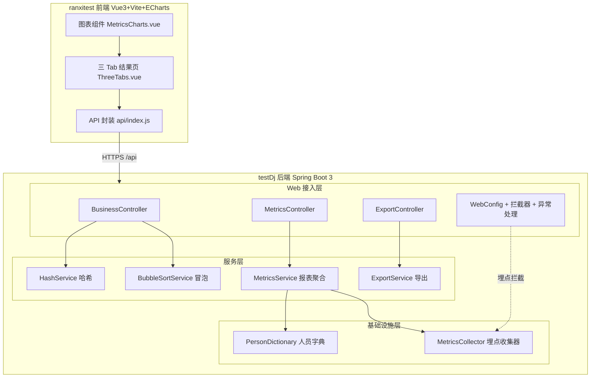
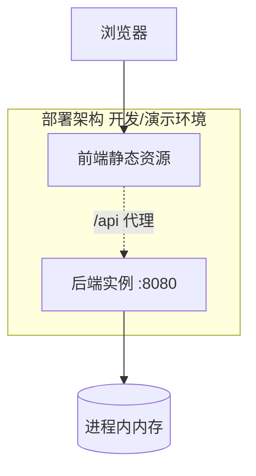
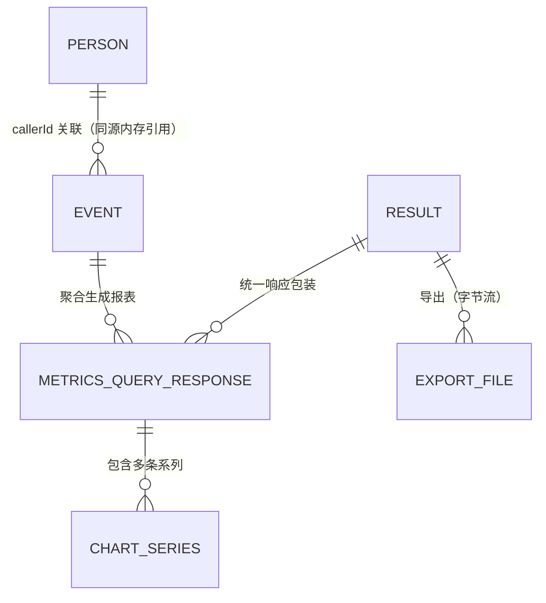
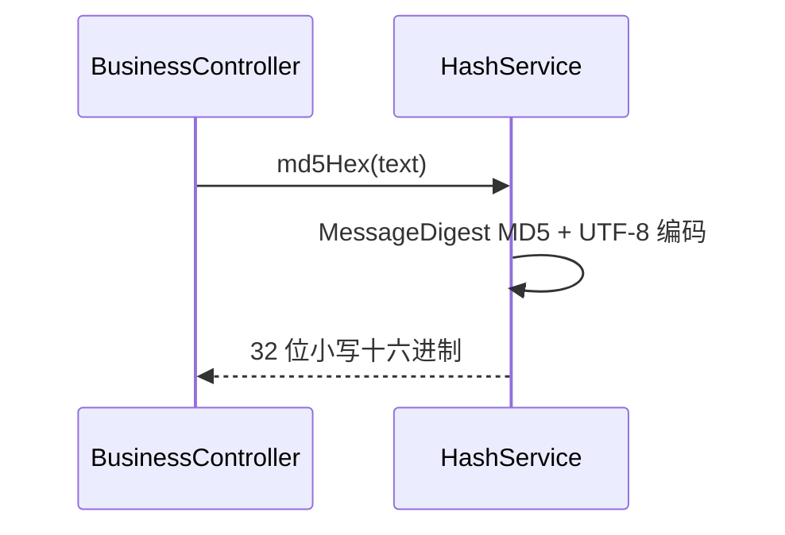
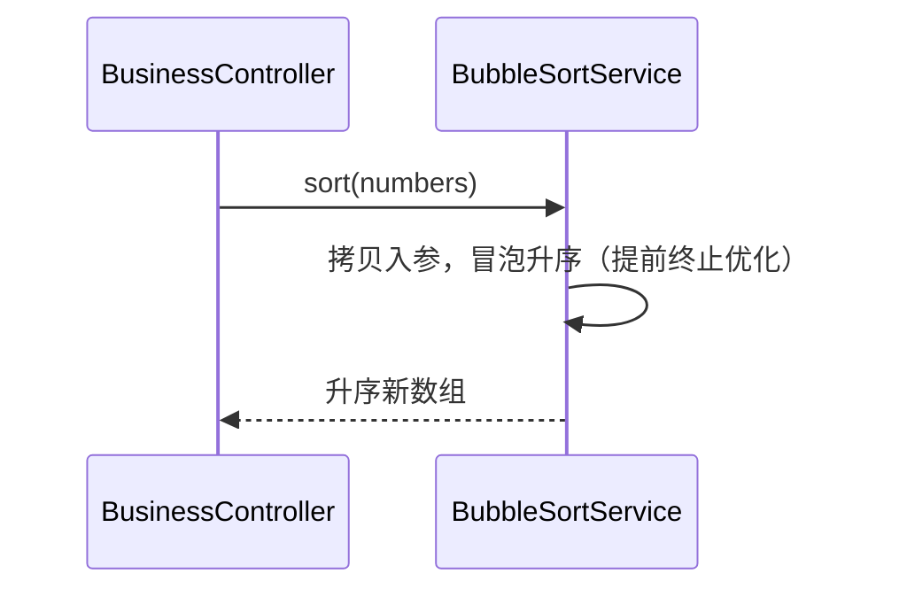
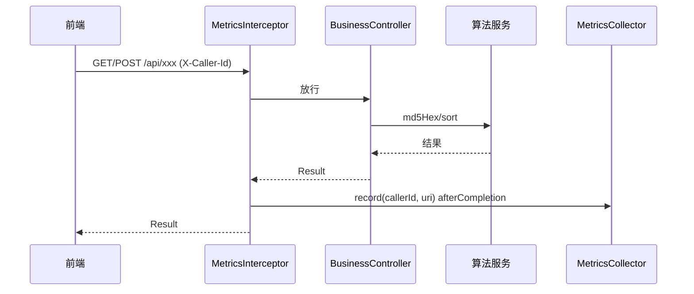
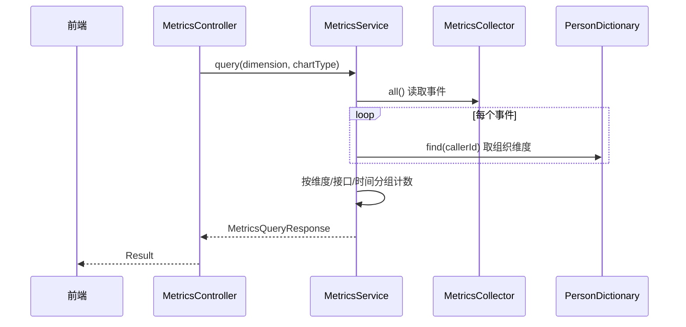
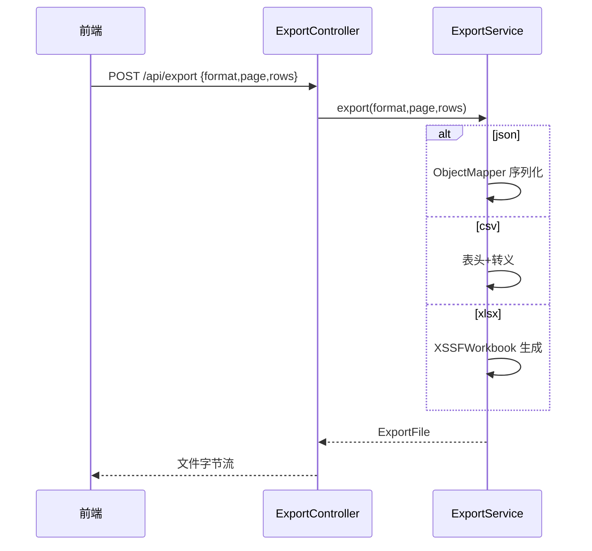
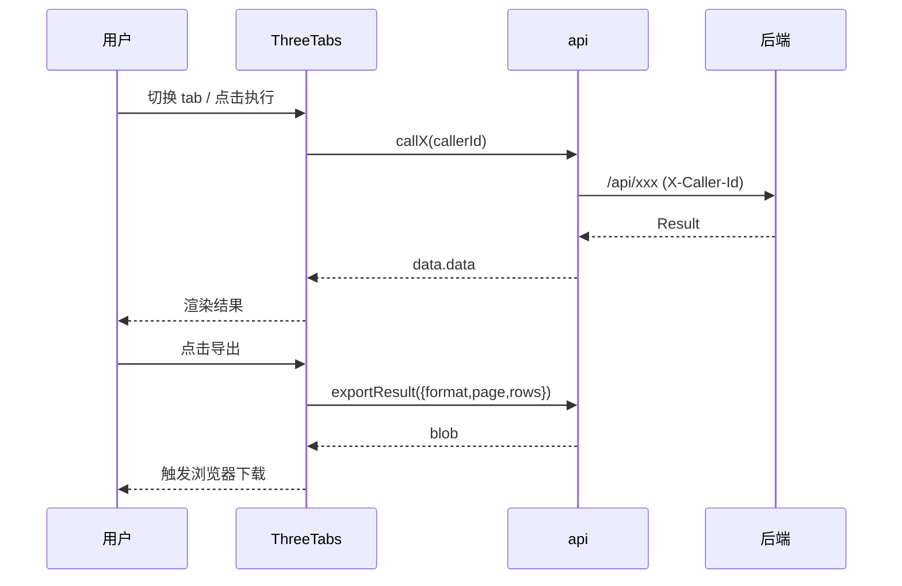
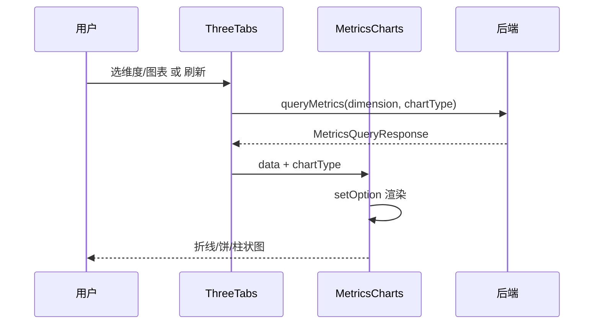

> **文档元信息**
>
> | 项目 | 内容 |
> |------|------|
> | 文档版本 | v1.0 |
> | 作者 | AiWork（系分节点） |
> | 创建日期 | 2026-10-26 |
> | 需求来源 | requirement_section + `.agents/20261023-分别写三个接口helloworld_哈希/dima.md`（需求澄清）+ `plan.md`（实施计划） |
> | 评审状态 | 待评审 |
> | 任务 ID | DEV-d885ee0d-78e2-11f1-8f3f-75954cb1c56f-02a853e4-5eda-4c6d-b754-838828eb0c80 |
> | 仓库归属 | testDj = 后端；ranxitest = 前端 |

# 三个接口（helloworld / 哈希 / 冒泡）+ 导出 + 埋点报表 系分设计

## 1. 需求与范围

### 1.1 背景与目标

用户要求在一个后端服务上提供三个演示接口（HelloWorld、哈希算法、冒泡排序），并在前端新增一个页面，以三个 tab 分别展示各接口的执行结果；同时支持导出展示结果；后端对接口调用做埋点（获取调用次数与调用人），前端在同一页面以折线图、饼图、柱状图三种形式，按人员类型、人员层级、人员部门等维度可视化调用报表。

目标：
- 打通「后端接口 → 前端展示 → 导出 → 埋点 → 可视化报表」的完整演示链路。
- 输出一份可落地的系分设计文档，作为后续编码阶段（可写类）的基准。

### 1.2 核心功能

1. `helloWorld` 接口：返回固定问候语 `Hello, World!`（无入参）。
2. 哈希算法接口：对入参文本做 MD5 计算，返回十六进制小写摘要。
3. 冒泡排序接口：对入参整数数组升序冒泡排序，返回有序数组（不修改入参）。
4. 前端页面：单页面三个 tab（helloworld / MD5 哈希 / 冒泡排序），分别展示对应执行结果。
5. 导出：页面「导出」按钮 + 后台导出接口，支持 JSON / Excel(.xlsx) / CSV 三种格式，导出当前页展示结果。
6. 埋点：后端拦截三个业务接口的调用，记录「调用人 + 调用接口 + 调用时间」，统计调用次数。
7. 人员字典：维护调用人的组织维度（人员类型 / 人员层级 / 人员部门）。
8. 报表：后端按多维度聚合调用数据，前端以折线/饼/柱状三种图表形式可视化。

### 1.3 约束与非功能要求

- 技术栈（已确认，见 dima.md 第 6 节）：后端 Java 21 + Spring Boot 3（`spring-boot-starter-web`）；前端 Vue 3 + Vite + ECharts。
- 统一响应结构 `Result<T>`：`{code:int, message:String, data:T}`，成功 `code=0`，失败 `code=400/500` 且 `data=null`。
- 导出支持 JSON / Excel(.xlsx) / CSV 三种格式。
- 埋点数据为进程内内存暂存（demo 级），预留后续持久化替换点。
- 图表形态：折线图＝按时间趋势；饼图＝按维度占比；柱状图＝按维度、按接口人次对比。
- 非功能：见第 6 章。

### 1.4 排除范围

- 不做登录鉴权与单点登录（`X-Caller-Id` 请求头仅作为演示用调用人标识）。
- 不做数据库持久化（埋点与人员字典均为进程内内存，重启即清空，属演示级）。
- 不做多租户隔离（无租户概念）。
- 不提供 OpenAPI 对外网关接口（仅 oneapi `/api` 前缀 + 前端演示）。
- 不做导出文件的云端存储与下载记录。

### 1.5 需求功能清单与优先级

| 编号 | 功能点 | 优先级 | 原始描述 | 归属 |
|------|--------|--------|----------|------|
| F01 | helloWorld 接口 | P0 | 「三个接口 helloworld」 | testDj |
| F02 | MD5 哈希算法接口 | P0 | 「哈希算法」 | testDj |
| F03 | 冒泡排序接口 | P0 | 「冒泡排序」 | testDj |
| F04 | 单页三 tab 结果展示 | P0 | 「前端新增一个页面，有三个tab分别展示不同的执行结果」 | ranxitest |
| F05 | 导出按钮 + 导出接口（JSON/xlsx/CSV） | P0 | 「新增导出按钮，后台提供导出接口，支持导出各个页面的展示结果」 | testDj + ranxitest |
| F06 | 埋点（调用次数 + 调用人） | P0 | 「后端再做个埋点，获取调用次数和调用人」 | testDj |
| F07 | 人员字典（类型/层级/部门） | P0 | 「人员类型、人员层级、人员部门等」 | testDj |
| F08 | 报表聚合查询接口 | P0 | 「可视化出来一个报表查看调用情况（根据不同的维度…）」 | testDj |
| F09 | 前端可视化报表（折线/饼/柱状） | P0 | 「折线图以及饼图和柱状图不同展示形式」 | ranxitest |

### 1.6 假设与待确认项

| 编号 | 假设/待确认内容 | 当前假设 | 确认状态 |
|------|-----------------|----------|----------|
| A01 | 后端技术栈 | 引入 Spring Boot 3（`spring-boot-starter-web`） | 已确认（Q1） |
| A02 | 前端技术栈 | Vue 3 + Vite + ECharts | 已确认（Q2） |
| A03 | 哈希算法 | MD5，十六进制小写输出 | 已确认（Q3） |
| A04 | 冒泡排序入参 | 整数数组，升序 | 已确认（Q3） |
| A05 | helloworld 入参 | 固定无参返回 `Hello, World!` | 已确认（Q3） |
| A06 | 调用人标识来源 | 请求头 `X-Caller-Id`，缺省记 `anonymous` | 已确认（Q4） |
| A07 | 人员组织维度来源 | 后端人员字典维护（进程内内置样例） | 已确认（Q4） |
| A08 | 埋点存储 | 进程内内存暂存，预留持久化替换点 | 已确认（Q4） |
| A09 | 导出格式 | JSON / Excel(.xlsx) / CSV 三选一（请求参数指定） | 已确认（Q5） |
| A10 | 折线图时间粒度 | 按 `HH:mm` 分钟桶聚合（demo 精度） | 假设：演示场景分桶 |
| A11 | 埋点计数范围 | 仅 3 个业务接口；导出/报表/人员字典不计入 | 假设：符合「调用次数」语义 |
| A12 | 权限与鉴权 | 不涉及，公开演示接口 | 假设：无鉴权 |

## 2. 架构与模块

### 2.1 功能架构



**功能说明：**
- 交互层：前端页面通过 axios 封装调用后端 `/api/**`；后端各 Controller 负责接入。
- 核心服务层：`HashService`、`BubbleSortService` 提供纯算法计算；`MetricsService` 提供埋点聚合；`ExportService` 提供文件转换导出。
- 基础设施层：`PersonDictionary` 维护调用人组织维度；`MetricsCollector` 收集调用事件（进程内内存）。

### 2.2 模块清单

| 模块 | 仓库 | 职责 | 依赖 |
|------|------|------|------|
| common（公共层） | testDj | `Result<T>` 统一响应 | 无 |
| algorithm（算法模块） | testDj | MD5 哈希、冒泡排序 | 无 |
| metrics（埋点模块） | testDj | 人员字典、埋点收集、多维聚合 | algorithm（仅接口名常量）、common |
| export（导出模块） | testDj | JSON/CSV/XLSX 文件生成 | 无 |
| web（接入层） | testDj | Controller、拦截器、CORS、全局异常 | 以上各服务模块、common |
| 页面视图 views | ranxitest | 三 tab 结果展示、导出触发、报表区 | api |
| 图表组件 components | ranxitest | ECharts 折线/饼/柱状渲染 | 无 |
| api（前端接入层） | ranxitest | axios 封装后端契约 | 无 |

无循环依赖：web 依赖各服务，服务依赖基础设施；前端 views 依赖 api 与 components。

### 2.3 应用集成架构

```mermaid
flowchart TB
    user[用户浏览器]
    subgraph app[应用]
        FE[ranxitest 前端 Vite dev server :5173]
        BE[testDj 后端 Spring Boot :8080]
    end
    user -->|HTTP :5173| FE
    FE -->|http /api/** (dev 代理)| BE
    BE -->|JVM 内| Mem[(进程内内存: 人员字典 / 埋点事件)]
```

**集成关系说明：**

| 调用方 | 被调用方 | 协议 | 接口类型 | 说明 |
|--------|----------|------|----------|------|
| 用户浏览器 | 前端 Vite dev server | HTTP | 静态资源 | 开发期 :5173 |
| 前端 Vite dev server | 后端 Spring Boot | HTTP | oneapi REST | `/api` 代理到 :8080（`changeOrigin`） |
| 后端 Controller | 服务层 Bean | JVM 方法调用 | 内部接口 | Spring 依赖注入 |
| 后端服务 | 人员字典 / 埋点收集器 | JVM 内存 | 内部接口 | 进程内集合 |

无外部系统集成；无数据库、缓存、MQ 等中间件（演示级）。

### 2.4 部署架构



**部署说明：**
- **负载均衡层**：开发演示阶段无负载均衡；生产化时前端静态资源经 Nginx 部署，`/api` 反向代理到后端集群。
- **应用层**：后端单实例（Spring Boot 内嵌 Tomcat）；前端经 Vite 构建后输出静态资源。
- **数据层**：无数据库。埋点为进程内内存，**多实例部署会导致埋点数据不共享**——生产化需切换到集中式存储（见 6.2 扩展性）。
- 假设：现阶段单机演示，不启用多副本；多副本一致性列为生产化待办。

## 3. 数据模型与存储

本需求为 demo 级，**不建数据库物理表**，数据以进程内内存集合承载。实体定义为内存数据结构（字段级定义在第 5 章各模块内体现）。db.md 的表/索引/命名规范仅在有数据库表时适用，本设计以「内存结构字段」等价呈现，均采用小写驼峰/小写下划线命名对齐 Java 字段。

### 3.1 实体清单

| 实体名称 | 实体说明 | 所属模块 | 与其他实体的关系 |
|----------|----------|----------|-----------------|
| Person | 人员及组织维度（调用人字典） | metrics | 被调用事件 Event 按 `callerId` 关联（事件 → 人员多对一） |
| Event | 一次接口调用埋点事件 | metrics | 多对一关联 Person（经 `callerId` 反查） |
| ChartSeries | 报表系列数据（名称 + 数值序列） | metrics | 组合在 MetricsQueryResponse 内 |
| MetricsQueryResponse | 报表查询响应（维度/图表/类别/系列/总量） | metrics | 聚合 Event，含多条 ChartSeries |
| ExportFile | 导出文件（字节、文件名、contentType） | export | 由分页展示结果生成 |
| Result\<T\> | 统一响应包 | common | 包裹所有接口返回值 |

### 3.2 实体关系图



**模型说明：**
- `Person` 为内置样例字典（u001~u004 + 未知人员兜底 `unknown`）。
- `Event` 由请求首部 `X-Caller-Id` + 接口 URI + 时间戳构成，进程内 `CopyOnWriteArrayList` 保存。
- 报告为按需实时聚合，不落库、不缓存。
- 存储形态：`LinkedHashMap`（人员字典）、`CopyOnWriteArrayList`（调用事件），均内存态。

## 4. 接口设计

> 接口形式采用 oneapi（`/api` 前缀），不设 OpenAPI 对外网关；集成接口无外部系统，故 4.4 不适用。

### 4.1 oneapi（Web 控制台接口，`/api` 前缀）

| 编号 | 接口名称 | 方法 | 路径 | 所属模块 |
|------|----------|------|------|----------|
| W01 | HelloWorld | GET | /api/helloWorld | web / BusinessController |
| W02 | MD5 哈希 | POST | /api/hash | web / BusinessController |
| W03 | 冒泡排序 | POST | /api/sort/bubble | web / BusinessController |
| W04 | 结果导出 | POST | /api/export | web / ExportController |
| W05 | 报表查询 | GET | /api/metrics/query | web / MetricsController |
| W06 | 人员字典 | GET | /api/metrics/persons | web / MetricsController |

### 4.2 OpenAPI（对外接口）

本项不适用，原因：演示场景无对外 OpenAPI 网关需求，全部接口走 `/api` oneapi 前缀。

### 4.3 内部接口（Service 层）

| 编号 | 接口名称 | 类 | 方法签名 |
|------|----------|------|----------|
| S01 | MD5 哈希 | HashService | String md5Hex(String input) |
| S02 | 冒泡排序 | BubbleSortService | int[] sort(int[] numbers) |
| S03 | 埋点记录 | MetricsCollector | void record(String callerId, String api) |
| S04 | 埋点查询 | MetricsCollector | List\<Event\> all() |
| S05 | 报表聚合 | MetricsService | MetricsQueryResponse query(String dimension, String chartType) |
| S06 | 人员查询 | PersonDictionary | Person find(String id) / List\<Person\> all() |
| S07 | 导出 | ExportService | ExportFile export(String format, String page, List\<Map\<String,Object\>\> rows) |

### 4.4 集成接口（Integration 层）

本项不适用，原因：无外部系统集成。

## 5. 功能模块设计

> 全局约定：错误码格式 `{MODULE}_{SEQ}`；通用出参 `Result<T> = {code:int, message:String, data:T}`；成功 `code=0`、`message="ok"`；失败 `code=400`（参数/业务错误）或 `500`（系统错误）、`data=null`。
>
> 模块间依赖拓扑：common → algorithm / metrics / export → web（前端 api → views → components）。

### 5.1 common（公共层）模块

#### 5.1.1 数据结构设计

统一响应 `Result<T>`（record，非数据库表）：

| 字段名 | 类型 | 约束 | 默认值 | 说明 |
|--------|------|------|--------|------|
| code | int | 非空 | 0 | 状态码，0 成功 |
| message | String | 非空 | "ok" | 提示信息 |
| data | T | 可空 | null | 业务数据，失败为 null |

**枚举与常量：** 成功码 `0`；错误码 `400`（参数错误）、`500`（系统错误）。

#### 5.1.2 接口详细设计

`Result<T>` 工厂方法：`ok(T data)`、`error(int code, String message)`（内部接口，供全站使用）。

**业务规则：** R-COMMON-01 所有 HTTP 响应（含异常）统一走 `Result<T>` 包装，导出接口除外（导出返回文件字节流）。

#### 5.1.3 子功能详细设计

**功能点：统一响应封装（跨模块基础，无独立 F 编号）**

**异常场景：**

| 异常场景 | 处理方式 |
|----------|----------|
| 参数校验失败（如 text/numbers 为空） | `GlobalExceptionHandler` 捕获 `IllegalArgumentException` → HTTP 400 + `Result.error(400, msg)` |
| 未知系统异常 | `GlobalExceptionHandler` 捕获 `Exception` → HTTP 500 + `Result.error(500, msg)` |

**并发控制：** 不适用（无状态纯值对象）。

### 5.2 algorithm（算法模块）模块

#### 5.2.1 子功能详细设计

**HashService（S01，对应 F02）**

- 处理时序图



**业务规则：**

| 规则编号 | 规则描述 | 校验时机 | 不满足时的处理 |
|----------|----------|----------|--------------|
| R-HASH-01 | 输入文本不能为 null | 调用前（Controller 校验） | 返回 400 `BIZ_400` |
| R-HASH-02 | 允许空串，输出固定 MD5 常量 | 计算时 | 正常返回 |

**异常场景：**

| 异常场景 | 处理方式 |
|----------|----------|
| MD5 算法不可用（JDK 缺失） | 抛 `IllegalStateException`，经全局处理返回 500 |

**并发控制：** 无并发风险（无状态）。

**BubbleSortService（S02，对应 F03）**

- 处理时序图



**业务规则：**

| 规则编号 | 规则描述 | 校验时机 | 不满足时的处理 |
|----------|----------|----------|--------------|
| R-SORT-01 | numbers 不能为 null | 调用前（Controller 校验） | 返回 400 `BIZ_400` |
| R-SORT-02 | 空数组安全返回空数组 | 计算时 | 正常返回 |
| R-SORT-03 | 不得修改入参数组 | 计算时 | 内部先 clone |

**异常场景：**

| 异常场景 | 处理方式 |
|----------|----------|
| 传入超大数组 | 冒泡 O(n²)，demo 场景限制入参长度（前端截断/后端可按需加 400 限制） |

**并发控制：** 无并发风险（无状态，返回新数组）。

### 5.3 web（接入层）模块

#### 5.3.1 接口详细设计

**W01 HelloWorld**

- **URI**: GET /api/helloWorld
- **描述**: 返回固定问候语。
- **入参**: 无。
- **出参（Result\<String\>）**:

| 参数名称 | 类型 | 描述 |
|----------|------|------|
| code | int | 0 |
| message | String | "ok" |
| data | String | "Hello, World!" |

- **错误码**: 无业务错误。
- **业务规则**: R-BIZ-01 固定返回 `Hello, World!`，不受调用人影响。

- **响应示例**:
```json
{ "code": 0, "message": "ok", "data": "Hello, World!" }
```

**W02 MD5 哈希**

- **URI**: POST /api/hash
- **描述**: 对文本做 MD5 计算。
- **入参（HashRequest）**:

| 参数名称 | 类型 | 是否必填 | 描述 |
|----------|------|----------|------|
| text | String | 是 | 待哈希文本 |

- **出参（Result\<Map\>）**:

| 参数名称 | 类型 | 描述 |
|----------|------|------|
| code | int | 0 |
| message | String | "ok" |
| data.algorithm | String | "MD5" |
| data.input | String | 原始输入 |
| data.hash | String | 32 位小写十六进制 |

- **错误码**:

| 错误码 | 说明 |
|--------|------|
| BIZ_400 | text 为空 |

- **业务规则**: R-HASH-01 见 5.2。

- **请求示例**:
```json
{ "text": "abc" }
```

- **响应示例**:
```json
{ "code": 0, "message": "ok", "data": { "algorithm": "MD5", "input": "abc", "hash": "900150983cd24fb0d6963f7d28e17f72" } }
```

**W03 冒泡排序**

- **URI**: POST /api/sort/bubble
- **描述**: 对整数数组升序冒泡排序。
- **入参（SortRequest）**:

| 参数名称 | 类型 | 是否必填 | 描述 |
|----------|------|----------|------|
| numbers | int[] | 是 | 待排序整数数组 |

- **出参（Result\<Map\>）**:

| 参数名称 | 类型 | 描述 |
|----------|------|------|
| code | int | 0 |
| message | String | "ok" |
| data.algorithm | String | "bubble-sort" |
| data.input | int[] | 原始输入 |
| data.sorted | int[] | 升序结果 |

- **错误码**: `BIZ_400`（numbers 为空）。
- **业务规则**: R-SORT-01 见 5.2。

- **请求示例**:
```json
{ "numbers": [5, 3, 8, 1] }
```

- **响应示例**:
```json
{ "code": 0, "message": "ok", "data": { "algorithm": "bubble-sort", "input": [5,3,8,1], "sorted": [1,3,5,8] } }
```

#### 5.3.2 子功能详细设计

**业务接口调用与埋点（对应 F01/F02/F03 + F06 穿插）**

- 处理时序图



**业务规则：**

| 规则编号 | 规则描述 | 校验时机 | 不满足时的处理 |
|----------|----------|----------|--------------|
| R-BIZ-02 | 埋点只覆盖 3 个业务接口路径 | 请求匹配 intercept path 时 | 非目标路径不埋点 |
| R-BIZ-03 | 调用人缺省为 `anonymous` | afterCompletion | 正常记录 |

**异常场景：**

| 异常场景 | 处理方式 |
|----------|----------|
| 请求体 JSON 解析失败 | Spring 默认 400，经全局处理统一 `Result.error(400, …)` |
| 手动抛 `IllegalArgumentException`（参数空） | 全局处理 → 400 |

**并发控制：** 埋点使用 `CopyOnWriteArrayList`，读（聚合）与写（记录）线程安全；无额外锁。

### 5.4 metrics（埋点与报表）模块

#### 5.4.1 数据结构设计（内存结构，无需表/索引）

`Person`（人员字典条目）：

| 字段名 | 类型 | 约束 | 默认值 | 说明 |
|--------|------|------|--------|------|
| id | String | 非空 | - | 调用人标识（对齐 X-Caller-Id） |
| name | String | 非空 | - | 姓名 |
| type | String | 非空 | "未知" | 人员类型 |
| level | String | 非空 | "未知" | 人员层级 |
| department | String | 非空 | "未知" | 人员部门 |

内置样例：u001 张三/正式员工/P6/研发部；u002 李四/正式员工/P5/产品部；u003 王五/外包/P4/研发部；u004 赵六/实习生/P3/市场部。

`Event`（埋点事件）：

| 字段名 | 类型 | 约束 | 默认值 | 说明 |
|--------|------|------|--------|------|
| callerId | String | 非空 | "anonymous" | 调用人标识 |
| api | String | 非空 | - | 被调接口 URI |
| timestamp | Instant | 非空 | now | 调用时间 |

`ChartSeries`（报表系列）：`name`（String）+ `values`（List\<Double\>）。

`MetricsQueryResponse`（报表响应）：

| 字段名 | 类型 | 约束 | 默认值 | 说明 |
|--------|------|------|--------|------|
| dimension | String | 非空 | personType | 聚合维度 |
| chartType | String | 非空 | pie | 图表类型 |
| categories | List\<String\> | 非空 | [] | 维度取值/时间桶 |
| series | List\<ChartSeries\> | 非空 | [] | 系列数据 |
| total | long | 非空 | 0 | 事件总数 |

#### 5.4.2 枚举与常量定义

| 枚举名称 | 取值 | 含义 | 关联字段 |
|----------|------|------|----------|
| Dimension | personType / personLevel / personDepartment | 聚合维度 | query.dimension |
| ChartType | line / pie / bar | 图表形态 | query.chartType |
| PersonType | 正式员工 / 外包 / 实习生 / 未知 | 人员类型 | Person.type |
| PersonLevel | P3 ~ P6 / 未知 | 人员层级 | Person.level |
| PersonDepartment | 研发部 / 产品部 / 市场部 / 未知 | 人员部门 | Person.department |

#### 5.4.3 接口详细设计

**W05 报表查询**

- **URI**: GET /api/metrics/query
- **描述**: 按维度与图表类型做埋点聚合。
- **入参**:

| 参数名称 | 类型 | 是否必填 | 描述 |
|----------|------|----------|------|
| dimension | String | 否（默认 personType） | personType / personLevel / personDepartment |
| chartType | String | 否（默认 pie） | line / pie / bar |

- **出参（Result\<MetricsQueryResponse\>）**: data 见 5.4.1。
- **错误码**:

| 错误码 | 说明 |
|--------|------|
| METRICS_400 | 不支持的 dimension / chartType |

- **响应示例（pie）**:
```json
{ "code": 0, "message": "ok", "data": { "dimension": "personType", "chartType": "pie", "categories": ["正式员工","外包"], "series": [{"name":"调用次数","values":[1.0,1.0]}], "total": 2 } }
```

- **图表形态数据约定**:
  - pie：`categories`=维度值，`series`=单条「调用次数」系列。
  - bar：`categories`=维度值，`series`=每个接口一条（helloworld/hash/bubble）。
  - line：`categories`=`HH:mm` 时间桶，`series`=单条「调用次数」系列。

**W06 人员字典**

- **URI**: GET /api/metrics/persons
- **描述**: 返回调用人及其组织维度列表。
- **入参**: 无。
- **出参（Result\<List\<Person\>\>）**: data 为 Person 数组。
- **错误码**: 无。

#### 5.4.4 子功能详细设计

**报表聚合（S05，对应 F08）**

- 处理时序图



**业务规则：**

| 规则编号 | 规则描述 | 校验时机 | 不满足时的处理 |
|----------|----------|----------|--------------|
| R-METRICS-01 | dimension 仅 3 个组织维度（+`time` 供折线） | 聚合前 | 抛 METRICS_400 |
| R-METRICS-02 | chartType 仅 line/pie/bar | 聚合前 | 抛 METRICS_400 |
| R-METRICS-03 | 未知调用人归入「未知」维度 | find 时 | 兜底 Person |

**异常场景：**

| 异常场景 | 处理方式 |
|----------|----------|
| 非法 dimension/chartType | 全局处理 → 400 `METRICS_400` |
| 无埋点数据 | 返回空 categories/series，total=0 |

**并发控制：** 读时 `all()` 返回事件快照；同一时刻读写兼容（CopyOnWrite），无锁竞争；线程安全。

### 5.5 export（导出）模块

#### 5.5.1 数据结构设计

`ExportFile`（record）：`content`（byte[]）、`filename`（String）、`contentType`（String）。

#### 5.5.2 枚举与常量定义

| 枚举名称 | 取值 | 含义 | 关联字段 |
|----------|------|------|----------|
| ExportFormat | json / csv / xlsx | 导出格式 | request.format |
| ExportPage | helloworld / hash / bubble | 当前页标识 | request.page |

#### 5.5.3 接口详细设计

**W04 结果导出**

- **URI**: POST /api/export
- **描述**: 将前端当前页展示结果转为指定格式文件返回（文件字节流，非 Result 包装）。
- **入参（ExportRequest）**:

| 参数名称 | 类型 | 是否必填 | 描述 |
|----------|------|----------|------|
| format | String | 是 | json / csv / xlsx |
| page | String | 是 | helloworld / hash / bubble |
| rows | List\<Map\<String,Object\>\> | 是 | 行数据（key/value） |

- **出参**: 文件字节流；Header `Content-Disposition: attachment; filename="<page>.<ext>"`；Content-Type 对应 MIME。
- **错误码**:

| 错误码 | 说明 |
|--------|------|
| EXPORT_400 | 不支持的 format |

- **请求示例**:
```json
{ "format": "xlsx", "page": "hash", "rows": [{"key":"input","value":"abc"},{"key":"md5","value":"9001..."}] }
```

- **业务规则**:

| 规则编号 | 规则描述 | 校验时机 | 不满足时的处理 |
|----------|----------|----------|--------------|
| R-EXPORT-01 | format 三选一 | 转换前 | 抛 EXPORT_400 |
| R-EXPORT-02 | CSV 加 UTF-8 BOM，字段含逗号/引号/换行时转义 | 生成时 | 正常处理 |
| R-EXPORT-03 | XLSX 表头取 rows 键集合，数字写数值单元格 | 生成时 | 正常处理 |

#### 5.5.4 子功能详细设计

**导出转换（S07，对应 F05 后端部分）**

- 处理时序图



**异常场景：**

| 异常场景 | 处理方式 |
|----------|----------|
| format 非法 | 全局处理 → 400 `EXPORT_400` |
| rows 为空 | 生成仅表头的文件（JSON 为 `[]`） |

**并发控制：** 无并发风险（无状态，每次请求独立生成字节数组）。

### 5.6 前端（ranxitest）模块

> 前端无数据库表，以组件与接口封装为设计对象。

#### 5.6.1 模块划分

| 组件 | 职责 | 依赖 |
|------|------|------|
| api/index.js | axios 封装：`callHelloWorld/callHash/callBubbleSort/exportResult/queryMetrics/listPersons`，统一携带 `X-Caller-Id` | 后端契约 |
| views/ThreeTabs.vue | 三 tab 切换、执行接口、导出、调用人选择、报表区 | api、MetricsCharts |
| components/MetricsCharts.vue | ECharts 折线/饼/柱状渲染 | ECharts |
| App.vue / main.js / vite.config.js | 入口与 `/api` 代理 | views |

#### 5.6.2 子功能详细设计

**三 tab 结果页与导出（对应 F04/F05 前端部分）**

- 交互时序图



**业务规则：**

| 规则编号 | 规则描述 | 校验时机 | 不满足时的处理 |
|----------|----------|----------|--------------|
| R-FE-01 | helloworld tab 执行后展示 data；hash tab 展示 data.hash；bubble tab 展示 data.sorted.join | 执行返回后 | 无 |
| R-FE-02 | 冒泡输入按逗号拆分解析为整数数组 | 执行前 | 丢弃非数字项 |
| R-FE-03 | 导出 payload 为 `{format,page,rows}`，rows 取当前 tab 展示值 | 导出前 | 无 |

**异常场景：**

| 异常场景 | 处理方式 |
|----------|----------|
| 后端返回 code≠0 或网络错误 | 前端按需提示（后续实现阶段补充 toast） |
| 报表无数据 | 图表显示空态 |

**图表组件（对应 F09）**

- 交互时序图



**业务规则：**

| 规则编号 | 规则描述 | 校验时机 | 不满足时的处理 |
|----------|----------|----------|--------------|
| R-FE-04 | pie 读 series[0].values 映射 categories | 渲染时 | 无数据显示空 |
| R-FE-05 | line/bar 读 categories 作 xAxis，series 映射数据 | 渲染时 | 无数据显示空 |

**并发控制：** 不适用（纯前端渲染，无共享可变状态冲突）。

## 6. 非功能性需求设计

### 6.1 高可用性
- 演示级单实例；埋点为内存，服务重启即丢失（已列为 demo 假设 A08）。
- 全局异常处理保证接口失败时仍返回结构化 `Result`，不暴露堆栈细节，避免不可控 500 裸响应。
- CORS 开放 `/api/**`，前端跨域可用。

### 6.2 可扩展性
- `PersonDictionary` / `MetricsCollector` 通过接口语义隔离，后续可无痛替换为数据库/Redis 持久化实现（预留替换点）。
- 报表聚合维度由 switch 枚举集中管理，新增维度只需扩展维度名与 `dimensionValue` 映射。
- 前端图表组件以 `data + chartType` 为 props，新增图表形态仅扩展 option 构造分支。

### 6.3 稳定性/可靠性
- 纯算法无状态：MD5/冒泡排序无副作用，幂等可重试。
- 埋点用 `CopyOnWriteArrayList` 保证读（聚合）写（记录）线程安全。
- 边界处理：空串哈希、空数组排序、未知调用人、空报表数据均显式兜底。

### 6.4 安全性设计
- **账户/鉴权**：本项不适用，原因：演示场景以 `X-Caller-Id` 请求头标识调用人，不校验登录态。
- **授权/访问控制**：本项不适用，原因：不涉及数据库查询与敏感资源，全部为公共演示接口。
- **SQL 注入**：本项不适用，原因：无 SQL 交互，全部内存计算。
- **数据防护/脱敏**：`X-Caller-Id`、人员姓名非敏感字段，不做脱敏；如后续接入真实账密/AK-SK，需按标准加密托管。
- 文件上传/下载风险：导出为用户主动触发，无服务端写盘，不引入任意文件读风险。

### 6.5 监控/统计/日志/告警
- 埋点本身的调用次数/维度可视化即监控能力（自证闭环）。
- 生产化建议：接入统一日志（traceId）、接口耗时埋点（见 7.1），对报表接口 P99 设置告警。

## 7. 变更三板斧

### 7.1 可监控
- 通过 `MetricsInterceptor` 对 3 个业务接口 afterCompletion 埋点，记录调用人 + 接口 + 时间，支撑调用次数与多维报表（本需求的监控实现）。
- 埋点扩展点：预留记录「处理结果/处理耗时」字段，便于后续接入真实监控埋点（如后续加入 `status`、`costMs` 字段，不影响现有聚合）。

### 7.2 可灰度
- 演示级单体/单仓，无租户灰度隔离诉求；若生产化，可按「人员类型/部门」等维度先放量观察报表基线，再全量（埋点天然支持按维度观察灰度效果）。
- 本项不适用，原因：当前为 demo，无生产灰度流量入口。

### 7.3 可应急
- 埋点为纯旁路能力，出问题时仅影响报表展示，不影响三个核心业务接口（可独立关闭拦截器/报表接口降级）。
- 应急手段：通过配置开关关闭埋点记录或报表查询以降级；核心接口无状态可随时回滚到无埋点版本，回滚不影响前端已有页面（前端对空报表有兜底）。

---

## 附录：方案检查（Step 9 checklist）

| 检查项 | 结论 | 说明 |
|--------|------|------|
| 模块划分合理性 | 通过 | 各模块单一职责，无循环依赖，无单一模块功能超 50% |
| 依赖关系合理性 | 通过 | web→service→infra 单向；后端异常由全局处理兜底 |
| 单点问题（部署） | 通过/适用性说明 | demo 单实例无单点要求；生产化见 6.2 |
| 表模型设计范式 | 不适用 | 无数据库表，全部内存结构 |
| 隐私安全检查 | 通过 | 无敏感数据落库/脱敏项 |
| 兼容性检查（接口） | 通过 | 新增接口，无旧调用方 |
| 兼容性检查（表） | 不适用 | 无表变更 |
| 数据迁移检查 | 不适用 | 无持久化数据 |
| 一致性（功能点） | 通过 | F01~F09 均在 5.x 对应设计 |
| 一致性（表） | 通过 | 3.x 实体在 5.x 均有字段定义 |
| 一致性（接口） | 通过 | W01~W06、S01~S07 均有详细定义 |
| 一致性（枚举） | 通过 | dimension/chartType/format 与字段说明一致 |
| 状态机完整性 | 不适用 | 无状态字段实体 |
| 并发风险 | 通过 | 埋点 CopyOnWrite；算法无状态；导出无状态 |
| 单点（定时任务） | 不适用 | 无定时任务 |
| 非功能性可行性 | 通过 | 第 6 章均可落地 |
| 变更三板斧（可监控） | 通过 | 拦截器埋点即监控 |
| 变更三板斧（可灰度） | 通过/不适用 | demo 无生产灰度诉求，已说明 |
| 变更三板斧（可应急） | 通过 | 旁路埋点可开关降级，核心接口可独立回滚 |

## 跨仓对齐点（Review 提示）

| 对齐点 | testDj（后端） | ranxitest（前端） |
|--------|----------------|-------------------|
| 统一响应 | `Result<T>{code,message,data}`，code=0 成功 | 前端读 `data.data` |
| 路径 | `@RequestMapping("/api")`（端口 8080） | `baseURL=/api` + Vite 代理 `:5173 → :8080` |
| 调用人 | 请求头 `X-Caller-Id`（缺省 anonymous） | 请求头 `X-Caller-Id`（下拉选择 id） |
| 报表契约 | `MetricsQueryResponse{dimension,chartType,categories,series,total}` | `data.series/categories` 渲染 |
| 维度/图表取值 | `personType/personLevel/personDepartment`；`line/pie/bar` | 下拉取值一一对应 |
| 导出契约 | `{format,page,rows}` → 字节流 | 前端组装同构 payload，blob 下载 |
| 埋点范围 | 仅 3 个业务接口 | 导出/报表/字典不计数 |