> **文档元信息**
>
> | 项目 | 内容 |
> |------|------|
> | 文档版本 | v1.0 |
> | 作者 | AiWork |
> | 创建日期 | 2026-10-30 |
> | 需求来源 | 需求描述（任务输入）：开发一个人员看板，有入口记录员工的基本信息以及增删改查，支持导入以及记录成本预算--白名单、批量导入 |
> | 评审状态 | 待评审 |

# 人员看板 系分设计

## 1. 需求与范围

### 1.1 背景与目标

- **背景**：当前团队缺少一个集中管理员工基础档案与人力成本预算的统一入口，员工信息、成本预算数据分散、无统一视图，日常维护依赖手工，效率低且易错。
- **目标**：建设一个「人员看板」，提供：
  1. 员工基本信息集中建档入口与看板展示；
  2. 员工档案的增、删、改、查（CRUD）；
  3. 成本预算的记录与维护；
  4. 员工数据的导入能力，支持「白名单」与「批量导入」两种方式。

### 1.2 核心功能

1. **人员看板（列表/概览）**：以看板/Card 形态展示人员基本信息与成本预算概览，支持多条件筛选与检索。
2. **员工信息录入（入口）**：提供员工基本信息的录入表单与入口。
3. **员工档案增删改查**：对员工基本信息进行新增、编辑、查看详情、删除（逻辑删除）。
4. **成本预算记录**：为员工记录成本预算（如年度/月度人力成本预算），可新增、修改、查看。
5. **白名单导入**：通过白名单机制校验待导入员工是否在允许导入范围内，命中白名单方可导入，用于控制可进入看板的员工范围。
6. **批量导入**：通过上传标准模板（Excel/CSV）批量导入员工及其成本预算，支持校验、错误行回显与结果反馈。

### 1.3 约束与非功能要求

- 全部接口必须校验登录态与服务端权限（垂直 + 水平权限）。
- 员工身份证号、手机号等敏感信息需脱敏展示、加密/哈希存储。
- 批量导入需限制单次文件大小与行数，避免大文件拖垮服务。
- 看板列表需支持分页，单页默认 20 条，上限 100 条。
- 需提供可监控、可灰度、可应急（开关/回滚）能力。

### 1.4 排除范围

- 不涉及员工薪酬明细、考勤、绩效等 HR 周边域的完整实现；本模块仅记录员工基本信息与成本预算（人力成本口径）。
- 不涉及组织架构、部门、岗位的独立管理模块；组织维度以「机构/部门」字段或外部系统引用方式承载（见假设 A03）。
- 不涉及 SSO/登录认证系统建设；登录态复用现有平台统一认证（见假设 A01）。

### 1.5 需求功能清单与优先级

| 编号 | 功能点 | 优先级 | PRD 原始描述/章节 | 备注 |
|------|--------|--------|-------------------|------|
| F01 | 人员看板入口与概览展示 | P0 | 开发一个人员看板 | 列表/Card 展示 |
| F02 | 员工基本信息录入 | P0 | 有入口记录员工的基本信息 | 提供录入入口 |
| F03 | 员工基本信息查询（列表/详情） | P0 | 增删改查 | 分页 + 筛选 + 详情 |
| F04 | 员工基本信息编辑 | P0 | 增删改查 | 更新档案 |
| F05 | 员工基本信息删除 | P0 | 增删改查 | 逻辑删除 |
| F06 | 成本预算记录与维护 | P0 | 记录成本预算 | 新增/编辑/查看预算 |
| F07 | 白名单导入 | P0 | 白名单、导入 | 白名单校验拦截 |
| F08 | 批量导入 | P0 | 支持导入、批量导入 | Excel/CSV + 校验回显 |

### 1.6 假设与待确认项

| 编号 | 假设/待确认内容 | 当前假设 | 确认状态 |
|------|-----------------|----------|----------|
| A01 | 登录认证体系 | 复用现有平台统一登录（含工号/姓名/角色上下文），本模块不重复建设认证 | 待确认 |
| A02 | 成本预算粒度 | 以「员工 × 年份」为粒度记录一条年度成本预算（含金额、币种、口径说明） | 待确认 |
| A03 | 组织维度来源 | 「部门/机构」为档案字段，由导入表或外部组织接口提供，本模块不单独建组织主数据 | 待确认 |
| A04 | 白名单来源 | 白名单为该看板的「可导入员工范围」配置，支持手工维护 + 平台侧下发 | 待确认 |
| A05 | 删除语义 | 员工删除采用逻辑删除（is_deleted 标记），不从物理表删除 | 待确认 |
| A06 | 导入文件格式 | 默认 Excel（.xlsx），兼容 CSV | 待确认 |
| A07 | 部署形态 | 默认单体应用，容器化、多副本部署，无单点 | 待确认 |

---

## 2. 架构与模块

### 2.1 功能架构

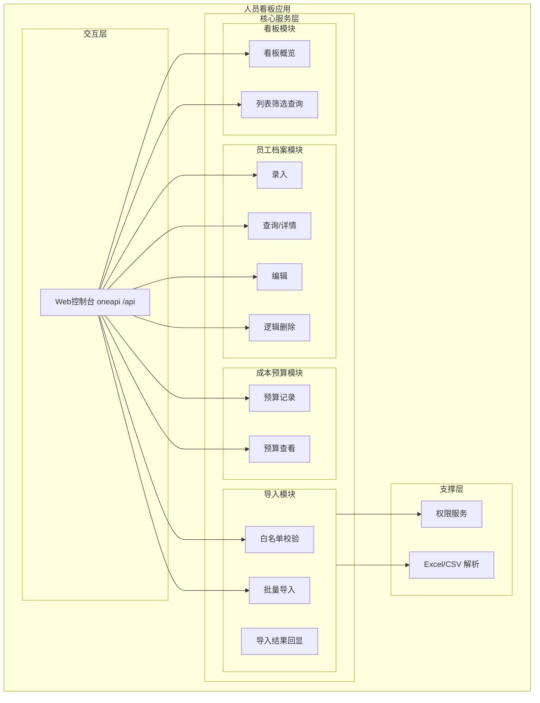

### 2.2 模块清单

| 模块 | 职责 | 依赖 |
|------|------|------|
| 看板模块 | 人员看板概览、列表展示与多条件筛选 | 员工档案模块、成本预算模块 |
| 员工档案模块 | 员工基本信息录入、查询、编辑、逻辑删除 | 权限服务 |
| 成本预算模块 | 员工成本预算记录与查看 | 员工档案模块 |
| 导入模块 | 白名单校验、批量导入、导入结果回显 | 员工档案模块、文件解析器、白名单配置 |
| 支撑层（权限） | 登录态校验、垂直/水平权限校验 | 平台统一认证 |

### 2.3 应用集成架构

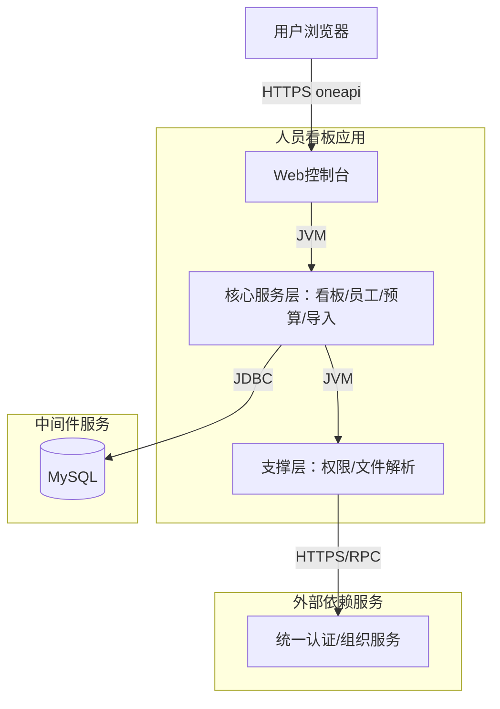

**集成关系说明：**

| 调用方 | 被调用方 | 协议 | 接口类型 | 说明 |
|--------|----------|------|----------|------|
| 用户浏览器 | Web 控制台 | HTTPS | oneapi REST | 看板/员工/预算/导入交互 |
| Web 控制台 | 核心服务层 | JVM | 内部调用 | Controller→Service |
| 核心服务层 | 统一认证/组织服务 | HTTPS/RPC | 集成接口 | 校验登录态、获取工号/部门等上下文 |
| 核心服务层 | MySQL | JDBC | SQL | 员工、预算、白名单、导入任务持久化 |

### 2.4 部署架构

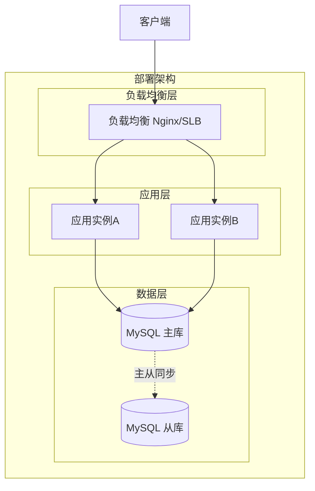

**部署说明：**
- **负载均衡层**：Nginx/SLB，HTTPS 终结，健康检查。
- **应用层**：无状态服务，≥2 副本，支持滚动发布与灰度。
- **数据层**：MySQL 主从（读写分离可选），员工/预算表读写均落主库，报表/列表查询可走从库（如需）。

---

## 3. 数据模型与存储

### 3.1 实体清单

| 实体名称 | 实体说明 | 所属模块 | 与其他实体的关系 |
|----------|----------|----------|-----------------|
| employee（员工档案） | 员工基本信息主表 | 员工档案模块 | 一对多：一名员工可有多条成本预算（budget_record） |
| budget_record（成本预算） | 员工成本预算记录 | 成本预算模块 | 多对一：每条预算属于一名员工 |
| import_whitelist（导入白名单） | 允许导入的白名单配置 | 导入模块 | 独立配置，按外部键（如工号/身份证号）校验员工 |
| import_task（导入任务） | 批量导入任务及结果摘要 | 导入模块 | 一对多：一次导入任务包含多条明细 import_detail |
| import_detail（导入明细） | 导入行级别明细与错误信息 | 导入模块 | 多对一：每条明细属于一个导入任务 |

### 3.2 实体关系图

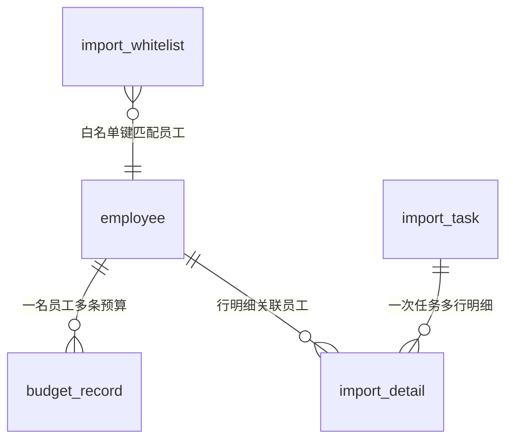

**模型说明：**
- 员工与预算为 1:N，预算以「员工 × 预算年份」唯一（uk 约束）。
- 导入任务与明细为 1:N，明细记录每行解析/校验结果，错误行状态标记并可回显。
- 白名单独立维护，导入校验时按工号/证件号/邮箱等白名单键匹配。

---

## 4. 接口设计

### 4.1 oneapi（Web 控制台接口）

| 编号 | 接口名称 | 方法 | 路径 | 模块 |
|------|----------|------|------|------|
| W01 | 看板概览查询 | GET | /api/person-board/overview | 看板模块 |
| W02 | 员工列表分页查询 | GET | /api/person-board/employees | 员工档案模块 |
| W03 | 员工详情查询 | GET | /api/person-board/employees/{id} | 员工档案模块 |
| W04 | 员工新增 | POST | /api/person-board/employees | 员工档案模块 |
| W05 | 员工编辑 | PUT | /api/person-board/employees/{id} | 员工档案模块 |
| W06 | 员工逻辑删除 | DELETE | /api/person-board/employees/{id} | 员工档案模块 |
| W07 | 成本预算新增/更新 | POST | /api/person-board/employees/{id}/budget | 成本预算模块 |
| W08 | 成本预算查询 | GET | /api/person-board/employees/{id}/budgets | 成本预算模块 |
| W09 | 白名单校验 | POST | /api/person-board/import/whitelist-check | 导入模块 |
| W10 | 批量导入（上传解析） | POST | /api/person-board/import/batch | 导入模块 |
| W11 | 导入结果查询 | GET | /api/person-board/import/task/{taskId} | 导入模块 |
| W12 | 导入模板下载 | GET | /api/person-board/import/template | 导入模块 |

### 4.2 OpenAPI（对外接口）

本项不适用，原因：当前需求为内部 Web 控制台看板，无对外 OpenAPI 集成需求；若后续需向外部系统开放，再扩展 /openapi 前缀接口。

### 4.3 内部接口（Service 层）

| 编号 | 接口名称 | 类 | 方法签名 |
|------|----------|------|----------|
| S01 | 员工分页查询 | EmployeeService | PageResult<EmployeeVO> pageEmployees(EmployeeQuery, Page) |
| S02 | 员工新增 | EmployeeService | Long createEmployee(EmployeeDTO) |
| S03 | 员工编辑 | EmployeeService | void updateEmployee(Long id, EmployeeDTO) |
| S04 | 员工逻辑删除 | EmployeeService | void deleteEmployee(Long id, String operator) |
| S05 | 成本预算保存 | BudgetService | void saveBudget(Long employeeId, BudgetDTO) |
| S06 | 白名单校验 | ImportService | WhitelistCheckResult checkWhitelist(ImportRow) |
| S07 | 批量导入 | ImportService | Long batchImport(ImportFile) |

### 4.4 集成接口（Integration 层）

本项本模块仅依赖统一认证/组织外部服务：

| 编号 | 接口名称 | 类 | 方法签名 | 说明 |
|------|----------|------|----------|------|
| I01 | 获取当前登录人上下文 | AuthClient | UserContext getCurrentUser() | 登录态 + 垂直权限 |
| I02 | 查询组织/部门 | OrgClient | DeptInfo getDeptByCode(String) | 导入时校验证件/部门有效性（可选） |

---

## 5. 功能模块设计

> 全局约定：错误码格式 `{MODULE}_{SEQ}`（如 EMP_001）；出参统一 `{code, msg, data}`。

### 5.1 员工档案模块

#### 5.1.1 表结构设计

##### 5.1.1.1 employee（员工档案表）

| 字段名 | 数据类型 | 约束 | 默认值 | 说明 |
|--------|----------|------|--------|------|
| id | bigint | PK, 自增 | - | 主键 |
| tenant_id | varchar(32) | NOT NULL | '' | 租户标识 |
| emp_no | varchar(64) | NOT NULL | '' | 工号 |
| name | varchar(64) | NOT NULL | '' | 姓名 |
| name_cipher | varchar(256) | NOT NULL | '' | 姓名加密/哈希值（脱敏存储可选） |
| id_card_no | varchar(64) | NOT NULL | '' | 身份证号（加密存储） |
| mobile | varchar(32) | NOT NULL | '' | 手机号（加密存储） |
| email | varchar(128) | NULL | NULL | 邮箱 |
| dept_code | varchar(64) | NULL | NULL | 部门编码 |
| dept_name | varchar(128) | NULL | NULL | 部门名称（冗余） |
| person_type | varchar(32) | NULL | NULL | 人员类型 |
| person_level | varchar(32) | NULL | NULL | 人员级别 |
| status | varchar(16) | NOT NULL | 'ACTIVE' | 状态（ACTIVE/DISABLED） |
| is_deleted | tinyint | NOT NULL | 0 | 逻辑删除标记（0/1） |
| version | int | NOT NULL | 0 | 乐观锁版本号（编辑时递增） |
| gmt_create | datetime | NOT NULL | CURRENT_TIMESTAMP | 创建时间 |
| gmt_modified | datetime | NOT NULL | CURRENT_TIMESTAMP | 修改时间 |

**索引：**
- UK: `uk_employee_emp_no`（tenant_id, emp_no）
- IDX: `idx_employee_name`（name）、`idx_employee_dept`（dept_code）、`idx_employee_status`（status, is_deleted）

##### 5.1.1.2 枚举与常量定义

| 枚举名称 | 取值 | 含义 | 关联字段 |
|----------|------|------|----------|
| EmployeeStatus | ACTIVE / DISABLED | 在职/停用 | employee.status |
| DeleteFlag | 0 / 1 | 未删除/已删除 | employee.is_deleted |

#### 5.1.2 接口详细设计

##### W02 员工列表分页查询（F03 列表）

- **URI**: GET /api/person-board/employees
- **描述**: 按条件分页查询员工列表
- **入参**:

| 参数名称 | 类型 | 是否必填 | 描述 |
|----------|------|----------|------|
| keyword | String | 否 | 姓名/工号模糊匹配 |
| deptCode | String | 否 | 部门编码筛选 |
| personType | String | 否 | 人员类型筛选 |
| pageNo | Integer | 否（默认1） | 页码 |
| pageSize | Integer | 否（默认20，上限100） | 每页条数 |

- **出参**:

| 参数名称 | 类型 | 描述 |
|----------|------|------|
| code | String | 结果码 |
| msg | String | 提示信息 |
| data | Object | 分页数据（records/total/pageNo/pageSize） |

- **错误码**: EMP_001（参数非法）、AUTH_001（未登录）、AUTH_002（无权限）

- **业务规则**: 默认排除 is_deleted=1 的记录；敏感字段（身份证/手机号）脱敏返回。

##### W03 员工详情查询（F03 详情）

- **URI**: GET /api/person-board/employees/{id}
- **描述**: 查询单个员工完整档案，并附带最近年度成本预算摘要
- **入参**:

| 参数名称 | 类型 | 是否必填 | 描述 |
|----------|------|----------|------|
| id | Long | 是 | 员工ID（path 参数） |

- **出参**:

| 参数名称 | 类型 | 描述 |
|----------|------|------|
| code | String | 结果码 |
| msg | String | 提示信息 |
| data | Object | 员工档案（敏感字段脱敏）+ latestBudget（最近年度预算摘要） |

- **错误码**: EMP_005（员工不存在或已删除）、AUTH_001（未登录）、AUTH_002（无权限）
- **业务规则**: 查询范围受水平权限约束（租户 + 部门数据范围）；is_deleted=1 视为不存在返回 EMP_005；身份证号/手机号脱敏返回。

##### W04 员工新增（F02）

- **URI**: POST /api/person-board/employees
- **描述**: 新增员工基本信息
- **入参**（EmployeeDTO）:

| 参数名称 | 类型 | 是否必填 | 描述 |
|----------|------|----------|------|
| empNo | String | 是 | 工号 |
| name | String | 是 | 姓名 |
| idCardNo | String | 否 | 身份证号 |
| mobile | String | 否 | 手机号 |
| email | String | 否 | 邮箱 |
| deptCode | String | 否 | 部门编码 |
| personType | String | 否 | 人员类型 |
| personLevel | String | 否 | 人员级别 |

- **出参**: `{code, msg, data:{id}}`
- **错误码**: EMP_001 参数非法、EMP_002 工号重复、AUTH_002 无权限
- **业务规则**: 工号唯一性校验；敏感字段加密后存储。

##### W05 员工编辑 / W06 员工逻辑删除（F04 / F05）

- W05 PUT `/api/person-board/employees/{id}`：更新基本信息，乐观锁防并发覆盖。
- W06 DELETE `/api/person-board/employees/{id}`：将 is_deleted 置 1，不物理删除；删除前校验未被「在用预算」关联锁定（如需）。

#### 5.1.3 子功能详细设计

##### 5.1.3.1 员工新增（F02）

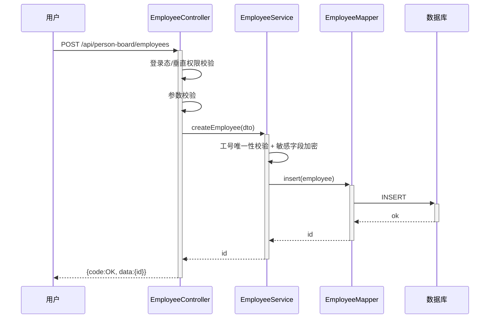

**业务规则：**

| 规则编号 | 规则描述 | 校验时机 | 不满足时的处理 |
|----------|----------|----------|--------------|
| R01 | 工号在租户内唯一 | 创建/编辑时 | 返回 EMP_002「工号已存在」 |
| R02 | 身份证号/手机号格式校验 | 创建/编辑时 | 返回 EMP_003「字段格式非法」 |
| R03 | 删除时员工无未结成本预算锁定 | 删除前 | 返回 EMP_004「存在在用预算，不可删除」 |

**异常场景：** 工号重复、参数非法、未登录、无权限、数据库写入失败（事务回滚）。

**并发控制：** 同一员工被多人同时编辑 → 乐观锁 version 字段 + `gmt_modified` 条件更新；工号唯一由 uk 索引兜底。

##### 5.1.3.2 员工编辑与逻辑删除（F04 / F05）

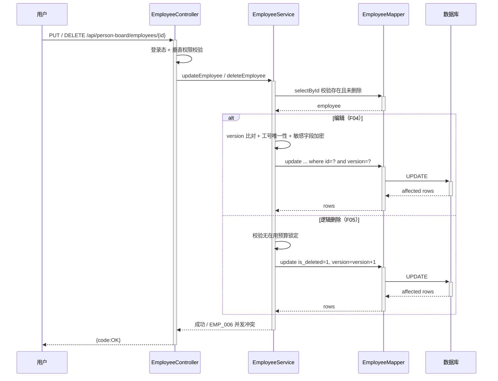

**业务规则：**

| 规则编号 | 规则描述 | 校验时机 | 不满足时的处理 |
|----------|----------|----------|--------------|
| R08 | 编辑必须以客户端持有的 version 作为条件 | 编辑落库前 | affected rows=0 → 返回 EMP_006「数据已被他人修改」 |
| R09 | 编辑时工号同样需满足租户内唯一 | 编辑落库前 | 返回 EMP_002「工号已存在」 |
| R10 | 已被逻辑删除的员工不可再编辑/删除 | 操作前 | 返回 EMP_005「员工不存在」 |

**异常场景：** 并发覆盖（乐观锁冲突）、工号冲突、员工不存在、无权限、数据库写失败（事务回滚）。

**并发控制：** 以 `version` 字段做 CAS 更新，冲突时提示刷新后重试；删除与编辑互斥，删除成功后编辑自然失败。

**状态机设计（员工状态 status）：**

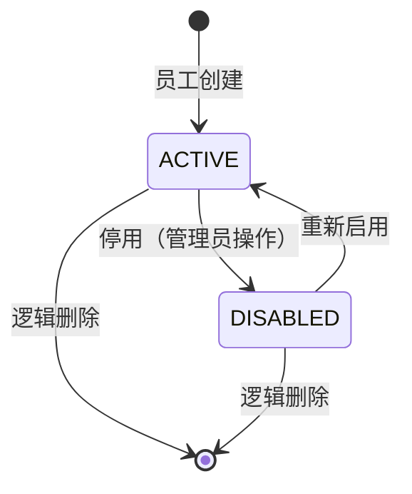

**状态流转规则：**

| 当前状态 | 目标状态 | 流转条件 | 前置校验 | 触发动作 |
|----------|----------|----------|----------|----------|
| ACTIVE | DISABLED | 管理员停用 | 有垂直权限 | 更新 status |
| DISABLED | ACTIVE | 管理员启用 | 有垂直权限 | 更新 status |
| ACTIVE | 删除 | 逻辑删除 | 无在用预算 | is_deleted=1 |
| DISABLED | 删除 | 逻辑删除 | 无在用预算 | is_deleted=1 |

### 5.2 成本预算模块

#### 5.2.1 表结构设计

##### 5.2.1.1 budget_record（成本预算表）

| 字段名 | 数据类型 | 约束 | 默认值 | 说明 |
|--------|----------|------|--------|------|
| id | bigint | PK, 自增 | - | 主键 |
| tenant_id | varchar(32) | NOT NULL | '' | 租户标识 |
| employee_id | bigint | NOT NULL | - | 员工ID |
| budget_year | varchar(8) | NOT NULL | '' | 预算年份（如 2026） |
| amount | decimal(18,2) | NOT NULL | 0.00 | 预算金额 |
| currency | varchar(8) | NOT NULL | 'CNY' | 币种 |
| budget_scope | varchar(64) | NULL | NULL | 成本口径说明 |
| remark | varchar(256) | NULL | NULL | 备注 |
| gmt_create | datetime | NOT NULL | CURRENT_TIMESTAMP | 创建时间 |
| gmt_modified | datetime | NOT NULL | CURRENT_TIMESTAMP | 修改时间 |

**索引：**
- UK: `uk_budget_employee_year`（tenant_id, employee_id, budget_year）
- IDX: `idx_budget_employee`（employee_id）

##### 5.2.1.2 枚举与常量定义

| 枚举名称 | 取值 | 含义 | 关联字段 |
|----------|------|------|----------|
| Currency | CNY / USD / EUR | 币种 | budget_record.currency |

#### 5.2.2 接口详细设计

##### W07 成本预算新增/更新

- **URI**: POST /api/person-board/employees/{id}/budget
- **描述**: 按「员工 × 年份」保存成本预算（存在则更新）
- **入参**:

| 参数名称 | 类型 | 是否必填 | 描述 |
|----------|------|----------|------|
| budgetYear | String | 是 | 预算年份 |
| amount | Decimal | 是 | 预算金额 |
| currency | String | 否（默认CNY） | 币种 |
| budgetScope | String | 否 | 成本口径说明 |
| remark | String | 否 | 备注 |

- **出参**: `{code, msg, data:{id}}`
- **错误码**: BUDGET_001 参数非法、BUDGET_002 金额非法、BUDGET_003 年份非法

##### W08 成本预算查询

- **URI**: GET /api/person-board/employees/{id}/budgets
- **入参**: path 参数 id
- **出参**: `{code, msg, data:[{budgetYear, amount, currency, budgetScope, remark}]}`

#### 5.2.3 子功能详细设计

##### 5.2.3.1 成本预算记录（F06）

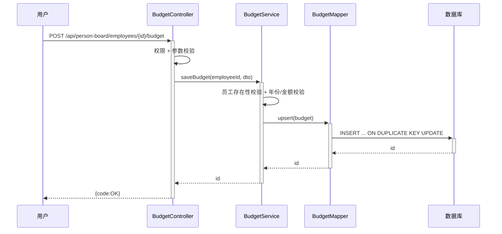

**业务规则：** 每位员工同一年度仅一条预算，金额非负；同年份重复提交走更新（upsert）。

**异常场景：** 员工不存在（EMP_005）、金额非法、年份格式错误。

**并发控制：** upsert 由 uk（tenant_id, employee_id, budget_year）保证幂等，避免重复插入。

### 5.3 导入模块

#### 5.3.1 表结构设计

##### 5.3.1.1 import_whitelist（导入白名单）

| 字段名 | 数据类型 | 约束 | 默认值 | 说明 |
|--------|----------|------|--------|------|
| id | bigint | PK, 自增 | - | 主键 |
| tenant_id | varchar(32) | NOT NULL | '' | 租户标识 |
| match_key | varchar(64) | NOT NULL | '' | 白名单键（工号/证件号） |
| key_type | varchar(16) | NOT NULL | '' | 键类型（EMP_NO/ID_CARD/EMAIL） |
| remark | varchar(128) | NULL | NULL | 备注 |
| gmt_create | datetime | NOT NULL | CURRENT_TIMESTAMP | 创建时间 |
| gmt_modified | datetime | NOT NULL | CURRENT_TIMESTAMP | 修改时间 |

**索引：** UK `uk_whitelist_key`（tenant_id, key_type, match_key）

##### 5.3.1.2 import_task（导入任务）

| 字段名 | 数据类型 | 约束 | 默认值 | 说明 |
|--------|----------|------|--------|------|
| id | bigint | PK, 自增 | - | 主键 |
| tenant_id | varchar(32) | NOT NULL | '' | 租户标识 |
| file_name | varchar(256) | NULL | NULL | 原始文件名 |
| total_count | int | NOT NULL | 0 | 总行数 |
| success_count | int | NOT NULL | 0 | 成功行数 |
| fail_count | int | NOT NULL | 0 | 失败行数 |
| status | varchar(16) | NOT NULL | 'PENDING' | PENDING/RUNNING/SUCCESS/PARTIAL/FAILED |
| operator | varchar(64) | NULL | NULL | 操作人 |
| file_md5 | varchar(64) | NULL | NULL | 文件内容摘要（幂等键） |
| gmt_create | datetime | NOT NULL | CURRENT_TIMESTAMP | 创建时间 |
| gmt_modified | datetime | NOT NULL | CURRENT_TIMESTAMP | 修改时间 |

**索引：** IDX `idx_import_task_md5`（tenant_id, file_md5）

##### 5.3.1.3 import_detail（导入明细）

| 字段名 | 数据类型 | 约束 | 默认值 | 说明 |
|--------|----------|------|--------|------|
| id | bigint | PK, 自增 | - | 主键 |
| task_id | bigint | NOT NULL | - | 导入任务ID |
| row_no | int | NOT NULL | - | 行号 |
| raw_data | text | NULL | NULL | 原始行数据（脱敏） |
| result | varchar(16) | NOT NULL | 'PENDING' | PENDING/SUCCESS/FAILED |
| error_msg | varchar(512) | NULL | NULL | 错误信息 |
| employee_id | bigint | NULL | NULL | 落地后员工ID |
| gmt_create | datetime | NOT NULL | CURRENT_TIMESTAMP | 创建时间 |

**索引：** IDX `idx_import_detail_task`（task_id）

##### 5.3.1.4 枚举与常量定义

| 枚举名称 | 取值 | 含义 | 关联字段 |
|----------|------|------|----------|
| ImportTaskStatus | PENDING / RUNNING / SUCCESS / PARTIAL / FAILED | 待执行/执行中/全成功/部分成功/失败 | import_task.status |
| ImportRowResult | PENDING / SUCCESS / FAILED | 行待处理/行成功/行失败 | import_detail.result |
| WhitelistKeyType | EMP_NO / ID_CARD / EMAIL | 白名单键类型：工号/身份证号/邮箱 | import_whitelist.key_type |

#### 5.3.2 接口详细设计

##### W09 白名单校验（F07）

- **URI**: POST /api/person-board/import/whitelist-check
- **描述**: 对待导入员工进行白名单校验
- **入参**:

| 参数名称 | 类型 | 是否必填 | 描述 |
|----------|------|----------|------|
| empNo | String | 否 | 工号 |
| idCardNo | String | 否 | 身份证号 |
| email | String | 否 | 邮箱 |

- **出参**: `{code, msg, data:{hit:true/false, matchKey, keyType}}`
- **错误码**: IMP_001 校验键为空

##### W10 批量导入（F08）

- **URI**: POST /api/person-board/import/batch
- **描述**: 上传 Excel/CSV 批量导入员工及成本预算
- **入参**: multipart 文件（file）
- **出参**: `{code, msg, data:{taskId, totalCount}}`
- **业务规则**: 单文件 ≤ 10MB、行数 ≤ 10000；逐行白名单校验 + 字段校验；错误行记录明细不整体回滚。

##### W11 导入结果查询 / W12 模板下载

- W11 GET `/api/person-board/import/task/{taskId}`：返回 total/success/fail 与明细（含错误行）。
- W12 GET `/api/person-board/import/template`：下载标准导入模板（按 A06 假设 Excel）。

#### 5.3.3 子功能详细设计

##### 5.3.3.1 批量导入（F08）

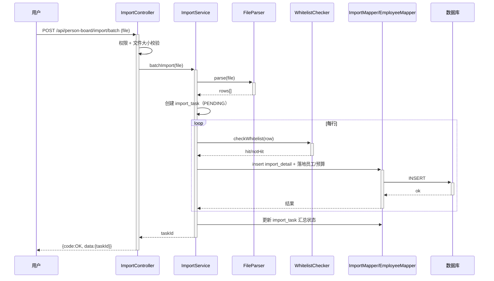

**业务规则：**

| 规则编号 | 规则描述 | 校验时机 | 不满足时的处理 |
|----------|----------|----------|--------------|
| R04 | 文件大小 ≤ 10MB、行数 ≤ 10000 | 解析前 | 返回 IMP_002「文件过大」 |
| R05 | 每行员工必须命中白名单 | 每行落地前 | 该行标记 FAILED，记录 IMP_003「未命中白名单」 |
| R06 | 必填字段缺失/格式非法 | 每行落地前 | 该行标记 FAILED，记录具体错误 |
| R07 | 工号与已有档案冲突 | 每行落地前 | 按策略：更新（upsert）或跳过，默认更新 |

**异常场景：** 文件损坏/格式错误、单行非法、白名单未命中、超行数限制、部分行写入失败（逐行事务，不影响其它行）。

**并发控制：** 同一租户重复提交同一文件 → 以 `file_md5` 作为幂等键，命中 24 小时内同摘要的成功/执行中任务时直接复用已有 taskId（索引 `idx_import_task_md5` 加速判定，不做唯一约束以免阻断人工重跑）；行级独立事务，支持断点续解析。

**状态机设计（import_task.status）：**

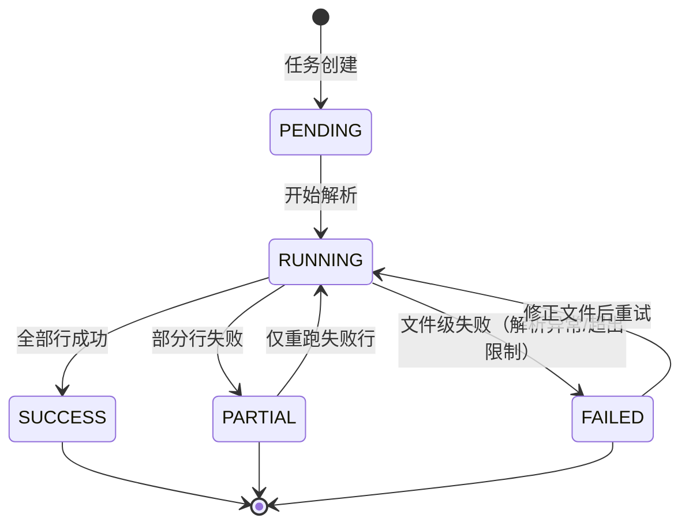

**状态流转规则：**

| 当前状态 | 目标状态 | 流转条件 | 前置校验 | 触发动作 |
|----------|----------|----------|----------|----------|
| PENDING | RUNNING | 解析线程获取任务 | 任务属于当前租户 | 更新 status + 开始逐行处理 |
| RUNNING | SUCCESS | fail_count=0 | 全部行处理完成 | 回填 success_count |
| RUNNING | PARTIAL | fail_count>0 且 success_count>0 | 全部行处理完成 | 回填成功/失败计数 |
| RUNNING | FAILED | 文件损坏/超限/解析中断 | 文件级异常 | 记录错误并终止 |
| PARTIAL | RUNNING | 用户选择重跑失败行 | 原任务可读、明细完整 | 重置失败明细为 PENDING |
| FAILED | RUNNING | 用户重新上传并重试 | 新文件通过大小/格式校验 | 生成新任务或复用原任务 |

### 5.4 看板模块

#### 5.4.1 数据与查询说明

看板模块不新增实体，只做 employee 与 budget_record 的只读聚合（人数、部门分布、预算合计、预算覆盖率），因此无独立表结构与状态机。

| 聚合指标 | 数据来源 | 口径 |
|----------|----------|------|
| 员工总数 / 在职数 / 停用数 | employee.status、is_deleted | 默认排除 is_deleted=1 |
| 部门人数分布 | employee.dept_code、dept_name | 按部门分组计数，Top N + 其他 |
| 预算合计 / 覆盖人数 | budget_record.amount、budget_year | 指定年度汇总，仅统计未删除员工 |
| 预算覆盖率 | 有预算员工数 ÷ 应统计员工数 | 用于识别未录预算人员 |

#### 5.4.2 接口详细设计

##### W01 看板概览查询（F01）

- **URI**: GET /api/person-board/overview
- **描述**: 返回看板首屏概览指标与列表卡片数据
- **入参**:

| 参数名称 | 类型 | 是否必填 | 描述 |
|----------|------|----------|------|
| budgetYear | String | 否（默认当前年） | 预算统计年度 |
| deptCode | String | 否 | 指定部门，空表示全部可见部门 |
| pageNo | Integer | 否（默认1） | 卡片列表页码 |
| pageSize | Integer | 否（默认20，上限100） | 卡片列表每页条数 |

- **出参**:

| 参数名称 | 类型 | 描述 |
|----------|------|------|
| code | String | 结果码 |
| msg | String | 提示信息 |
| data | Object | summary（总人数/在职/停用/预算合计/覆盖率）+ deptDistribution + cards（分页员工卡片） |

- **错误码**: BOARD_001（年度格式非法）、AUTH_001（未登录）、AUTH_002（无权限）
- **业务规则**: 数据范围按当前登录人可见部门过滤；敏感字段脱敏；卡片仅返回姓名、工号、部门、人员类型、级别、当年预算。

#### 5.4.3 子功能详细设计

##### 5.4.3.1 看板概览与筛选（F01）

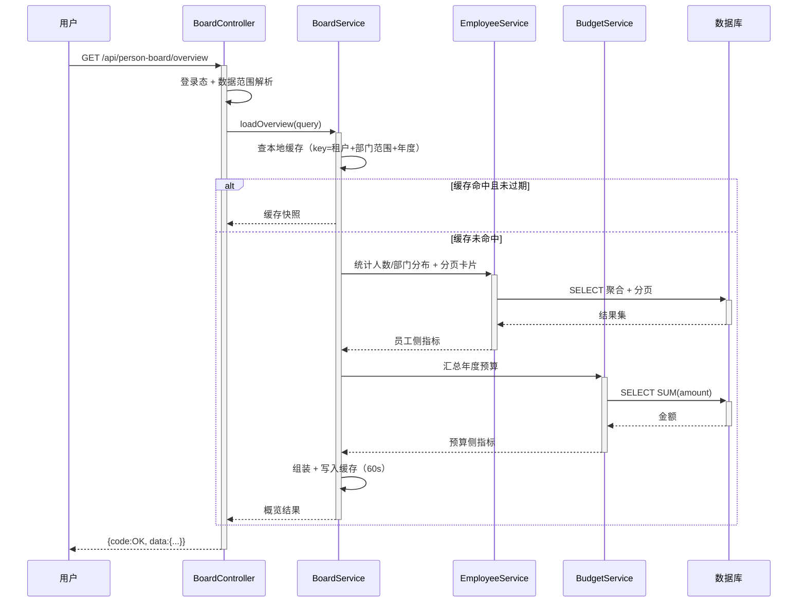

**业务规则：**

| 规则编号 | 规则描述 | 校验时机 | 不满足时的处理 |
|----------|----------|----------|--------------|
| R11 | 概览只统计未逻辑删除员工 | 聚合查询时 | 隐式过滤，无需提示 |
| R12 | 预算合计仅取指定年度、且员工未删除 | 聚合查询时 | 年度缺失按 0 计 |
| R13 | 数据范围不得超过登录人可见部门 | 查询前 | 越权部门参数直接忽略并记录审计日志 |

**异常场景：** 年度参数非法（BOARD_001）、无权限（AUTH_002）、预算汇总超时（降级为仅展示人数，预算字段返回 null 并提示）。

**并发控制：** 只读接口无并发写风险；缓存采用短 TTL（60s）+ 单飞（同一 key 只允许一个回源请求），避免批量刷新击穿数据库。

### 5.5 技术选型与模块自检

#### 5.5.1 技术选型对比

| 决策项 | 方案A | 方案B | 备选C | 推荐 | 理由 |
|--------|-------|-------|-------|------|------|
| 看板概览取数 | 实时聚合查询（JOIN + GROUP BY） | 预计算汇总表定时刷新 | 引入 OLAP/搜索集群 | 方案A + 60s 本地缓存 | 数据量级为单租户万级员工，实时聚合足够；汇总表带来一致性与维护成本，OLAP 属过度设计 |
| Excel 解析 | EasyExcel 流式读取 | Apache POI 全量载入内存 | 上传后异步队列解析 | EasyExcel 流式 + 同步返回 taskId | 单文件 ≤10MB/1 万行，流式内存占用可控；引入 MQ 会增加部署与运维面 |
| 白名单匹配 | 每次查库 | 本地缓存 + 定时刷新 | Redis 集中缓存 | 本地缓存 + 定时刷新（5min） | 白名单变更低频、数据量小；避免为单一场景引入 Redis 依赖 |
| 员工删除语义 | 物理删除 | 逻辑删除 | 归档表迁移 | 逻辑删除（is_deleted） | 保留追溯与误删恢复能力，导入/预算外键关系不被破坏 |

#### 5.5.2 完备性对账表（F 编号 → 设计）

| 需求编号 | 功能点 | 模块 | 设计小节 | 接口 | 表/存储 |
|----------|--------|------|----------|------|---------|
| F01 | 人员看板入口与概览展示 | 看板模块 | 5.4.3.1 | W01 | employee、budget_record（只读聚合） |
| F02 | 员工基本信息录入 | 员工档案模块 | 5.1.3.1 | W04 | employee |
| F03 | 员工基本信息查询（列表/详情） | 员工档案模块 | 5.1.2 W02/W03 | W02、W03 | employee |
| F04 | 员工基本信息编辑 | 员工档案模块 | 5.1.3.2 | W05 | employee |
| F05 | 员工基本信息删除 | 员工档案模块 | 5.1.3.2 | W06 | employee（is_deleted） |
| F06 | 成本预算记录与维护 | 成本预算模块 | 5.2.3.1 | W07、W08 | budget_record |
| F07 | 白名单导入 | 导入模块 | 5.3.2 W09 | W09 | import_whitelist |
| F08 | 批量导入 | 导入模块 | 5.3.3.1 | W10、W11、W12 | import_task、import_detail |

#### 5.5.3 过度设计检查

| 候选能力 | 是否引入 | 结论与原因 |
|----------|----------|------------|
| 消息队列（异步导入） | 否 | 单文件 ≤1 万行，同步解析 + 行级事务可满足；引入 MQ 增加部署与重试复杂度 |
| 分库分表 | 否 | 单租户万级员工、年度预算量级小，单库可支撑 |
| 独立搜索/OLAP 集群 | 否 | 看板筛选为结构化条件，MySQL 索引 + 分页足够 |
| 工作流引擎（审批流） | 否 | 本需求无审批环节，白名单为配置数据 |
| 多级缓存（Redis + 本地） | 否 | 仅概览短缓存与白名单本地缓存，规模不需要 Redis |

---

## 6. 非功能性需求设计

### 6.1 高可用性
- 应用无状态多副本部署，任意实例故障由 LB 摘除。
- 统一认证/组织服务不可用时降级：仅影响白名单人员上下文补充，本地已缓存字典数据仍可读看板列表。

### 6.2 可扩展性
- 模块职责单一，看板/员工/预算/导入均独立 Service，可水平扩展应用实例。
- 文件解析器抽象为可插拔，未来可扩展 CSV/自定义模板。
- 报表类查询预留读写分离能力。

### 6.3 稳定性/可靠性
- 批量导入采用行级事务 + 异步任务，避免长事务与单点阻塞。
- 金额字段统一 decimal，禁止浮点运算。
- 列表查询分页 + 索引（emp_no/name/dept/status）。

### 6.4 安全性设计

#### 6.4.1 账户系统方案
复用平台统一认证（假设 A01），本模块不自实现登录/注册/找回。

#### 6.4.2 授权与访问控制
- **水平权限**：接口查询/操作均按当前登录人可访问的数据范围（默认租户隔离 tenant_id + 部门范围）过滤。
- **垂直权限**：删除/预算维护/导入等管理操作接入角色权限配置。
- **登录态**：全局拦截器统一校验，未登录/无权限返回 AUTH_001/AUTH_002。

#### 6.4.3 数据防护方案
- **加密存储**：身份证号、手机号等敏感字段加密/哈希存储（employee.name_cipher/id_card_no/mobile 等）。
- **展示脱敏**：列表/详情对姓名、身份证、手机号部分打码；日志输出脱敏。

### 6.5 监控/统计/日志/告警
- 接口调用埋点（接口名、操作人、耗时、结果状态）。
- 批量导入任务成功率、失败行数埋点。
- 慢 SQL 与异常率告警。

---

## 7. 变更三板斧

### 7.1 可监控
- 看板概览、员工 CRUD、预算保存、导入接口分别埋点（调用次数/成功率/耗时/P99）。
- 导入任务漏斗：提交数/白名单命中数/落地成功数/失败分布。

### 7.2 可灰度
- 应用按实例/租户灰度引流：先小流量租户验证导入与预算逻辑，再全量。
- 若不可灰度（如单部署），按租户开关放量，并保留回滚能力。

### 7.3 可应急
- 导入开关：关闭批量导入入口，仅保留查询（配置开关 import.enabled）。
- 白名单联调异常时，降级为「手工录入白名单」兜底。
- 整体回滚：发布包版本回退，数据库仅新增表，无破坏性变更，回退无上下游兼容问题（见检查项）。

---

## 8. 方案检查（Step 9 checklist）

| 检查项 | 结果 | 说明 |
|--------|------|------|
| 模块划分合理性检查 | 通过 | 看板/员工/预算/导入单一职责，无循环依赖 |
| 依赖关系合理性 | 通过 | 外部认证挂掉时看板查询可降级读缓存 |
| 单点问题检查（部署层面） | 通过 | 多副本 + LB，无单点 |
| 表模型设计范式检查 | 通过 | 满足 3NF，部门名称冗余属可控冗余 |
| 隐私安全检查 | 通过 | 身份证/手机号加密存储 + 展示脱敏 |
| 兼容性检查（接口） | 通过 | 本次为新增接口，不影响旧调用方 |
| 兼容性检查（表） | 通过 | 均为新增表，无旧表变更 |
| 数据迁移检查 | 通过 | 新增表无需迁移；导入模板为静态文件 |
| 一致性检查（功能点） | 通过 | F01~F08 与 5.5.2 对账表逐条对应：F01→5.4、F02~F05→5.1、F06→5.2、F07~F08→5.3 |
| 一致性检查（表） | 通过 | Step 3 实体均有 Step 5 表结构 |
| 一致性检查（接口） | 通过 | W01~W12 均在 5.1~5.4 有详细定义（W01→5.4.2、W03→5.1.2、W09/W10→5.3.2） |
| 一致性检查（枚举） | 通过 | status/currency/is_deleted 枚举与表一致 |
| 状态机完整性检查 | 通过 | employee.status、import_task.status 均有状态机与流转规则表，无孤岛状态 |
| 并发风险检查 | 通过 | 员工编辑乐观锁、预算 upsert、导入幂等键 |
| 单点问题检查（定时任务层面） | 不适用 | 本模块无常驻定时任务 |
| 非功能性设计可行性检查 | 通过 | 均为常规容器化 + MySQL 可落地 |
| 变更三板斧设计可行性检查（可监控） | 通过 | 埋点方案可落地 |
| 变更三板斧设计可行性检查（可灰度） | 通过 | 租户/实例灰度 + 开关 |
| 变更三板斧设计可行性检查（可应急） | 通过 | 导入开关 + 版本回退，无破坏性变更 |

---

## 9. 仓间对齐点（跨仓协作）

| 对齐点 | 说明 | 影响仓 |
|--------|------|--------|
| 需求归属 | 本次「人员看板」为全新业务域，现有 testDj / testDJnew 均为空壳仓库，无既有架构可复用 | testDj、testDJnew |
| 落地仓建议 | 建议后端/接口归 testDj（或 testDJnew），前端归另一仓；本系分为方案级设计，实现阶段需按仓库分工落码 | testDj、testDJnew |
| 接口契约 | `/api/person-board/*`（W01~W12）为前后端对齐契约 | 前后端仓 |
| 数据链路 | employee → budget_record（1:N）、import_task → import_detail（1:N） | 后端仓 |
| 待确认 | 两仓现有代码为空壳，实际技术栈需在执行阶段由仓库 `pom.xml`/`package.json` 确定（本系分默认 SOFABoot + Bigfish，沿用团队规范假设） | testDj、testDJnew |