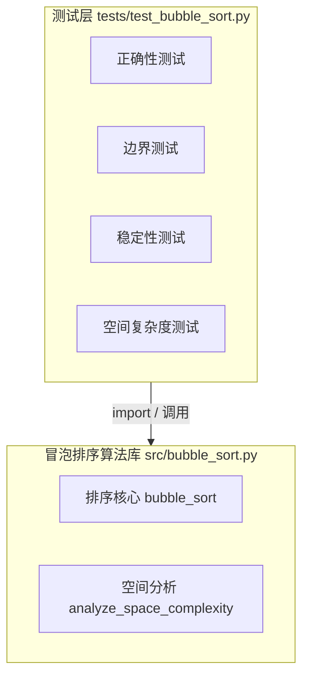
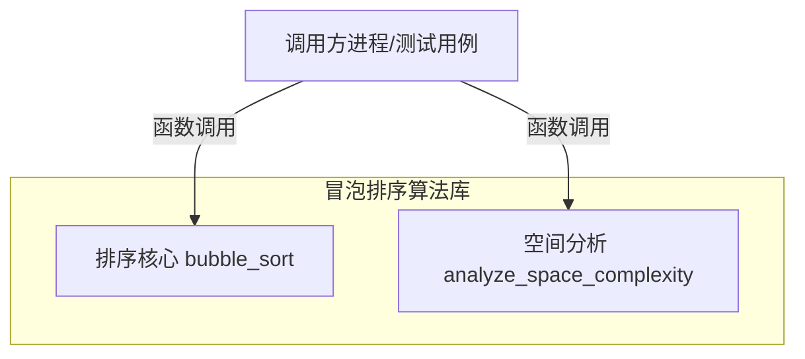
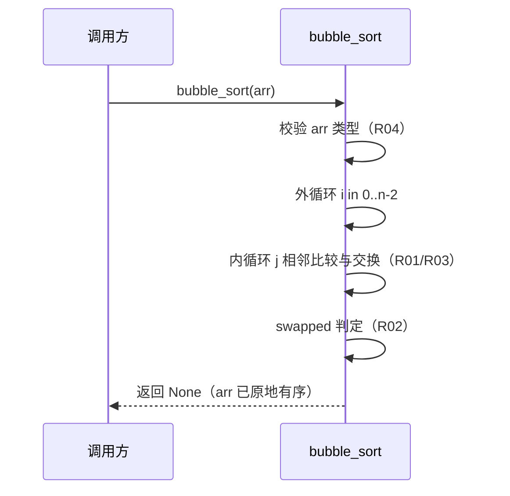
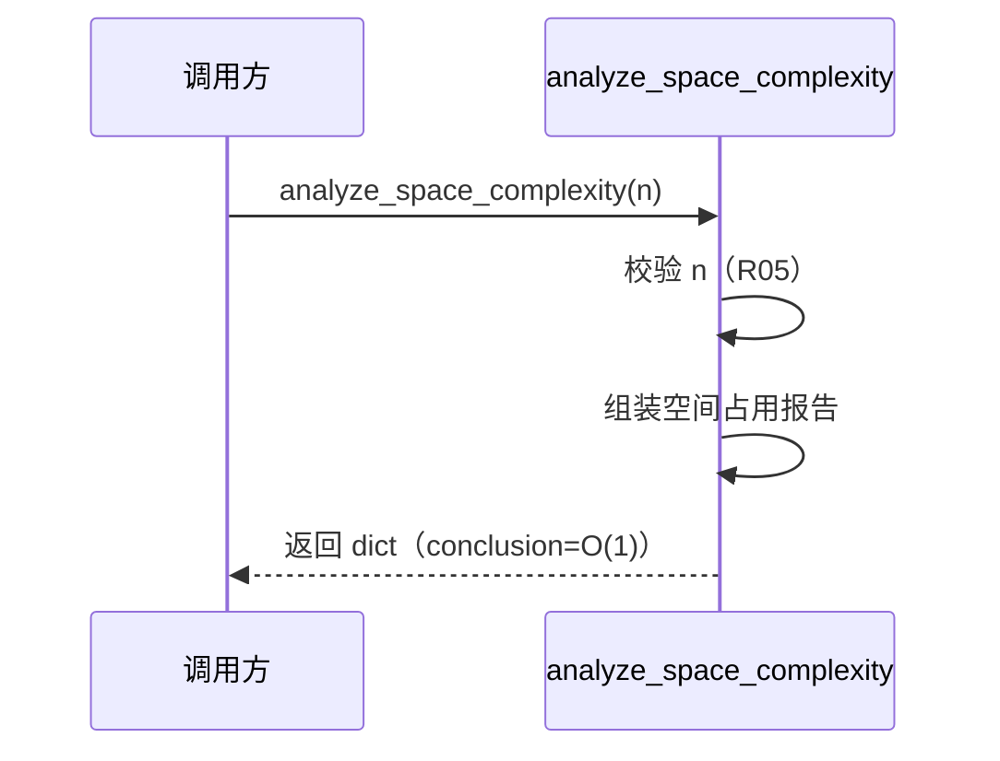

> **文档元信息**
>
> | 项目 | 内容 |
> |------|------|
> | 文档版本 | v1.0 |
> | 作者 | AiWork |
> | 创建日期 | 2026-10-22 |
> | 需求来源 | 需求「写个冒泡排序-空间」；前置方案 `docs/superpowers/specs/2026-10-22-bubble-sort-space-complexity-design.md` |
> | 评审状态 | 待评审 |

# 冒泡排序（空间复杂度重点）系分设计

## 1. 需求与范围

### 背景与目标
需求原文「写个冒泡排序-空间」经前一节点澄清：「空间」指**空间复杂度**。目标为产出一份聚焦**空间复杂度为 O(1)** 的冒泡排序方案设计：明确算法如何工作、时间/空间复杂度如何推导、以及为何是原地排序。

### 核心功能
- F01 对任意可比元素序列执行升序冒泡排序（原地修改）。
- F02 保证辅助空间复杂度为 O(1)（仅常量级临时变量，迭代实现，不分配与 n 成比例的辅助存储）。
- F03 稳定排序：相等元素不交换，保持相对顺序。
- F04 已有序时的提前退出优化（swapped 标志），使最好情况时间 O(n)。
- F05 对输入规模的空间占用提供可验证/可分析依据（空间占用不随 n 增长）。

### 约束与非功能要求
- 空间复杂度 O(1)，原地排序，迭代实现（严禁递归）。
- Python ≥ 3.9，测试框架 pytest，无第三方依赖。
- 稳定性要求：相等元素相对顺序不变。
- 正确性：输出升序且元素多重集不变；空/单元素安全返回。

### 排除范围
- 仅算法与复杂度分析方案，不含具体语言实现代码（代码在后续实现阶段落地）。
- 不实现并行/分布式排序，不实现数据持久化。

### 需求功能清单与优先级

| 编号 | 功能点 | 优先级 | 原始描述/章节 | 备注 |
|------|--------|--------|---------------|------|
| F01 | 原地升序冒泡排序 | P0 | 需求「写个冒泡排序」 | 核心入口 |
| F02 | O(1) 辅助空间 | P0 | 需求「-空间」，spec 3.1 | 本次重点 |
| F03 | 稳定性 | P1 | spec 4 节 | 相等元素不交换 |
| F04 | 提前退出优化 | P1 | spec 2.2 / 3.2 | 最好 O(n) |
| F05 | 空间占用可验证 | P2 | spec 5.3 / plan Task 3 | analyze_space_complexity |

### 假设与待确认项

| 编号 | 假设/待确认内容 | 当前假设 | 确认状态 |
|------|-----------------|----------|----------|
| A01 | 系统形态 | 单文件纯算法模块，非 Web/微服务 | 待确认 |
| A02 | 实现语言 | Python 3.9+ | 待确认 |
| A03 | 排序方向 | 升序 | 待确认 |
| A04 | 元素类型 | 任意可比类型 | 待确认 |
| A05 | 函数签名 | `bubble_sort(arr: list) -> None` | 待确认 |

## 2. 架构与模块

### 功能架构

本系统为单文件算法模块，无网络暴露、无持久化、无外部系统集成。按算法库分层组织：

- 核心服务层说明：`bubble_sort` 为排序核心，`analyze_space_complexity` 为空间分析辅助，二者相互独立。
- 测试层说明：对算法库单向依赖，覆盖正确性/边界/稳定性/空间复杂度。

**模块清单**

| 模块 | 职责 | 依赖 |
|------|------|------|
| bubble_sort | 对任意可比列表执行原地升序冒泡排序，O(1) 辅助空间 | 无 |
| analyze_space_complexity | 返回结构化空间占用报告，佐证 O(1) 结论 | 无 |
| 测试套件 | 验证正确性、边界、稳定性、空间复杂度 | bubble_sort, analyze_space_complexity |

### 应用集成架构

无外部系统。本系统为纯进程内函数调用，不产生网络或 IPC 集成关系。

**集成关系说明：** 仅存在调用方 → 算法库的进程内函数调用，无外部协议、无中间件。

### 部署架构

本模块为纯函数式 Python 算法库，随宿主应用进程部署，不独立部署，无中间件、无可单点组件。

**部署说明：** 算法库以源码模块形式被宿主进程 import，与宿主共同生命周期，无独立实例与数据层。无状态纯计算，天然可水平扩展。

## 3. 数据模型与存储

### 实体清单

本系统为纯算法模块，无持久化需求，不引入数据库、缓存或消息队列。排序过程直接在输入列表上原地完成，无新增实体。

| 实体名称 | 实体说明 | 所属模块 | 与其他实体的关系 |
|----------|----------|----------|-----------------|
| （无） | 纯函数算法，不产生业务实体 | — | — |

### 实体关系图

本项不适用，原因：无业务实体与持久化数据，不存在实体关系。

**模型说明：** 输入数据结构为可比的变长序列（Python list），由调用方传入，原地修改，不销毁不重建。无缓存、无 MQ、无租户隔离诉求。空间维度仅存在 n、i、j、swapped 及交换期间 Python 内部管理的临时槽位，均为常量级。

## 4. 接口设计

本系统无网络暴露，故 oneapi、OpenAPI、集成接口均不适用，仅保留内部函数接口。

### 4.1 oneapi（Web 控制台接口）

本项不适用，原因：非 Web 控制台系统，无 HTTP 控制面。

### 4.2 OpenAPI（对外接口）

本项不适用，原因：无对外网络服务。

### 4.3 内部接口（函数层）

| 编号 | 接口名称 | 类/模块 | 方法签名 |
|------|----------|---------|----------|
| S01 | 原地冒泡排序 | src.bubble_sort | `bubble_sort(arr: list) -> None` |
| S02 | 空间复杂度分析 | src.bubble_sort | `analyze_space_complexity(n: int) -> dict` |

### 4.4 集成接口（Integration 层）

本项不适用，原因：无外部系统集成。

## 5. 功能模块设计

### 全局约定

| 项 | 约定 |
|------|------|
| 错误码格式 | {MODULE}_{SEQ}，模块前缀 `BS`（Bubble Sort） |
| 通用出参结构 | 纯函数无网络包装；`analyze_space_complexity` 返回业务数据字典，`bubble_sort` 返回 None |
| 错误码 | BS_001（arr 非 list）、BS_002（n 非非负整数） |

### 5.1 bubble_sort（排序核心）

#### 5.1.1 表结构设计

本项不适用，原因：纯函数无持久化表结构。

#### 5.1.2 接口详细设计

##### S01 原地冒泡排序

- **签名**: `bubble_sort(arr: list) -> None`
- **描述**: 对传入列表原地执行升序冒泡排序，辅助空间 O(1)，稳定，迭代实现。
- **入参**:

| 参数名称 | 类型 | 是否必填 | 描述 |
|----------|------|----------|------|
| arr | list | 是 | 待排序的任意可比元素列表，原地修改 |

- **出参**:

| 参数名称 | 类型 | 描述 |
|----------|------|------|
| （返回值） | None | 原地修改，无返回值 |

- **错误码**:

| 错误码 | 说明 |
|--------|------|
| BS_001 | arr 非 list 类型（抛出 TypeError） |

- **业务规则**:

| 规则编号 | 规则描述 | 校验时机 | 不满足时的处理 |
|----------|----------|----------|--------------|
| R01 | 仅比较相邻元素，前大后小则交换 | 每轮内层循环 | 交换 a[j] 与 a[j+1] |
| R02 | 本轮无交换则提前退出 | 每轮外循环结束 | break，最好情况 O(n) |
| R03 | 相等元素不交换 | 比较时 | 保持相对顺序（稳定） |
| R04 | arr 必须为 list | 入口校验 | 抛出 BS_001 |

- **处理时序图**:

- **异常场景**:

| 异常场景 | 处理方式 |
|----------|----------|
| arr 非 list | 抛 TypeError，错误码 BS_001 |
| 空列表 / 单元素 | 直接返回，无循环 |
| 元素不可比较 | 抛 Python 原生 TypeError（调用方责任） |

- **并发控制**: 无并发风险。原因：不写共享全局状态，仅修改调用方传入的列表引用；同一列表并发修改的线程安全由调用方负责。

- **状态机设计**: 本项不适用，原因：无业务状态字段，swapped 为瞬时布尔标志。

#### 5.1.3 子功能详细设计

##### 5.1.3.1 原地升序排序（F01）

- 处理时序图：见 S01 处理时序图。
- 业务规则：R01、R03。
- 异常场景：见 S01 异常场景表。
- 并发控制：无并发风险（无共享状态）。

##### 5.1.3.2 O(1) 辅助空间（F02）

| 空间占用项 | 是否随 n 增长 | 说明 |
| --- | --- | --- |
| 长度引用 n | 否 | O(1) |
| 外循环变量 i | 否 | O(1) |
| 内循环变量 j | 否 | O(1) |
| swapped 标志 | 否 | O(1) |
| 交换临时槽位 | 否 | Python tuple swap 内部管理，O(1) |
| 递归调用栈 | 无 | 迭代实现 |
| 辅助数组 | 无 | 不分配与 n 成比例的数组 |

**结论**：辅助空间复杂度 O(1)，原地排序。

##### 5.1.3.3 稳定性（F03）

- 业务规则：R03（相等元素不交换），保证稳定。

##### 5.1.3.4 提前退出优化（F04）

- 业务规则：R02（swapped=false 时 break），使已有序输入在 O(n) 时间完成。

#### 5.1.4 技术选型方案对比

| 维度 | 方案 A：迭代实现（推荐） | 方案 B：递归实现 |
|------|------------------------|-----------------|
| 空间复杂度 | O(1) | O(n)（递归栈） |
| 实现复杂度 | 低 | 中，额外处理深度 n-1 |
| 核心目标契合 | 完全契合「空间」重点 | 违背 O(1) 目标 |

**推荐**：方案 A 迭代实现。**理由**：需求重点即空间复杂度 O(1)，递归会引入 O(n) 栈空间直接违背目标，且迭代更直观、无栈溢出风险。

### 5.2 analyze_space_complexity（空间分析）

#### 5.2.1 表结构设计

本项不适用，原因：纯函数无持久化表结构。

#### 5.2.2 接口详细设计

##### S02 空间复杂度分析

- **签名**: `analyze_space_complexity(n: int) -> dict`
- **描述**: 返回冒泡排序空间占用的结构化报告，佐证 O(1) 结论，不修改任何状态。
- **入参**:

| 参数名称 | 类型 | 是否必填 | 描述 |
|----------|------|----------|------|
| n | int | 是 | 输入规模（数组长度），非负整数 |

- **出参**:

| 参数名称 | 类型 | 描述 |
|----------|------|------|
| variable_count | int | 常量级变量个数（4） |
| variables | list | 变量清单：name/type/grows_with_input |
| auxiliary_array_count | int | 辅助数组数量（0） |
| recursive_call_stack | str | 递归栈说明（none，迭代实现） |
| conclusion | str | 结论「O(1)」 |

- **错误码**:

| 错误码 | 说明 |
|--------|------|
| BS_002 | n 非非负整数（抛出 ValueError） |

- **业务规则**:

| 规则编号 | 规则描述 | 校验时机 | 不满足时的处理 |
|----------|----------|----------|--------------|
| R05 | n 必须为 int 且 ≥ 0 | 入口校验 | 抛出 BS_002 |

- **处理时序图**:

- **异常场景**:

| 异常场景 | 处理方式 |
|----------|----------|
| n 为负数/非 int | 抛 ValueError，错误码 BS_002 |

- **并发控制**: 无并发风险。原因：纯函数，无任何共享状态写入。

- **状态机设计**: 本项不适用，原因：无状态字段。

#### 5.2.3 子功能详细设计

##### 5.2.3.1 空间占用可验证（F05）

- 报告内容即为 5.1.3.2 空间占用逐项的程序化表达。
- 验证方式：不同 n 下 variable_count 恒为 4、auxiliary_array_count 恒为 0，即空间与 n 无关。

#### 5.2.4 技术选型方案对比

| 维度 | 方案 A：结构化报告字典（推荐） | 方案 B：仅注释文字说明 |
|------|------------------------------|----------------------|
| 可验证性 | 高（可断言） | 无 |
| 下游 TDD 契合 | 高 | 低 |

**推荐**：方案 A。**理由**：使 O(1) 结论可被测试程序化断言，契合后续 TDD 验收标准。

## 6. 非功能性需求设计

### 6.1 高可用性
本项不适用，原因：纯函数算法库随宿主进程运行，无网络、无第三方依赖，不存在上下游故障导致自身不可用的场景。

### 6.2 可扩展性
- 垂直扩展：无独立资源诉求。
- 水平扩展：无状态纯计算，天然可水平扩展；算法库被多个宿主进程/实例各自加载即可。
- 架构扩展：模块边界清晰，可随宿主按需扩展为更大算法库的一支，无需改动现有接口。

### 6.3 稳定性/可靠性
- 边界可靠性：空列表、单元素、含重复、含负数、含 ±inf 等边界均安全返回。
- 无外部副作用：不修改共享全局状态，不写磁盘/网络，运行结果稳定可复现。
- 输入校验：非 list 入参抛 BS_001，非法 n 抛 BS_002，快速失败。

### 6.4 安全性设计
#### 6.4.1 账户系统方案
本项不适用，原因：无账户体系、无登录态。

#### 6.4.2 授权&访问控制
本项不适用，原因：纯算法函数无数据查询，不涉及权限资源。

#### 6.4.3 数据防护方案
本项不适用，原因：不处理敏感数据，不对数据落盘；排序在内存中原地完成，不产生日志输出。

### 6.5 监控/统计/日志/告警
本项不适用，原因：算法为纯计算函数，无服务埋点面；复杂度分析由 `analyze_space_complexity` 提供可观测结构数据。

## 7. 变更三板斧

### 7.1 可监控
本项不适用，原因：纯函数无服务调用链路。替代方案：通过 `analyze_space_complexity(n)` 提供结构化空间占用报告作为静态可观测依据；宿主可在调用 `bubble_sort` 前后记录规模与耗时。

### 7.2 可灰度
本项不适用，原因：无多租户、无网络流量入口，纯算法库无灰度引流面；算法变更通过宿主发布节奏控制。

### 7.3 可应急
- 自身角度：纯函数无状态，出现问题以修复/回退宿主依赖的模块包为准。
- 开关控制：无需业务开关；如需隔离，宿主侧可对调用路径做开关/依赖版本切换。
- 回滚兜底：算法库以源码/包版本管理，回滚旧版本即恢复旧行为；无数据表、无持久化，回滚不涉及数据兼容问题。

## 8. 方案检查清单

| 检查项 | 结论 |
|------|------|
| 模块划分合理性检查 | 通过（单一职责，无循环依赖，无超限模块） |
| 依赖关系合理性 | 通过（仅测试层单向依赖算法库，无下游异常） |
| 单点问题检查（部署） | 通过（随宿主部署，无单点组件） |
| 表模型设计范式检查 | 不适用（无表模型） |
| 隐私安全检查 | 通过（无敏感信息） |
| 兼容性检查（接口） | 通过（新增接口，无旧调用方兼容问题） |
| 兼容性检查（表） | 不适用（无表） |
| 数据迁移检查 | 不适用（无表） |
| 一致性检查（功能点） | 通过（F01~F05 均有对应设计） |
| 一致性检查（表） | 不适用（Step 3 无实体） |
| 一致性检查（接口） | 通过（S01/S02 均有详细定义） |
| 一致性检查（枚举） | 通过（错误码 BS_001/BS_002 与规则一致） |
| 状态机完整性检查 | 不适用（无状态字段） |
| 并发风险检查 | 通过（无共享状态写入，无并发风险） |
| 单点问题检查（定时任务） | 不适用（无定时任务） |
| 非功能性设计可行性检查 | 通过（纯函数落地可行） |
| 变更三板斧（可监控） | 通过（结构化报告作为可观测依据） |
| 变更三板斧（可灰度） | 通过（宿主侧发布节奏控制即可） |
| 变更三板斧（可应急） | 通过（版本回滚，无数据兼容问题） |