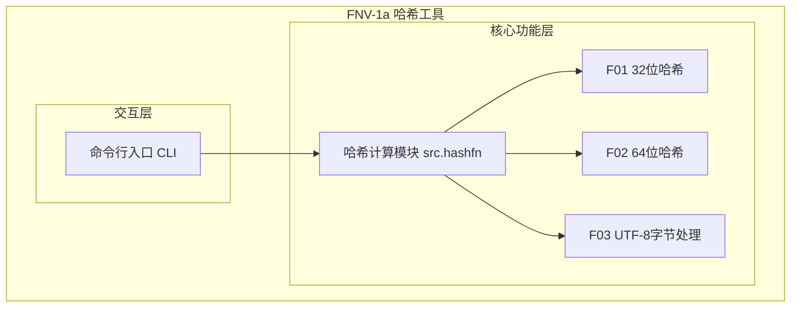
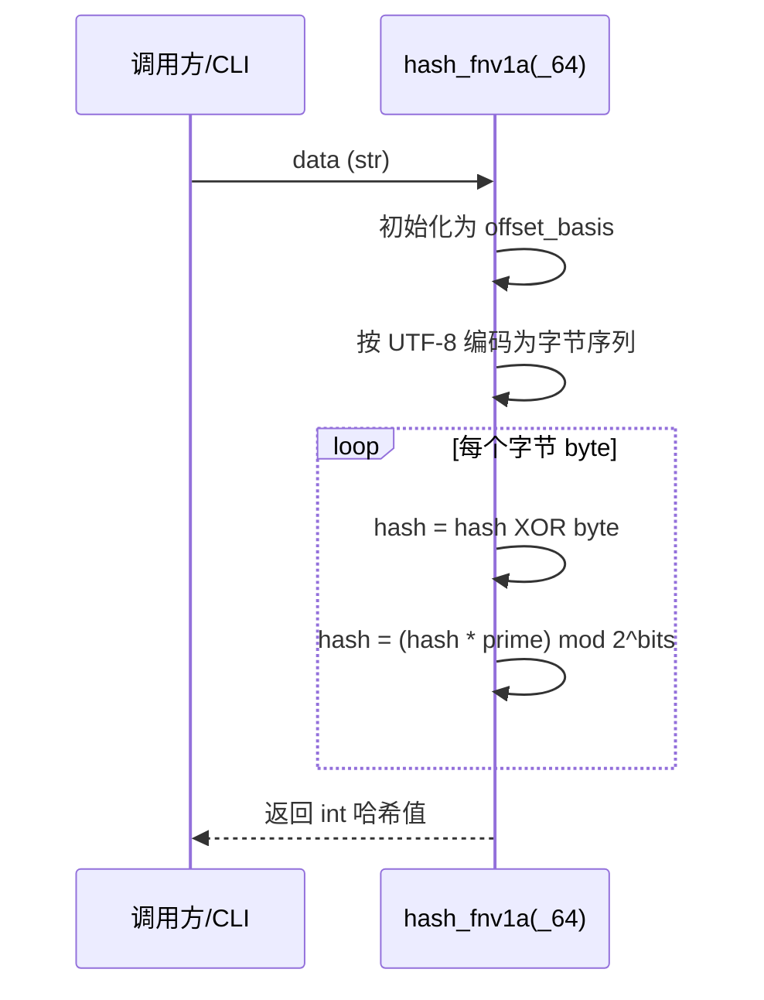
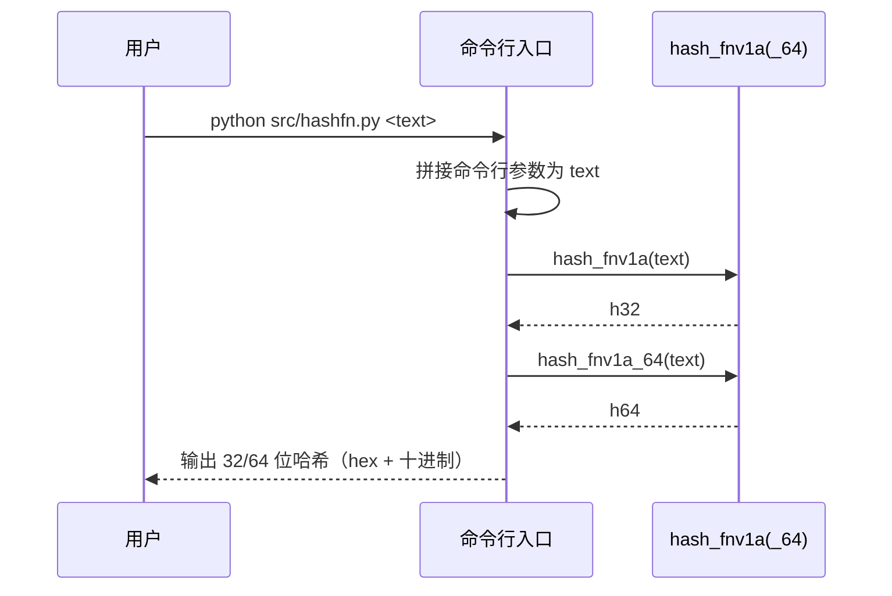

> **文档元信息**
>
> | 项目 | 内容 |
> |------|------|
> | 文档版本 | v1.0 |
> | 作者 | aiwork |
> | 创建日期 | 2026-10-22 |
> | 需求来源 | 计划文档 docs/superpowers/plans/2026-10-22-hash-function.md |
> | 评审状态 | 待评审 |

# FNV-1a 哈希函数 系分设计

## 1. 需求与范围

### 背景与目标
提供一个快速、稳定、零外部依赖的哈希工具函数，支持字符串输入的 32 位与 64 位 FNV-1a 哈希计算，并提供命令行独立运行入口。目标对象为需对字符串做快速非加密哈希定位/校验的调用方（如分片路由、一致性标识生成、去重辅助等）。

### 核心功能
- 32 位 FNV-1a 字符串哈希计算
- 64 位 FNV-1a 字符串哈希计算
- UTF-8 编码的字节级处理（支持中文、emoji 等多字节字符）
- 命令行独立运行入口

### 约束与非功能要求
- 运行环境：Python 3.8+
- 零运行时外部依赖（开发期 pytest 除外）
- 遵循 FNV-1a 标准算法：`hash = (hash XOR byte) * FNV_prime`（模 2^bits）
- 确定性：相同输入必然产生相同输出

### 排除范围
- 不提供密码学安全哈希（FNV 为非加密哈希，不可用于密码、签名等安全场景）
- 不提供持久化存储、网络接口、多租户/权限体系
- 不提供流式/分块哈希（输入整体一次编码）

### 需求功能清单与优先级

| 编号 | 功能点 | 优先级 | PRD 原始描述/章节 | 备注 |
|------|--------|--------|-------------------|------|
| F01 | 32 位 FNV-1a 字符串哈希计算 | P0 | 计划 Goal / Task 2 | 返回 [0, 2^32) 整数 |
| F02 | 64 位 FNV-1a 字符串哈希计算 | P0 | 计划 Goal / Task 2 | 返回 [0, 2^64) 整数 |
| F03 | UTF-8 字节级编码处理 | P0 | 计划 Global Constraints | 支持中文/emoji 多字节 |
| F04 | 命令行独立运行入口 | P1 | 计划 Architecture | 有参输出哈希，无参输出用法 |

### 假设与待确认项

| 编号 | 假设/待确认内容 | 当前假设 | 确认状态 |
|------|-----------------|----------|----------|
| A01 | 输入类型约定 | 仅接收 str，统一 UTF-8 编码；非 str 由调用方保证 | 待确认 |
| A02 | 应用形态 | 面向工具库/离线计算，无服务化、无部署集群诉求 | 待确认 |
| A03 | 哈希算法 | 采用 FNV-1a（32/64 位），非密码学哈希 | 待确认 |

## 2. 架构与模块

### 功能架构

- 交互层说明：提供 `python src/hashfn.py <text>` 命令行入口，负责参数解析与结果展示。
- 核心服务层说明：哈希计算模块实现 32/64 位 FNV-1a 核心算法与 UTF-8 编码，供交互层与外部调用方复用。
- 扩展/集成层说明：无外部集成。

**模块清单**

| 模块 | 职责 | 依赖 |
|------|------|------|
| 哈希计算模块 src.hashfn | 实现 32/64 位 FNV-1a 与 UTF-8 编码 | 标准库 struct（可选） |
| 命令行入口 | 解析参数、调用哈希计算、格式化输出 | 哈希计算模块 |

### 应用集成架构

本工具为纯函数库，无外部系统、无中间件、无数据库依赖。集成关系表不适用，原因：无网络/数据库/外部服务依赖。

### 部署架构

作为 Python 模块/脚本随宿主应用分发运行，无独立部署集群。部署说明不适用，原因：非服务化工具。

## 3. 数据模型与存储

本工具为无状态纯函数，不产生持久化数据。

### 实体清单

| 实体名称 | 实体说明 | 所属模块 | 与其他实体的关系 |
|----------|----------|----------|-----------------|
| （无） | 无持久化实体 | - | - |

### 实体关系图

本项不适用，原因：无数据库表、无缓存、无 MQ，仅内存计算。

## 4. 接口设计

### 4.1 oneapi（Web 控制台接口）

本项不适用，原因：工具函数无 HTTP 服务接口。

### 4.2 OpenAPI（对外接口）

本项不适用，原因：工具函数无对外 HTTP 接口。

### 4.3 内部接口（函数）

| 编号 | 接口名称 | 模块 | 方法签名 |
|------|----------|------|----------|
| S01 | 32 位哈希计算 | 哈希计算模块 | hash_fnv1a(data: str) -> int |
| S02 | 64 位哈希计算 | 哈希计算模块 | hash_fnv1a_64(data: str) -> int |

### 4.4 集成接口（Integration 层）

本项不适用，原因：无外部系统集成。

## 5. 功能模块设计

### 5.1 哈希计算模块（src.hashfn）

#### 5.1.1 表结构设计

本项不适用，原因：无持久化存储。

##### 5.1.1.1 枚举与常量定义

| 常量名称 | 取值 | 含义 | 关联字段 |
|----------|------|------|----------|
| FNV32_OFFSET_BASIS | 0x811c9dc5 | 32 位初始偏移基值 | - |
| FNV32_PRIME | 0x01000193 | 32 位素数 | - |
| FNV32_MOD | 2^32 | 32 位模 | - |
| FNV64_OFFSET_BASIS | 0xcbf29ce484222325 | 64 位初始偏移基值 | - |
| FNV64_PRIME | 0x01000001b3 | 64 位素数 | - |
| FNV64_MOD | 2^64 | 64 位模 | - |

#### 5.1.2 接口详细设计

##### S01 32 位哈希计算 hash_fnv1a

- **URI**: 函数 `hash_fnv1a(data: str) -> int`
- **描述**: 对输入字符串按 UTF-8 字节序列计算 32 位 FNV-1a 哈希
- **入参**:

| 参数名称 | 类型 | 是否必填 | 描述 |
|----------|------|----------|------|
| data | str | 是 | 待哈希字符串 |

- **出参**:

| 参数名称 | 类型 | 描述 |
|----------|------|------|
| （返回值） | int | 32 位哈希值，范围 [0, 2^32) |

- **错误码**: 无业务错误码，非 str 输入由调用方保证（A01）
- **业务规则**: R01/R02/R03（见 5.1.3）

##### S02 64 位哈希计算 hash_fnv1a_64

- **URI**: 函数 `hash_fnv1a_64(data: str) -> int`
- **描述**: 对输入字符串按 UTF-8 字节序列计算 64 位 FNV-1a 哈希
- **入参**:

| 参数名称 | 类型 | 是否必填 | 描述 |
|----------|------|----------|------|
| data | str | 是 | 待哈希字符串 |

- **出参**:

| 参数名称 | 类型 | 描述 |
|----------|------|------|
| （返回值） | int | 64 位哈希值，范围 [0, 2^64) |

- **错误码**: 无业务错误码
- **业务规则**: R01/R02/R03（见 5.1.3）

#### 5.1.3 子功能详细设计

##### 5.1.3.1 哈希计算核心（F01/F02/F03）

- 处理时序图

**业务规则：**

| 规则编号 | 规则描述 | 校验时机 | 不满足时的处理 |
|----------|----------|----------|----------------|
| R01 | 起始值使用对应位宽 offset_basis | 计算前 | 固定常量，不存在不满足 |
| R02 | 输入统一按 UTF-8 编码为字节 | 计算前 | 非 str 输入抛 TypeError（调用方保证） |
| R03 | 每字节执行 XOR 后乘以 prime 并取模 2^bits | 每字节 | 保证结果落在 [0, 2^bits) |

**异常场景：**

| 异常场景 | 处理方式 |
|----------|----------|
| 空字符串 | 返回 offset_basis（32/64 位各自基值） |
| 多字节字符（中文/emoji） | 按 UTF-8 编码字节正常计算 |
| 超长输入（万级字符） | 线性 O(n) 遍历，无额外内存增长 |
| 非字符串输入 | 编码阶段抛 TypeError，调用方保证输入类型（A01） |

**并发控制（如涉及数据写入）：**
无共享状态（纯函数），无并发风险，原因：不读写全局可变数据。

**状态机设计（如实体存在状态字段）：**
本项不适用，原因：无状态字段实体。

**技术选型方案对比：**

| 方案 | 优点 | 缺点 |
|------|------|------|
| FNV-1a（推荐） | 零依赖、实现简单、速度快、有标准测试向量 | 非密码学，抗碰撞能力弱 |
| MD5/SHA-256 | 密码学强度高、标准库内置 | 计算较重、语义为安全摘要、速率慢于 FNV |
| MurmurHash（需第三方库） | 分布性好 | 引入外部依赖，违背零依赖约束 |

推荐：**FNV-1a**。理由：符合计划指定与零依赖、快速非加密哈希诉求。

### 5.2 命令行入口

#### 5.2.1 表结构 / 枚举

本项不适用，原因：无存储、无枚举字段。

#### 5.2.2 接口详细设计（F04）

- **URI**: `python src/hashfn.py <text>`
- **描述**: 接收命令行文本，输出 32/64 位哈希的 hex 与十进制
- **入参**: 命令行参数（字符串列表，可含空格拼接）
- **出参**: Input、FNV-1a (32-bit)、FNV-1a (64-bit) 三行文本

#### 5.2.3 子功能详细设计

- 处理时序图

**业务规则：**

| 规则编号 | 规则描述 | 校验时机 | 不满足时的处理 |
|----------|----------|----------|----------------|
| R04 | 有参数时拼接为单条文本并计算 | 启动时 | 无参数输出使用说明 |

**异常场景：**

| 异常场景 | 处理方式 |
|----------|----------|
| 无命令行参数 | 输出 Usage 说明并退出 |
| 含空格文本 | 用空格连接所有参数作为输入 |

**并发控制：** 单进程一次性执行，无并发写，无并发风险。

## 6. 非功能性需求设计

### 6.1 高可用性
本项不适用，原因：纯函数工具无在线服务、无第三方依赖，无可用性降级场景。

### 6.2 可扩展性
位宽已参数化（32/64），可通过新增常量与函数扩展为 128 位等；函数以增量方式新增，不改动已有签名。

### 6.3 稳定性/可靠性
纯函数确定性强，相同输入输出恒定；覆盖空串、中文、emoji、超长输入等边界，结果严格落在 [0, 2^32) 或 [0, 2^64) 区间。

### 6.4 安全性设计

#### 6.4.1 账户系统方案
本项不适用，原因：无账户体系、无登录态。

#### 6.4.2 授权&访问控制
本项不适用，原因：无数据库查询、无权限检查场景。

#### 6.4.3 数据防护方案
本项不适用，原因：无敏感数据存储与展示；需在文档中明示 FNV 为非加密哈希，不可用于密码存储、签名或安全断言。

### 6.5 监控/统计/日志/告警
本项不适用，原因：无运行期服务与埋点需求。

## 7. 变更三板斧

### 7.1 可监控
本项不适用，原因：纯函数工具无运行期服务埋点。

### 7.2 可灰度
本项不适用，原因：无在线流量、无租户引流场景。

### 7.3 可应急
- 工具库以版本发布，异常时可通过回退依赖版本快速恢复（回归测试向量保障兼容）。
- 函数签名保持向后兼容（新增函数不修改已有签名），降低回滚风险。