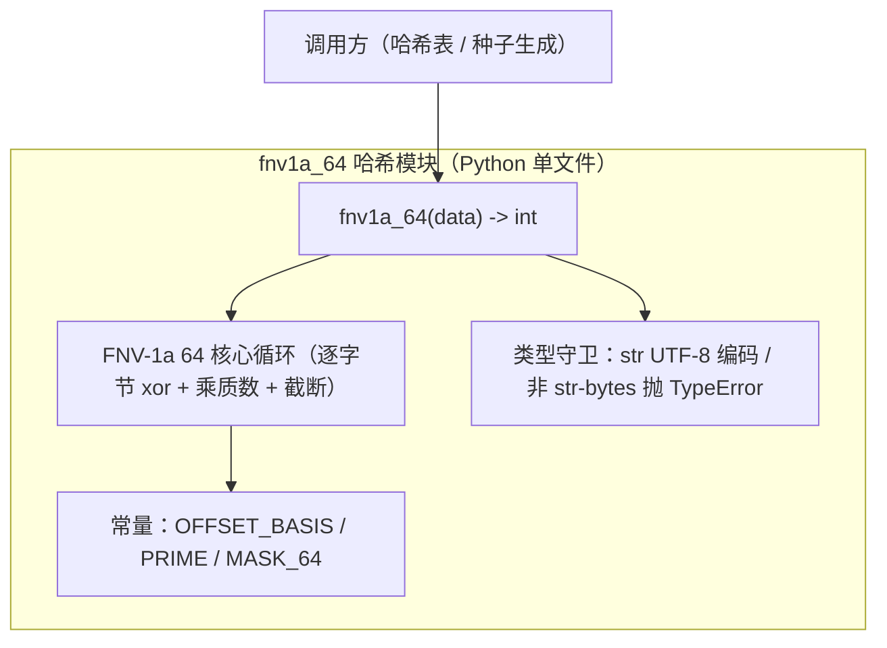

> **文档元信息**
>
> | 项目 | 内容 |
> |------|------|
> | 文档版本 | v1.0 |
> | 作者 | AiWork |
> | 创建日期 | 2026-10-22 |
> | 需求来源 | docs/superpowers/specs/2026-10-22-fnv1a-64-hash-design.md、docs/superpowers/plans/2026-10-22-fnv1a-64-hash.md |
> | 评审状态 | 待评审 |

# FNV-1a 64 位通用哈希函数 系分设计

## 1. 需求与范围

### 背景与目标

仓库现状：空壳仓库（根目录 `07hubtasty` 内容为 `hello world`），无业务代码、测试框架或架构资产。需求来源为需求节点的已确认设计（spec）与实现计划（plan）。

目标：提供一个零依赖、确定性、跨进程一致的通用哈希函数 `fnv1a_64(data) -> int`，用于哈希表索引/查找/种子生成。采用 FNV-1a 64 位算法；输入 `str`（内部按 UTF-8 编码）或 `bytes`；表示相同字节序列的 `str` 与 `bytes` 输出一致。

### 核心功能

1. 对 `str`/`bytes` 输入计算 FNV-1a 64 位哈希，返回 `[0, 2^64-1]` 的无符号整数。
2. `str` 与等价 `bytes`（`s.encode("utf-8")`）结果一致。
3. 非 `str`/`bytes` 输入抛出 `TypeError`，不静默转换。

### 约束与非功能要求

- 语言：Python 3，仅标准库。
- 零第三方依赖。
- 确定性：同一输入跨进程结果一致。
- 非密码学哈希，不得用于安全/完整性场景。
- 单表纯函数：无全局可变状态、无副作用、无 I/O。
- 不提供流式（分块）接口。

### 排除范围

- 不实现密码学强度哈希（SHA/MD5/BLAKE 等）。
- 不提供流式/增量（分块）接口。
- 不引入第三方库、不做 CLI、不做 HTTP 服务。
- 不做性能基准优化。

### 需求功能清单与优先级

| 编号 | 功能点 | 优先级 | 需求原始描述/章节 | 备注 |
|------|--------|--------|-------------------|------|
| F01 | 对 str/bytes 输入计算 FNV-1a 64 位哈希，返回无符号 int | P0 | spec §2/§3、plan Task1 | 核心能力 |
| F02 | str 按 UTF-8 编码后与等价 bytes 结果完全一致 | P0 | spec §1/§3、plan Global Constraints | 关键不变式 |
| F03 | 非 str/bytes 输入抛 TypeError，不静默转换 | P0 | spec §4、plan Task1 | 错误处理契约 |
| F04 | 结果落在 [0, 2^64-1] 范围 | P0 | spec §2、plan Global Constraints | 范围契约 |

### 假设与待确认项

| 编号 | 假设/待确认内容 | 当前假设 | 确认状态 |
|------|-----------------|----------|----------|
| A01 | 语言与运行环境 | Python 3，仅标准库 | 已确认（spec/plan 明确） |
| A02 | 模块文件名 | 项目根目录 `fnv1a_64.py` | 已确认（plan Task1） |
| A03 | 测试文件名与框架 | `test_fnv1a_64.py`，标准库 unittest（兼容 pytest） | 已确认（plan Task1） |
| A04 | 哈希算法型 | FNV-1a 64 位（非密码学） | 已确认（spec/plan 明确） |
| A05 | 返回类型 | Python int（无符号 64 位范围内） | 已确认（spec §2） |
| A06 | 架构形态 | 单机纯函数库，不套用分层 Web 服务 | 已确认（需求本质为纯函数模块） |

## 2. 架构与模块

本需求为「单机纯函数库」，非典型分层 Web 服务；强行套用 Controller–Service–DAO 分层属于过度设计（A06），故采用「单模块 + 纯函数接口」形态。

### 功能架构



**模块清单**

| 模块 | 职责 | 依赖 |
|------|------|------|
| fnv1a_64（单一模块文件） | 提供 `fnv1a_64(data) -> int` 纯函数：类型守卫、UTF-8 编码、FNV-1a 64 迭代、64 位截断 | 无（仅 Python 标准库 builtins） |
| test_fnv1a_64（测试模块） | 用标准库 unittest 验证官方向量、str/bytes 等价、范围、非法输入 | fnv1a_64 |

### 应用集成架构


**集成关系说明：**

| 调用方 | 被调用方 | 协议/方式 | 说明 |
|--------|----------|-----------|------|
| 调用方代码 | fnv1a_64 函数 | Python import / 函数调用 | 无网络、无进程间通信 |
| fnv1a_64 函数 | str.encode("utf-8") | Python 标准库内置方法 | str→bytes 归一化 |

### 部署架构

无独立部署形态：作为纯函数库随宿主进程部署。无中间件、无数据库、无外部系统、无单点问题（无状态、无副本概念）。

## 3. 数据模型与存储

本项不适用，原因：`fnv1a_64` 为无状态纯函数，不涉及数据库表、缓存、MQ、文件存储或任何持久化数据结构，无租户隔离需求。

### 实体清单

无持久化实体。

### 运行时数据形态（内存态，非数据库）

| 数据形态 | 用途 | 生命周期 |
|----------|------|----------|
| `str` 输入 | 调用方传入，UTF-8 编码为 bytes | 函数调用期 |
| `bytes` 输入 | 直接参与逐字节迭代 | 函数调用期 |
| `h`（int 累加器） | FNV-1a 迭代中间值，最终结果 | 函数调用期 |

### 实体关系图

不适用：无实体关系。

## 4. 接口设计

本设计为纯函数库，对外暴露单一函数，无 REST/OpenAPI/oneapi 网络接口，亦无外部系统集成。

### 4.1 oneapi（Web 控制台接口）

不适用：无 Web 控制台。

### 4.2 OpenAPI（对外接口）

不适用：无对外网络接口。

### 4.3 内部接口（函数签名）

| 编号 | 接口名称 | 类 | 方法签名 |
|------|----------|------|----------|
| S01 | fnv1a_64 | 模块级函数 | `def fnv1a_64(data) -> int`（data 为 str 或 bytes） |

### 4.4 集成接口（Integration 层）

不适用：无外部系统集成。

## 5. 功能模块设计

全局约定：

| 约定项 | 约定内容 |
|--------|----------|
| 错误码格式 | 不适用：库函数通过 Python 异常（TypeError/ValueError）表达错误，不设业务错误码 |
| 通用出参结构 | 不适用：返回原生 `int`，非 `{code, msg, data}` 包装结构 |
| 模块映射 | fnv1a_64 模块 → F01/F02/F03/F04；test_fnv1a_64 测试模块覆盖上述功能点 |

### 5.1 fnv1a_64 模块

#### 5.1.1 表结构设计

本项不适用，原因：纯函数库无持久化实体，无表结构、索引、字段定义。

#### 5.1.1.1 枚举与常量定义

| 常量/枚举名称 | 取值 | 含义 | 关联位置 |
|----------|------|------|----------|
| _FNV_OFFSET_BASIS_64 | 14695981039346656037 | FNV-1a 64 位初始 offset basis | 函数内部初始化 h |
| _FNV_PRIME_64 | 1099511628211 | FNV-1a 64 位质数 | 每字节乘数 |
| _MASK_64 | 0xFFFFFFFFFFFFFFFF | 64 位截断掩码 | 每步 `&` 截断 |

#### 5.1.2 接口详细设计

##### S01 fnv1a_64

- **签名**: `def fnv1a_64(data) -> int`
- **描述**: 对 `str` 或 `bytes` 输入计算 FNV-1a 64 位哈希，返回 `[0, 2^64-1]` 的无符号整数；`str` 内部按 UTF-8 编码。

- **入参**:

| 参数名称 | 类型 | 是否必填 | 描述 |
|----------|------|----------|------|
| data | str 或 bytes | 是 | 待哈希数据；str 按 UTF-8 编码后参与计算 |

- **出参**:

| 参数名称 | 类型 | 描述 |
|----------|------|------|
| (返回值) | int | 无符号 64 位哈希值，`[0, 2^64-1]` |

- **错误码**:

| 错误/异常 | 说明 |
|--------|------|
| TypeError | 入参既非 str 也非 bytes 时抛出，信息包含实际类型名，不静默转换 |

- **业务规则**:
  - R01：`isinstance(data, str)` 为真时，先 `data.encode("utf-8")` 归一化为 bytes。
  - R02：非 str 且非 bytes 时抛 TypeError。
  - R03：迭代每字节 `h ^= byte`，随后 `h = (h * PRIME) & MASK_64`。
  - R04：初始 `h = OFFSET_BASIS`。

- **请求示例**: 调用方传入 `b"foobar"`（bytes）或 `"中文"`（str，内部按 UTF-8 编码后参与计算，结果与其等价 bytes 一致）。
- **响应示例**: 传入 `b""` 时返回官方向量 `0xcbf29ce484222325`；传入 `b"foobar"` 时返回 `0x85944171f73967e8`。

#### 5.1.3 子功能详细设计

##### 5.1.3.1 哈希计算主流程（F01/F02/F04）

- 处理时序图

```mermaid
sequenceDiagram
    participant C as 调用方
    participant F as fnv1a_64
    participant E as str.encode
    participant L as 逐字节循环

    C->>F: fnv1a_64(data)
    F->>F: isinstance 判断类型（R01/R02）
    alt data 为 str
        F->>E: data.encode("utf-8")
        E-->>F: bytes
    else data 为非 str/bytes
        F-->>C: 抛 TypeError
    end
    F->>F: h = OFFSET_BASIS
    loop 每个字节 b
        F->>L: h ^= b; h = (h * PRIME) & MASK
    end
    F-->>C: 返回 int（[0, 2^64-1]）
```

**业务规则：**

| 规则编号 | 规则描述 | 校验时机 | 不满足时的处理 |
|----------|----------|----------|--------------|
| R01 | str → UTF-8 编码归一化 | 计算前 | 不适用（任何 str 均可编码） |
| R02 | 仅接受 str/bytes | 计算前 | 抛 TypeError |
| R03 | 每字节 xor 后乘质数并 64 位截断 | 计算中 | 不适用（纯运算） |
| R04 | 初始化为 offset basis | 计算前 | 不适用 |

**异常场景：**

| 异常场景 | 处理方式 |
|----------|----------|
| 入参为 int/None/list 等非 str/bytes | 抛 TypeError，信息含实际类型名 |
| 极大输入导致中间值溢出 | Python int 无固定宽度，每步 `& MASK_64` 保证结果稳定在 64 位 |

**并发控制（如涉及数据写入）：** 无并发风险，原因：纯函数无共享可变状态、无 I/O，同输入必同输出，线程安全。

**状态机设计（如实体存在状态字段）：** 本项不适用，原因：无状态实体/状态字段。

#### 5.1.4 模块自检

**完备性对账表：**

| 功能点 | 是否覆盖 | 覆盖位置 |
|--------|----------|----------|
| F01 计算哈希返回 int | 是 | 5.1.2/5.1.3.1 |
| F02 str 与 bytes 等价 | 是 | R01、5.1.3.1 |
| F03 非 str/bytes 抛 TypeError | 是 | R02、异常场景 |
| F04 范围 [0, 2^64-1] | 是 | R03/R04 |

**过度设计检查：** 未引入流式接口、缓存、线程池、日志框架、CLI；本模块仅一个纯函数，符合 YAGNI，无需裁剪。

## 6. 非功能性需求设计

### 6.1 高可用性

不适用，原因：为无状态纯函数库，无服务实例、无上下游调用、无故障切换概念；随宿主进程存活，不存在单点故障。

### 6.2 可扩展性

作为纯函数库，横向扩展随宿主进程水平扩展即可，无共享状态，天然支持多实例并发调用；无需额外分片/路由设计。

### 6.3 稳定性/可靠性

- 边界稳定：Python int 任意精度 + 每字节 `& MASK_64` 保证结果稳定在 64 位，无溢出、无平台位宽差异。
- 确定性：纯函数 + 固定算法常量，同一输入任意环境输出一致。
- 空输入：`b""` 返回 offset basis（`0xcbf29ce484222325`），不抛异常。

### 6.4 安全性设计

本项不适用，原因：无网络入口、无账户、无数据库查询、无敏感数据存储或展示；且该哈希为非密码学哈希，文档已显式限定不得用于安全/完整性场景。

### 6.5 监控/统计/日志/告警

本项不适用，原因：纯函数无副作用、无 I/O，不引入日志与监控埋点；如需统计调用可在宿主层自行包装。

## 7. 变更三板斧

### 7.1 可监控

本项不适用，原因：纯函数库无运行时服务埋点载体；如需要可在宿主层对调用耗时/命中情况做统计，但不属于本函数职责范围。

### 7.2 可灰度

本项不适用，原因：作为库函数随宿主进程发布，无独立引流入口、无租户维度，灰度由宿主应用发布策略决定。

### 7.3 可应急

- 以「版本替换」兜底：库函数以独立文件 `fnv1a_64.py` 交付，存在问题时整体回退旧文件/旧发布包，不依赖数据库迁移。
- 无状态、无外部依赖，回滚不影响上下游（无数据兼容性问题）。
- 哈希值为运行时计算、不落库，无持久化兼容负担。

## 8. 方案检查结果（Step 9）

| 检查项 | 结果 | 说明 |
|------|------|------|
| 模块划分合理性检查 | 通过 | 单模块单一职责、无循环依赖、无功能点超 50% 的模块 |
| 依赖关系合理性 | 通过 | 无外部系统依赖，可用性由宿主决定 |
| 单点问题检查（部署层面） | 通过 | 无状态纯函数，无部署单点 |
| 表模型设计范式检查 | 不适用 | 无表结构 |
| 隐私安全检查 | 通过 | 无敏感信息输入/输出 |
| 兼容性检查（接口） | 通过 | 新增函数，无历史调用方 |
| 兼容性检查（表） | 不适用 | 无表 |
| 数据迁移检查 | 不适用 | 无持久化数据 |
| 一致性检查（功能点） | 通过 | F01-F04 均在 5.1 覆盖 |
| 一致性检查（表） | 不适用 | Step 3 无实体 |
| 一致性检查（接口） | 通过 | Step 4 S01 在 5.1.2 有详细定义 |
| 一致性检查（枚举） | 通过 | 常量定义与规则引用一致 |
| 状态机完整性检查 | 不适用 | 无状态字段 |
| 并发风险检查 | 通过 | 纯函数无共享状态，无并发风险 |
| 单点问题检查（定时任务层面） | 不适用 | 无定时任务 |
| 非功能性设计可行性检查 | 通过 | 极简纯函数设计落地无阻碍 |
| 变更三板斧设计可行性检查（可监控） | 不适用 | 纯函数库无埋点载体，已说明 |
| 变更三板斧设计可行性检查（可灰度） | 不适用 | 库函数随宿主发布，灰度由宿主决定，已说明 |
| 变更三板斧设计可行性检查（可应急） | 通过 | 版本替换即可快速回退，无迁移依赖 |